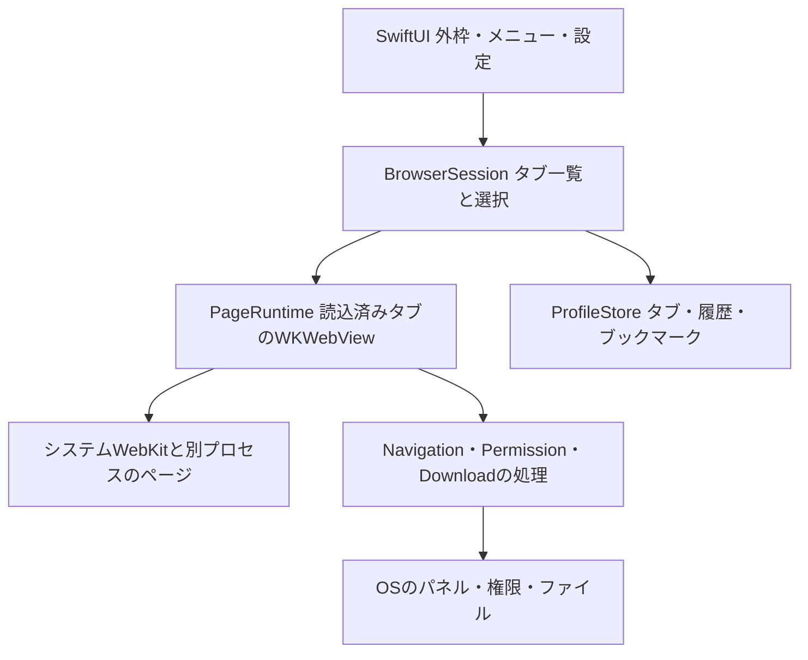

# Levistica 技術設計と完成までの計画

2026-10-22時点。M0の設計・環境準備と基本閲覧が成立し、M2のタブ・復元・PDF・入出力・履歴・設定等の主な機能を実装した。M1の主要サイトの一連の確認と、M3の性能基準・受入は未完了。固定文書・動画の予備比較と5ホストの比較を実施した。20ホストでは読み込みを確認したが、背面の報告継続条件が成立せず比較値の取得を保留した。保持指定・手動休眠と入力検知登録の解放を実装し、固定5文書の前後比較・反復測定・型別診断を進めた。反復時の全体メモリは増減しており、割当元と実サイトでの削減量は未確認。M4の見た目の仕上げ、M5の常用・更新・復旧はこれから。PMは計画を基本承認し、実装と通常のPRのマージを許可している。独立試作は作っていない。仕様と受入案は [PRODUCT_SPEC.md](PRODUCT_SPEC.md)、作業規則は [AGENTS.md](AGENTS.md) を参照する。各工程の現在の状態と、末尾の検証記録を区別して読む。

## 推奨方式と選定理由

SwiftUIの外枠に、小さなAppKitの接続部分を通してシステムWebKitの `WKWebView` を組み込む。新規の正式アプリ一つを育て、既存ブラウザのforkは出発点にしない。標準のウィンドウ・メニュー・設定を利用し、閲覧エンジンと外枠を別に扱う。

この案はMac専用、メモリ最優先、拡張互換より日常の3用途を優先する条件に合う。Chromiumや外枠用のWeb実行環境をアプリに同梱せず、タブ一覧のためにWebViewを作らない構成を選べる。ページ自身の重さは残るため、ネイティブUIやWebKitの採用だけではChrome比の削減を保証できない。Safariと同じタブ管理・認証・保護機能を引き継げるわけでもない。

| 候補 | 今回の判断 | 再検討する条件 |
|---|---|---|
| SwiftUI + AppKit + WKWebView | 推奨。delegate・ページの寿命・入出力・権限を明示して設計できる。UIの変更を閲覧処理から分けやすい | 必須サイトの認証・動画が成立しない、または同条件のメモリ目標が達成不能 |
| SwiftUIのWebView/WebPage | システムWebKitを利用する点は共通。今回はWKWebViewを選び、2種類の閲覧実装を持たない。macOS 26 APIを使うためだけの切替はしない | 必要な公開機能がWKWebView経路より明確に扱いやすくなり、移行の効果を示せる |
| AppKit主体 | 同じエンジン。SwiftUIとの差をRAM改善の実測値とは扱わない。全体をAppKitへ寄せる作業は保留 | 外枠のフォーカス・ウィンドウ・入力で小さな橋渡しでは解決できない問題が出る |
| Tauri/Wry | Webの外枠を好む強い条件は今ない。外枠WebViewやIPC境界を増やす理由が薄い。Rustだけでページ側RAMは減らない | PMがHTML/CSSで外枠を変えることを必須とし、比較する価値が生じる |
| Search/Kylmora等のfork | タブ・休眠の参考に限定。既存調査では非公開API利用があり、全機能・依存・保守負担を引き取らない | 必要な公開APIだけを持つ既存実装の監査で、新規実装より小さい範囲で安全に完成できると分かる |
| DuckDuckGoのfork | 実用挙動の参考。大きな共有コード・依存・素材の権利を初期から引き取らない | 新規実装で必要な認証等の負担が大きいと判明した場合に、対象部分だけ再評価 |
| Electron/Chromium | Chrome拡張との近さは利点だが、現優先順位では同梱エンジンと更新責任を増やす選択をしない。RAMの敗北が実証されたという意味ではない | WebKitで必須用途が成立せず、その影響をPMと確認したとき |

選定は実装開始の推奨であり、性能による最終採用判定ではない。M1でサイト成立性、M3でメモリと復帰を判定し、不成立ならこの表へ戻る。

## 環境の確認結果

| 項目 | 2026-10-20に読み取りで確認した事実。CLT更新後の再確認を含む |
|---|---|
| 作業先 | `/Users/User/Non-iCloud-Documents/Levistica`。参照資料の外。初期ファイルはAGENTS.mdとimozuruへのリンク |
| Git | 初回は未初期化。その後ユーザーがmainの基準コミット `0e36965` を作成し、非公開の `fomalhaut16/Levistica` へpush済み。ローカルとGitHubの同一SHAを確認 |
| OS | macOS 26.6、build 25G72、arm64 |
| Mac | `system_profiler` はMacBook Pro / Mac17,2 / Apple M5 / 10 cores / 32 GBを返した。識別番号は記録しない |
| 制限 | `sysctl` のCPU・容量取得はOperation not permitted。一方、上記のsystem_profiler出力で確認できた。独立したVRAM容量は取得していない |
| 選択中の開発先 | `/Library/Developer/CommandLineTools` |
| Swift | 初回は5.10。ユーザーによるCLT更新後はApple Swift 6.4、swiftlang-6.4.0.34.1。clangは21.0.0、clang-2100.3.34.2 |
| SDK | 初回の既定は14.4。CLT更新後の既定はmacOS SDK 27.0。実行中のOSは26.6で、SDKの版とは別に扱う |
| Xcode | 初回は未発見。ユーザーの導入承認後、取得済みのXcode_27.1.xipを/Applicationsへ展開し、Xcode 27.1 / build 27A9275を確認。codesign検証とGatekeeper評価は成功。ライセンス同意後、Swift 6.4とmacOS SDK 27.0の実行確認済み。最初の実ビルドで判明したCoreSimulator共通frameworkの不足は、ユーザーのrunFirstLaunch実行で解消。Debug／Releaseのビルドとアプリ起動を確認 |
| 基本道具 | xcrun、swift、xcodebuildの入口、codesign、plutil、lldb、gitがPATH上に存在。利用可能な署名identityやDeveloperアカウントは未確認 |
| 比較対象 | Chrome 155.0.8059.85、Safari 26.6 / 21624.4.5.11.5をInfo.plistで確認。いずれも起動・操作・設定変更していない |
| 空き容量 | 作業先のData volumeで約606 GiB。導入時に再確認する。Xcodeの必要容量は今回測っていない |
| Homebrewツール | gh 2.102.0が実行可能。CLT更新後にpkgconf 3.0.10が導入済みと確認。gh更新後に止まっていたpkgconfの再インストールも解消 |

本体の構成はXcodeのmacOS Appプロジェクト一つを推奨する。entitlement、署名、通常の.app、XCTest/XCUITest、Instrumentsの操作を一つの流れで管理するため。SwiftPMのGUIアプリを.appにまとめる方法もあるが、現在のCLTだけで本製品の検証まで十分とは確認していない。新旧2種類のビルド構成を同時に作らない。

フルXcodeの導入はユーザーが承認済み。今回はユーザーが取得した安定版Xcode 27.1を採用する。公式の[対応表](https://developer.apple.com/xcode/system-requirements)ではmacOS 26.6以上で利用可能。新APIの採用やdeployment targetの引き上げは伴わない。Apple署名を検証して展開済みで、ライセンス同意は完了。共通framework不足も解消し、実ビルドで初回セットアップの完了を確認した。`DEVELOPER_DIR`をビルド入口だけで指定し、全体のxcode-selectは勝手に変更しない。

v1の実利用・受入対象はこのMacのmacOS 26.6。deployment targetは26.0を初期案とし、これは個人用の対象を絞る判断で、26専用の新APIを多用する指示ではない。以前のOS対応やIntel対応を先に作らない。Swiftは採用Xcodeのコンパイラで、原則Swift 6モード・UIはMainActorとし、利用するSDKで署名と並行処理の注釈を確認する。現在はCLTのSwift 6.4とSDK 27.0を確認できたが、フルXcodeは展開済みだが、選択したXcodeのSwift 6.4とSDK 27.0は確認済み。Debug／Releaseの実ビルドと起動、単体・UI試験を確認済み。CLTのSwift/SDKと混同しない。

## 責務と所有の境界

単一のアプリtarget内で責務を分ける。汎用エンジン切替層、プラグイン基盤、DIコンテナ、別サービス常駐、将来用パッケージ分割は作らない。



| 責務 | 所有するものと境界 |
|---|---|
| App/外枠 | 通常scene、設定、メニュー、URL受信、起動・終了。レイアウト・色・余白は外枠側に集約し、M4で変えられる。ページ内容へのCSS注入と外枠UIを混同しない |
| BrowserSession | 安定したTabID、順序、選択、URL、タイトル、保持指定、状態。WebViewを生成せず一覧を描ける。SwiftUIの再評価や選択行の表示で読込を発火しない |
| PageRuntime | 読込済みTabIDごとのWKWebView、delegate、観測、必要な子ウィンドウ。MainActorで操作し、同じTabIDのWebViewを再利用。実行状態をDBへ丸ごと保存しない |
| AppKit接続 | NSViewRepresentableと小さなCoordinator。値と操作をSessionから受け、遷移・進捗・エラーをイベントで返す。updateNSViewのたびにloadしない。表示を外すことと休眠・終了を区別する |
| Navigation/Permission | URL入力の解釈、遷移とscheme、origin/frame、権限、ポップアップ。信頼UIをページから独立させ、WebKit delegateのcompletionを必ず一度完了する |
| Download処理 | DownloadIDで転送・保存先・取消・失敗を管理し、タブ表示から独立。URLSessionでページ要求を勝手に複製せず、WKDownloadを使う |
| ProfileStore | SQLiteの直列処理、短いtransaction、schema version、移行、バックアップ。大きいI/OをUIスレッドに置かない。Viewやdelegateが直接SQLを発行しない |

M1はApp、RootView、BrowserSession、PageRuntimeと接続部分だけから始める。表の全責務を空クラスで先に作らず、必要な機能を追加するときに分ける。既知の境界を保った小さな関数から始め、Coordinatorや巨大なContentViewへ全機能を詰めない。

タブの状態は `未生成 → 読込中 → 保持中`、そこから明示した条件で `休眠`、再選択で生成・読込へ戻る。ページ終了は `異常` として扱う。閉じたTabIDは一覧と復元データから除去し、実行中の参照も解放する。KVO、delegate、通知、Task、クロージャ、message handlerを所有者の終了時に外す。単なる非表示やstopLoadingをメモリ解放と同義にしない。

## データ・API・権限

| データ | 保存・寿命・失敗時の方針 |
|---|---|
| セッション | SQLiteにschema version、TabID、順序、選択、URL、タイトル、保持指定、正常終了の印。操作後に短くまとめて保存し、正常終了はflush完了後に記録する。URLに機微情報があり得るため通常ログには出さない |
| 履歴/ブックマーク | ブックマークは独立したbookmarks.sqlite3を初回利用時に開き、明示削除まで保存する。タブDBの形式を変えずに失敗を分ける。履歴は独立したhistory.sqlite3をactorで扱い、記録・一覧利用・期間変更時に設定した保持期間を超えた行を整理する。同じURLの最新訪問を10000件まで残し、一覧は200件まで。保持期間と記録停止は後述のプライバシー設定で扱う。履歴削除とタブ一覧の削除を混同しない |
| 設定 | 小さなUserDefaults。検索先・外枠の好み・復元・休眠設定。Cookieやフォーム値を入れない |
| Cookie/サイトストレージ | 通常用WKWebsiteDataStoreに任せる。Chrome/Safariのデータを共有・複製しない。削除は対象とログアウトの影響を示して行う |
| ページ内部の状態 | 稼働中のWebViewに保持。interactionStateはM3で寿命・容量・型・復元可否を確かめた範囲だけ使う。任意のJSヒープや接続を保存できるとは扱わない。フォーム値を含み得るblobはv1ではディスク保存しない |
| ダウンロード | サービス側に転送状態、選択された保存先、部分ファイル。resumeDataは使える場合のみ短期間保持し、機微情報として扱う。失敗した部分ファイルの処理を利用者に示す |
| 実行時データ | sandboxコンテナ内のApplication Support等。実際の場所はM1のbundle IDと署名で確定し、READMEを増やさず本書に記録。ディレクトリは利用者限定、DB・バックアップは個人データとして保護する |
| 検証物 | `.local/`に隔離したプロファイル・計測・テスト記録。Git対象外。実利用データとの切替は起動時に明示し、環境変数の値や閲覧URLを大量出力しない |

SQLiteはシステムのSQLite3を使い、初期に外部DBフレームワークを追加しない。DBの書込みは一つのactor/直列所有者にまとめ、移行前のバックアップはSQLiteの整合したbackup経路で作る。稼働中のWAL付きDBの本体だけをコピーしない。破損・容量不足・保存エラーは検出し、原本を保持する。復元・旧版への巻戻しはアプリを停止して、対応するデータ世代と一緒に行う。これはLevisticaの管理データの復旧であり、サイト側で失効したログインやWebKit内部の移行まで元に戻す保証ではない。サイトデータを更新処理で勝手に消去・コピーしない。

| API/機能 | 採用方針と確認の境界 |
|---|---|
| WKNavigationDelegate/WKUIDelegate | 遷移、失敗、TLS既定検証、ダウンロード移行、子画面、ダイアログ、権限、ページprocess終了を処理。APIの存在は実サイト互換の証拠ではない |
| WKDownload | `NSProgressReporting`準拠とmacOS 11.3導入を手元SDKの公開headerで確認。ページのestimatedProgressを転送の進捗と取り違えない。取消後のresumeDataはnilになり得る |
| interactionState | 保存原文・公開headerではmacOS 12から、履歴・現在ページ・スクロール・フォーム等を対象とする。Any?を無条件にData/Codableと仮定せず、休眠時の実装方式を先に検証する |
| cameraCaptureState/microphoneCaptureState | 手元headerでmacOS 12からの公開APIと確認。任意の音声・PiP・画面共有・入力をこれだけで完全に検知したとは扱わない |
| WKProcessPool | 複数poolの作成・利用が無効という非推奨理由を保存原文で確認。メモリを減らす設定として採用しない。サイト分離を弱めない |
| WKWebExtensionController | 保存したDocCのavailabilityはmacOS 15.4。初回確認時のSDK14.4では前提を満たさなかった。現在の採用SDKは27.0だが、拡張APIは未実装・未検証。Control Panel for Twitterの検証時に採用SDKで確認する。Chrome拡張全互換やSafari版の直接流用は保証しない |
| 認証 | サイトログイン、nativeアプリ自身のOAuth、他アプリからのASWebAuthenticationSession要求を分ける。任意RP向けpasskey権限は組織アカウントのAccount Holder申請という制約があり、個人利用でも自動取得できるとは扱わない |

アプリ自身のApp Sandboxとnetwork.clientを基本にする。ネットワークサーバ、Full Disk Access、Accessibility、画面収録はブラウザの基本閲覧には要求しない。ファイルはNSOpenPanel/NSSavePanelと利用者の選択範囲へ限定し、継続が必要なアクセスだけsecurity-scoped bookmarkを検討する。アップロード・保存・再起動後の再アクセスはsandbox下で試す。

カメラ・マイク等は機能を実装するときだけ必要なentitlement・用途説明を追加する。サイトorigin単位の許可とTCCを区別し、初期は永続許可を安易に保存せず都度判断する。任意ページや子iframeにファイル・Keychain・シェルへの汎用bridgeを渡さない。WebKitの要求するJITのためだとして、アプリ側へ未検証の緩い権限を加えない。

URLバーは信頼UIで実際の遷移先とhostを示し、ホストを省略してページタイトルだけで安全と見せない。IDNの紛らわしさ、ユーザー情報部、redirect、別origin iframeの要求をセキュリティfixtureに入れる。HTTPとHTTPSを区別し、HTTPS失敗からHTTPへ黙って落とさない。証明書エラーの全許可、App-Bound Domainsの任意サイトへの一律適用はしない。詐欺サイト警告の既定を保ち、Safariと同等の全保護を保証したとは扱わない。

## メモリ目標を決め、検証する手順

固定文書・固定動画で同条件のChrome比較を行ったが、実用的なサイト混在・大量タブ・Safariの比較は未完了で、RAM上限や実用条件での合否はまだ決められない。当初はM1完了後・M2の機能拡大前に目標を合意する予定だったが、機能実装が先行している。比較を進めてPMへ具体値を提案し、M3の受入前に合意する。目標未定のままM3を完了にはしない。

1. M1のReleaseで空画面、1ページ、少数の同じページの基準を取る。Chromeは通常配布版、Safariは参考値とする。使う機種・OS・browser/WebKit版・commit・SDK・署名・電源・他アプリを記録する。
2. 隔離プロファイルで同一URL・同一操作・同じloaded数、キャッシュcold/warm、ログイン、広告ブロック、拡張有無をそろえる。既存Chromeの個人プロファイルを変更しない。実サイトの広告や通信の揺れと固定fixtureの結果は分ける。
3. Chrome中央値をC、LevisticaをLとし、まず同じloaded数で比較する。別に実用の休眠・遅延読込ポリシー同士を比べる。C−Lと変動幅を示し、総タブ数だけをそろえた値で優位を宣言しない。
4. 実測から、空画面・読込済み・大量復元・全件巡回後の絶対footprint上限とChrome比の削減目標を提案する。起動・選択・休眠復帰の待ち時間上限と入力欠落ゼロ等の条件も同時に決める。PMが許容する速度・状態欠落との交換を確認するまで未合意と記録する。
5. M2で機能追加時の内訳を残し、M3で合意値を判定する。達成できない場合は参照保持、縮小画像、DB、WebContent、拡張等の内訳を調べる。意味のある削減が実測の揺れを超えて得られなければ、製品上の価値と方式をPMと再判断する。

同じ条件で最低3回、順番を変えて実施し、各回と中央値・範囲を残す。初期案は読み込み完了から60秒後、操作/解放の直後・1分後・5分後を観測する。試験時間はサイトの安定性を見て調整し、変えた条件を記録する。3回の結果で精密なp95や統計的優位を作らない。

大量タブの試験は5→20→50→100件と段階的に進める。継続した強いメモリ圧迫、極端な応答低下、process終了があれば中断し、到達した条件を失敗として記録する。100件のためにユーザーの稼働中Chromeや他アプリを勝手に終了しない。

| 試験 | 分けて記録する状態と判定 |
|---|---|
| W0 空/1ページ | WebView未生成の外枠と1件生成後。操作可能になる時間、安定時とピーク |
| W1 同じloaded数 | 固定5ページと、X/YouTube/Discord＋資料の実用セット。拡張なしの基準と、必要な拡張ありの実用条件を別に測る |
| W2 大量復元 | 50・100件は暫定候補。総数とloaded1を記録し、未選択ページの意図しない生成・通信がないか確認 |
| W3 全件巡回 | 一度全ページを表示し、同じloaded状態の比較を行う。次に保護・手動休眠・合意した自動休眠の各ポリシーと復帰を別に測る |
| W4 保護/復帰 | テスト用入力、音声、動画、必要なら通話・添付・認証。閉じる、終了取消、休眠、復帰、process終了を確認する |
| W5 継続 | 代表操作の反復と実利用候補の長時間稼働。参照増加、CPU待機、メモリ圧迫、圧縮、swap、スリープ復帰を記録する |

帰属はUIプロセスに加えWebContent・Network・GPU等を調べ、PID・開始時刻・役割・根拠を残す。PPIDだけではXPCを落とし得る。名前だけで他のWebKitアプリを足さず、同一PIDをタブごとに重複計上しない。

指標は各PIDのphysical footprintを基本にし、UI単独・確認できた集合の内訳・集計を並べる。共有メモリやIOSurfaceの記帳と重複の可能性を示し、単純合計を専有RAMと呼ばない。帰属や権限で取れない値は不明とし、0MBにしない。RSS、JS heap、Swift heapは別指標として扱う。Activity Monitor等によるシステムのMemory Pressure・Compressed・Swapも添えるが、アプリ単独の値とはしない。正しいfootprint取得経路をM1で検証し、Instruments等の観測負荷がある詳細解析は通常測定から分ける。

## 互換性・セキュリティ・配布

| 論点 | 検証と判断 |
|---|---|
| X/YouTube/Discord | M1の正式アプリで表示・代表ログイン・動画を早く確認。M2で投稿用テスト入力・添付・再起動を確認。GoogleログインやWebAuthnが止まる場合はAPI経路・サービス方針・権限を分けて調べる |
| 動画/DRM | YouTubeの通常動画を必須とする。任意サービスのDRM、ライブ、サブスク再生は未確認。有料サービスが必要ならその試験を追加し、単なるWKWebView採用で対応済みにしない |
| Control Panel for Twitter | 作者の[公開リポジトリ](https://github.com/insin/control-panel-for-twitter)ではMITとSafari版の存在を確認。Levisticaでの互換性は未確認。具体版のmanifest・利用API・content script・設定UI・権限・background処理を読む。最小権限の公開WKWebExtension APIを第一候補とし、独自Chrome shimは先に作らない |
| 拡張検証の上限 | M2後半〜M3で、1版・Xの代表3操作・2回の互換修正まで。動作/権限/無効化/メモリが許容範囲なら任意採用。超えたら未対応として本体から外し、v1必須は進める。Safari拡張がそのままWKWebViewへ入るとは仮定しない |
| 権限・入力保護 | TLS、scheme、popup、frame、カメラ/マイク拒否、入力、POST、WebContent終了を固定fixtureで試す。DOM観測は完全な活動検知ではない。取得したフォーム値をログへ流さない |
| OSとWebKit更新 | システムWebKitはOS等の更新に依存する。更新後は代表サイトと保存・復元・権限の短い回帰試験を行う。WebKitの版をLevistica単体で巻き戻せるとは考えない |

個人用v1はMac App Storeを経由しない通常の.appを基本とし、手動更新とする。開発用と常用用のbundle ID・データは分けるが、同じソースと同じ正式アプリをビルドする。独立した試作品を並べる意図ではない。bundle IDの最終値と署名identityはM1で実在を確認する。

自分のMacでのビルド・起動用署名と、ダウンロード配布のDeveloper ID署名・notarizationを分ける。アカウント・費用は未確認で、有料契約を前提にしない。配布する場合はDeveloper ID等の取得条件を確認して相談し、Gatekeeperの無効化やquarantineの一律削除を手順にしない。Hardened Runtime・entitlementは実物の.appを検査し、署名があることだけで安全と判定しない。

常用版は署名・provisioningの有効期限と更新時のTCCへの影響も確認する。短命な開発用署名で一度動いたことを、開発ツールなしで継続利用できる証拠にしない。安定した常用経路に契約等が必要なら、M5を完了する前に具体的な条件を相談する。

更新時はアプリを終了し、整合したデータのバックアップ、署名と版の確認、置換、起動・主要操作・migration確認の順に進める。DBの前方移行がある場合、旧アプリだけを戻さず対応するバックアップも戻す。移行失敗・新しいOSとの非互換は隔離データで再現する。自動更新、常駐updater、同期基盤はv1には追加しない。

## M0〜M5と直近の一つの仕事

### 初期設計の期間

既存の調査資料を利用できる前提で、初期設計を固める目安は1〜3作業日とする。2026-10-20に初版を作成し、PMから初版への「OK」を受け、GitHubの基準版 `0e36965` を記録した。以後はレビューや環境確認で分かった条件を、小さなPRで修正する。認証・権限の許可待ちやPMの都合による待機日は、作業日数と分けて記録する。10月20日に着手した場合、待機がなければ10月20〜22日を初期設計の想定範囲とする。これは納期の約束や実作業時間の実測値ではない。

| 作業 | 想定と現状 |
|---|---|
| 資料・環境・方式・初版仕様 | 0.5〜1作業日を見込む。初版は作成済み |
| PMレビューと必要な修正 | 0.5〜1作業日、1〜2回のやり取りを想定。全ての将来機能を決めきるために延ばさない |
| 整合確認・GitHubの基準版 | 0.5作業日程度。README、期間、工程別スキル方針と初回コミットの掲載を確認済み |

初期設計の完了は、v1の目的・範囲・受入案、推奨方式、重大な不確実性の検証時期、次の一仕事を説明できることとする。認証やRAMの実測はM1以降の仕事として残し、机上で実証した扱いにしない。実装全体の所要期間は、M1でビルド・サイト・メモリの基準が得られた時点で、残作業とPMの確認頻度から見積もり直す。M0の1〜3日を製品完成までの期間へ読み替えない。

### GitHubでの開発運用

掲載先は個人アカウントの非公開リポジトリ [fomalhaut16/Levistica](https://github.com/fomalhaut16/Levistica)。2026-10-20にユーザーが初期化・初回コミット・作成・pushを実行した。gh APIで非公開設定、READMEと設計文書の存在、基準コミット `0e36965bc2730e9258015e3586ce4564485669aa` とローカルmainの一致を確認済み。ghの認証もfomalhaut16として成功した。以前の認証確認の失敗は通信制限下の結果であり、無効な認証と断定しない。

最初に設計とスキルの基準版をmainへ記録する。その後は、一つの使い方や問題を一つのブランチ・PRにまとめ、目的、実際の変更、検証結果、未確認事項を残す。必要な検証を終えた通常のPRはCodexがmainへ統合する。PMの判断が必要な条件変更等は相談し、技術検証済みとPM受入済みを履歴で区別する。M1で実行可能なビルド・テストができたら、その検証をCIへ移す。今は実行対象のないビルドCI、保護ルールや大量のIssuesを先に作らない。有料枠の利用や管理設定の変更が必要なら相談する。

GitHub認証・API操作を行うghと、ローカルの履歴を作るgitは別の道具である。GitHubのログイン確認にgit initは必要ない。認証・通信の許可と、ローカルの.git書込みの許可を分けて確認する。制約が出たらユーザーを挟み、ブラウザや別コネクタへ黙って切り替えない。

### 工程の到達条件

| 工程 | 到達条件 | 残す証拠と状態 |
|---|---|---|
| M0 設計・準備 | 3用途・優先順位・挙動・方式・工程を説明できる。未確認API/性能と担当・検証時期が明確 | 設計初版はPM確認済み。GitHub掲載・4スキルの自動認識・CLT更新を確認済み。Xcode利用の相談、サイト成立性・数値目標はM1/M3へ引き継ぐ。実装開始は承認済み。Xcode 27.1は展開・署名検証・ライセンス同意済み。共通framework不足も解消し、正式アプリの実ビルドと起動を確認済み |
| M1 正式アプリの一本 | Finder/Dockから起動→URL→ページ→戻る/進む→Cmd-Q→再起動。Releaseで動き、代表サイト成立性と初期メモリを記録 | 実行コマンド・SDK・署名・操作結果・process内訳。最初の閲覧操作は実装・検証済み。代表サイト・初期メモリは継続。工程末でメモリ/速度の具体目標をPMへ提案し、M2前に合意する |
| M2 普段の操作 | タブ、通常データ、ログイン、復元、PDF、入出力、基本権限とエラーをA2〜A6/A8で確認 | タブ・保存復元・ダウンロード・添付選択・サイトの確認画面・PDF・ブックマーク・履歴・プライバシー設定の基本操作を実装し検証中。実資料のPDF互換性・権限・復旧などは未完了。Control Panel for Twitterは独立した任意判断 |
| M3 メモリと安定性 | 合意値を同条件で満たし、保護と復帰を含む測定が揃う。休眠設定は結果から決める | 固定文書・固定動画の予備比較を実施。実用的なサイト混在、50/100タブ、長時間稼働、数値目標の合意と受入は未完了。W0〜W5の各回・中央値・範囲・帰属・状態欠落を残し、未達は方式/範囲の再判断へ戻す |
| M4 外枠UI | PMの好みに仕上げ、キーボード・IME・フォーカス・アクセシビリティの基本を確認 | PM受入、M2の機能回帰、M3の主要性能回帰。参考画像や好みはこの段階でまとめて聞く。未実施 |
| M5 常用v1 | 開発ツールなしで利用・終了・翌日再開・更新・旧版復旧ができ、主要用途と品質をPMが受入 | 隔離データでの配布/復旧試験と、PMとの合意期間の常用記録。重大未解決があれば完成にしない。未実施 |

最初の実装単位は、正式アプリLevisticaで「起動→URL入力→ページ表示→戻る/進む→終了」を一本つなぐこと。最初にXcodeの利用条件を解消し、既存ファイルを保護してルートのGit状態を整える。Xcodeプロジェクト一つ、App/RootView/Session/PageRuntimeの最小構成、開発用.app、`script/build_and_run.sh`一つを作る。Run設定は入口の完成後、書き込み権限を得た場合だけ追加する。タブ永続化・拡張・テーマ・自動休眠はこの一仕事に入れない。

この一仕事の合格は、2つの固定ページを順に開き、実際の戻る/進むで元へ移動し、メニューやCmd-Qで終了、Finderから再起動できること。URL入力中のIME、空/不正URL、オフライン/TLS失敗、外部ページからの危険scheme、ページprocess終了の扱いも確認する。XCTestはURL判定・状態遷移、UI試験は起動と操作に絞り、process存在だけで合格にしない。M1の続きとして代表サイトと少数ページのメモリを測り、別アプリは作らない。

以後の順序は、タブと所有/解放 → セッションと通常サイトデータ → サイトログインと入出力/PDF → エラー/復旧/権限の完成 → 省メモリの計測と改善 → 外枠UI → 常用・更新・復旧。認証や再生が不成立なら順番を待たず調べ、不要な機能を増やして回避しない。

独立実験は、正式アプリに組み込むと切り分け不能な公開APIや署名の不明点に限る。問い、1対象・1仮説・2実装案までの投入上限、結果を得る操作を先に記録する。合格なら最小の成果と試験を正式アプリへ移し、不合格なら理由だけを本書へ残して実験を削除する。上限を超えて追う場合はPMへ影響と代案を示す。通常のサイト互換やメモリ測定は正式アプリの隔離データで行う。

## 未解決事項と判定期限

| 項目 | 次に確認すること | 期限・判断 |
|---|---|---|
| 大学資料・認証 | 代表PDF/サイト、SSOやpasskeyが必要か。私的なURLはGitへ書かない | M1〜M2。現在は通常のWeb/PDFを仮定し、特定SSOの対応を約束しない |
| 主要サイト | X・YouTube・Discordのログイン/再起動/再生/入力 | M1で成立性、M2で一連の操作。失敗なら方式/必須範囲をPMと再判断 |
| 50/100タブ | どれだけloaded/保護されるか、実際の使い方と復帰の許容時間 | M1基準からM3へ。100件全活動のRAM保証にはしない |
| メモリと速度 | Chrome/Safariと同条件の基準、実用上の差、目標絶対値と比率 | M1後・M2前に具体案を合意。M3で合否 |
| passkey/DRM/通話 | API経路・資格・代表サービスと操作 | 必要と分かった時点。未確認を対応済みにしない |
| スキルの自動認識 | 既存4件は相対リンク・本文読込・セッションの利用可能一覧で確認済み | 追加導入時も同じ確認を行う。別のMacで認識済みとは扱わない |
| 開発/配布環境 | 適合Xcode、署名identity、アカウント、常用用の署名/更新経路 | Xcode追加は承認・展開済み。Swift 6.4を確認済み。ビルドとad hocの開発用署名を確認済み。配布はM5で具体化 |

## スキル導入と指示の調整

出発点は参照資料のSKILL_SELECTION.md。公式の[導入説明](https://learn.chatgpt.com/docs/build-skills)で `.agents/skills`、symlinkの追跡、自動検出、表示されない場合の再起動を確認した。初期セッションではそこへ書き込めなかったが、ユーザーが相対リンクを設定し、その後のセッションの利用可能一覧にbuild-run-debug、swiftui-patterns、appkit-interop、imozuruの4件が表示された。相対リンクとSKILL本文を読めることも確認済み。

| スキル | 採用と導入状態 | 依存・制約 |
|---|---|---|
| build-run-debug | `skills/build-run-debug/`。SKILLとrun-button-bootstrapを配置し本文を読込 | shell-first。将来のxcodebuild/swift/open/lldb等。MCP必須ではない。今回は環境確認だけに適用し、scaffoldと起動は保留 |
| swiftui-patterns | `skills/swiftui-patterns/`。SKILLと全6参照を配置、windowing/commands/settings等を設計に使用 | SwiftUI/SDKの実在を優先。ビルド入口の例はbuild-run-debugを参照するだけに統一 |
| appkit-interop | `skills/appkit-interop/`。SKILLと全4参照を配置、representable/panels/responderを読込 | AppKit/WebKitの所有と解放に適用。別の状態管理や全面AppKit化の指示にしない |
| imozuru原版 | `skills/imozuru`に既存導入物8ファイルをコピーし、コピー元との一致を確認。`.installed-from`はMaryCache/imozuru @ 4f8fec7。MIT本文を同梱 | GitHubから使う際の絶対パス依存を解消。元の設置先は変更していない。今回は既存調査を利用し疑わしい部分だけ確認し、全資料の再調査は行わない |
| yomiyasu | ユーザー共通の既存版を明示読込。最後に手元のlintを1回 | 版の確認・更新、進捗報告の毎回検査はユーザー指示で取りやめ。共通ファイルは変更しない |

OpenAI側の採用物は[build-macos-apps](https://github.com/openai/plugins/tree/main/plugins/build-macos-apps)のmanifest記載版0.1.4。manifestはMITを宣言している。専用LICENSE本文は今回の取得範囲では発見できず、アプリへコードや素材を再配布するときは権利表示と実ファイルの条件を改めて確認する。採用manifestを `skills/openai-build-macos-apps.plugin.json`、14ファイルの取得URLとローカルSHA-256を `skills/SOURCES.json` に保存した。

公式skill-installerによる取得を試みたが、シェルのネットワーク名前解決が失敗した。通常の権限拡張申請も現セッションのポリシーで拒否された。そこで利用可能なWebツールで公式raw原文の全行を取得し、許可されたskills内に配置した。Webのテキスト抽出を経ているため、改行や空白が上流のバイト列と同一とは保証せず、ハッシュは配置した写しを識別するものとする。採用commitの完全な固定取得はできず、版0.1.4と取得日で記録している。これは公式installerで正常導入したという報告ではない。

SKILLのfrontmatter、必要参照の存在、手動読込は確認した。swiftui-patternsからbuild-run-debugのcanonical参照へは相対リンクを1本置き、重複した実行手順を作っていない。3スキルとも外部パッケージ、MCP、hook、常駐処理を追加していない。追加スキルは次の工程表に従って、必要な仕事を計画・開始する時点でCodexが導入する。ユーザーの再依頼を待たず、既存の同等スキルがあれば先に活用する。候補を一括で常時適用したり、使う予定のないものを先に全て入れたりしない。

| 導入・参照する時点 | 候補と取得元 | 導入前の確認と役割の調整 |
|---|---|---|
| M1でApp Sandbox・署名・entitlementを具体化するとき（配置済み） | OpenAI [signing-entitlements](https://github.com/openai/plugins/tree/main/plugins/build-macos-apps/skills/signing-entitlements) | 権限の設計と実際の署名の確認に限定。ブラウザ全体の安全性をこのスキルだけで承認しない。アカウントや有料契約は自動追加しない |
| M1のSwift 6/MainActor、M2の非同期I/O・キャンセルを実装する前 | AvdLee [swift-concurrency](https://github.com/AvdLee/Swift-Concurrency-Agent-Skill/tree/main/skills/swift-concurrency) | 実コンパイラと言語モードを確認。非同期処理の担当とし、SwiftUIの状態所有を全面変更する指示にはしない |
| M1で最初のロジック試験を設計するとき | Paul Hudson [swift-testing-pro](https://github.com/twostraws/Swift-Testing-Agent-Skill/tree/main/swift-testing-pro) | Swift 6.2以上という前提を採用Xcodeで確認。単体・統合テストに利用し、UI操作はXCTest/XCUITestで扱う。スキルに合わせてSwiftを更新しない |
| M3の具体的な性能測定を計画するとき、または実際にメモリ問題が出たとき | rshankras [performance/profiling](https://github.com/rshankras/claude-code-apple-skills/tree/main/skills/performance/profiling) | macOSに適合する参照だけ使う。OS・iOS固有の記述や依存を確認し、本書の複数processの帰属と同条件比較を優先する |
| M4の外枠レビュー、またはSwiftUIの更新・寿命の問題が出たとき | AvdLee [swiftui-expert-skill](https://github.com/AvdLee/SwiftUI-Agent-Skill/tree/main/skills/swiftui-expert-skill) | 最初は範囲を絞ったレビューに使用。swiftui-patternsと同じ担当を常時二重化しない。Impeccableはさらに必要な具体的不足がある場合だけ別途判断 |
| M5の.app包装・配布・復旧を計画するとき | OpenAI [packaging-notarization](https://github.com/openai/plugins/tree/main/plugins/build-macos-apps/skills/packaging-notarization) | その時点の実物.appと署名経路を読む。ビルド入口は増やさず、配布条件と費用・アカウントの必要性はPMへ相談する |

原因不明の不具合が続く場合は、参照資料にあるsystematic-debugging等を個別に検討し、Superpowers一式は自動導入しない。スキルを使っても解決しない場合は、時間を使っただけで品質が上がったとは報告しない。

導入時は、取得元と採用版・commit、ライセンス本文、SKILLと必要な参照、外部依存、重複する工程を確認し、プロジェクト内に配置する。自動認識と手動読込を区別し、記録をskills/SOURCES.jsonへ追加する。認証・権限・外部接続の追加が必要なら操作と影響を伝え、ユーザーを挟む。yomiyasuはユーザーの指定により版確認・更新の対象外とする。

現在の4件は自動認識確認済み。以下はユーザーが実行済みの設定で、リポジトリにも相対リンクを含めている。新しい環境で不足している場合の参照として残し、設定済みの環境でそのまま再実行しない。既存の同名項目があれば上書きせず調べる。禁止された書込みを別の道具で迂回しない。

```sh
# Levisticaルートで実行。既存の同名項目があれば上書きせず調べる。
mkdir -p .agents/skills
ln -s ../../skills/build-run-debug .agents/skills/build-run-debug
ln -s ../../skills/swiftui-patterns .agents/skills/swiftui-patterns
ln -s ../../skills/appkit-interop .agents/skills/appkit-interop
ln -s ../../skills/imozuru .agents/skills/imozuru
```

新しい環境では、Codexの `/skills` で4件の名前とLevistica内のパスを照合する。表示されなければ再起動して再確認する。配置済み、手動で使用可能、自動認識確認済みを一つの状態にまとめない。グローバルや他プロジェクトを変更する必要はない。

現在のプラグイン一覧にあった `imozuru-research-chatgpt` は原版とは別の派生版で、本プロジェクトでは使わない。前の削除試行で管理APIはnot installedを返したがローカルキャッシュが残り、共通領域は書込み不可。削除済みとは扱わない。Notion・Sites・ペット等の利用可能なプラグインは本設計のためには使わず、接続や権限を変更しない。

## 根拠と今回の確認範囲

参照資料のREADME.md、PRODUCT_DELIVERY.md、SKILL_SELECTION.mdを先に読み、DESIGN_BRIEF.mdとVALIDATION_PLAN.mdの方式・API・計測・受入部分を使用した。提案・仮説は実測や決定済み仕様に変えていない。原文へ戻ったのはpasskey、SSO、WebExtension、processPool、interactionState等の制約に関係する部分。新しい文献調査や全原文の読み直しはしていない。

現在のAppleの一部ページはJavaScript表示のみで、リンク先MarkdownもWebツールのcontent-type制約により取得できなかった。その部分は保存DocC原文と手元の公開SDK headerを根拠とし、現行SDK全体でコンパイル確認済みとはしない。Apple/WebKit公式資料の候補検索には指定のGPT-6 Lunaを一度使用した。比較・設計・最終判断は主担当が行い、その検索役は終了済み。

| 根拠 | 設計で使う範囲 |
|---|---|
| [WKWebView](https://developer.apple.com/documentation/webkit/wkwebview)、[公開header](https://github.com/WebKit/WebKit/blob/main/Source/WebKit/UIProcess/API/Cocoa/WKWebView.h) | WebViewの公開境界、interactionState、capture等。mainのheaderを出荷済みOSの実装保証にはしない |
| [WKDownload](https://developer.apple.com/documentation/webkit/wkdownload)と手元SDKのWKDownload.h | 転送の所有・NSProgressReporting・取消の境界 |
| [ブラウザpasskey権限](https://developer.apple.com/documentation/bundleresources/entitlements/com.apple.developer.web-browser.public-key-credential)と参照資料の対応DocC | 任意RP権限の申請制約。全Googleログイン不可などへ一般化しない |
| [SSO受信](https://developer.apple.com/documentation/authenticationservices/supporting-single-sign-on-in-a-web-browser-app)と参照資料の対応DocC | 対応宣言と実装が必要なこと、未対応時のSafari fallback |
| [WKWebExtensionController](https://developer.apple.com/documentation/webkit/wkwebextensioncontroller)と参照資料の対応DocC | 拡張実装の候補。15.4導入と、完全Chrome互換の保証を分ける |
| [Xcode対応表](https://developer.apple.com/xcode/system-requirements) | 現Macで利用できる開発環境の候補。最新への更新義務にはしない |
| [Control Panel for Twitter](https://github.com/insin/control-panel-for-twitter) | 作者・配布先・MIT宣言・Safari版の存在。Levisticaでの動作は未試験 |

最終見直しでは、100タブを全件生かす保証、Safari並みの性能保証、未送信入力の完全検知、Chrome拡張全互換、個人アカウントでのpasskey権限取得を断定していないことを確認する。独立試作、汎用基盤、二重ビルド入口、常時MCP、不要な管理文書を追加せず、最初の操作経路を確認し、代表サイトと計測を続ける。

2026-10-20の実装準備でsigning-entitlements 0.1.4を追加。公式installerのGit方式でcommit `0722921d5542fc593105c27bd52630babd8b8c2a` に固定し、本文とagents/openai.yamlを取得した。MITは公式plugin manifestの宣言を確認し、独立したLICENSE本文は未発見。依存はmacOS標準のcodesign・spctl・security・plutilで、追加パッケージや常時処理はない。署名調査だけを担当し、build-run-debugのビルド入口と競合させない。本文は手動参照可能、自動認識は次のターンで確認する。ファイルのハッシュはskills/SOURCES.jsonへ記録した。

M1準備でswift-concurrencyとswift-testing-proを追加した。採用commit・MIT本文・全ファイルのハッシュはskills/SOURCES.jsonに記録。後者は公式installerが入れ子のプラグイン用リンクを拒否したため、同じ固定commitから本文・5参照・agents設定を取得し、リンクを含むプラグインwrapperは導入していない。依存パッケージ、MCP、hooks、共通設定は追加しない。SwiftUIは画面と状態所有、Concurrencyはactor境界、Testingは単体・統合テストと担当を分ける。両スキルは手動参照可能、自動認識は次のターンで確認する。

### M1最初の実装単位の結果

正式なXcodeプロジェクト一つ、SwiftUIの単一ウィンドウ、BrowserSession、PageRuntime、小さなNSViewRepresentableを追加した。表示の更新ではloadを呼ばず、空画面ではWebViewを作らない。URL欄はHTTP/HTTPS、ホスト名、検索語を扱い、検索は確定後だけDuckDuckGoへ送る。外部scheme、資格情報入りURL、WHATWG Fetchの禁止ポートを拒否する。WebKitから開始用navigationが返らない場合や、失敗通知のnavigationがnilの場合も扱い、about:blankで入力したURLを上書きしない。TLS失敗を迂回せず、再試行はGETに限る。

開発用bundle IDは `dev.fomalhaut16.Levistica`、対象CPUはarm64、deployment targetは26.0。通常のサイトデータはこの開発用IDのコンテナ内で、UI試験はDEBUG限定の非永続WKWebsiteDataStoreへ分離した。署名identityは0件だったため、ローカル確認用のad hoc署名を使う。通常Releaseの実entitlementはapp-sandboxとnetwork.clientの2件だけで、Releaseへのデバッグ用base entitlementの自動注入を止めた。Debugのテスト時にはXcodeがテスト用権限を付けるため、配布時の権限とは分けて検査する。ad hocではXcodeがHardened Runtimeを無効化する旨を表示する。設定値だけでHardened Runtime・Developer ID署名・公証が成立したとは扱わず、配布はM5の未完了条件に残す。

Swiftは6モード・strict complete・既定のactor isolationはnonisolated・Approachable Concurrencyは無効。UIを所有するSessionとRuntimeを明示的なMainActorへ置き、公開SDKのdelegate completion注釈に合わせた。ATSの例外はWebコンテンツの明示HTTP閲覧に限り、証明書検証を回避しない。

`script/build_and_run.sh` が唯一のビルド・起動入口で、Run設定も同じ入口へ接続した。停止対象はこのcheckoutのDebug/Releaseの実行パスと開発用bundle IDが一致するプロセスだけ。試験入口 `script/test.sh` も同じ入口で既存アプリを停止する。UI試験は127.0.0.1の空きポートでHTTP・自己署名HTTPS・即時切断のサーバーを起動し、終了時に停止する。要求は記録せず、証明書と結果はGit対象外の `.local/artifacts/` に置く。`TEST_ONLY=Target/Suite/Method ./script/test.sh --ui` で失敗箇所を絞れる。

2026-10-20にこのMacのXcode 27.1／Swift 6.4／SDK 27.0で確認した結果は次のとおり。

| 検証 | 結果と限界 |
|---|---|
| Debug／Releaseビルドと署名の整合性 | 成功。通常Releaseの権限も確認。配布・公証の合格ではない |
| Swift Testing | 13テスト、3 suiteが成功。不正URL、検索、危険scheme・禁止ポート、WebViewを作らない空状態、解放、公開delegateの適合、process終了通知後の状態を含む |
| XCUITest | 4経路が同じ実行で成功。実際の2ページ遷移と戻る/進む、危険リンクの遮断、Cmd-Qと再起動、危険な入力の拒否、TLS拒否、通信切断とURL保持・再試行の提示 |
| Releaseの実画面 | 2ページ表示、リンク、戻る/進む、Cmd-LでURL全選択、Cmd-Qと再起動を別に確認。日本語文字列の貼り付け表示は確認したが、IMEの変換候補・未確定状態の操作は未検証 |
| 故障時の限界 | WebContent終了は公開delegate通知を与えた単体試験。OSによる実際の強制終了、DNS失敗やオフライン切替、未送信POSTの全遷移は引き続き検証する |
| memory取得経路 | Release本体のphysical footprintをfootprintで取得できた。単発の空画面・UIプロセスだけの確認で、WebKit別プロセスの帰属、反復、Chrome/Safari比較、目標判定は未実施 |
| CI | GitHubのmacos-26／Xcode 26.6でReleaseビルドと単体試験が成功。UI試験やこのMacの性能判定は実機側で行う。公式image一覧を確認し、Actionsはcommit固定、権限はcontents:read、失敗証拠は3日保存 |

最終のローカル統合結果は `.local/artifacts/tests.rbaJO6/Results.xcresult`。途中で試験用の待ち受けないsocketが即時拒否を返さず、約60秒のタイムアウトになることも確認した。最終fixtureは接続後即時に切断する方式とし、キー入力はURL文字列を確認してからReturnを送る。試験で見つかった不正HTTPS URLのエラー分類と禁止ポートの無案内を修正済み。試験中に別アプリChromeのクラッシュ記録が一件あったが、関連は未確認で、アプリ起動・停止の対象にはしていない。

M1全体は継続中。次は代表3サイトの表示・動画・認証の成立性、WebKitプロセスの帰属を含む初期計測、IME・故障時の残項目を確認し、M2前にメモリ・速度の具体目標をPMへ提案する。最初の閲覧経路が動いたことを、日常利用やメモリ削減の合格に読み替えない。

### M1の公開サイト・動画・計測経路の確認

2026-10-20、正式Releaseのguest状態でYouTubeのホームと公開動画、Xの公開トップ、Discordのログインフォームを表示した。YouTubeはBlender公式のBig Buck Bunny（動画ID `aqz-KE-bpKQ`）で、再生時間が2分42秒まで進むことと一時停止を確認。WKPreferencesの `isElementFullscreenEnabled` は公開SDKで既定NOと確認し、YESにした。YouTubeの全画面ボタンが現れ、実際の全画面表示とEscapeによる通常画面への復帰も確認した。タイトルに4Kとあっても、実際の選択解像度・codecを測った意味にはしない。音量UIは確認したが、聴感による音声の確認はまだ必要。

本人のアカウントでのログイン、再起動後のログイン継続、Xの投稿、Discordの会話・添付は未確認。認証・passkey・SSOの成立を、フォームが表示できたことだけで合格にしない。パスワード・認証コードはチャットやログへ出さず、必要な試験は本人がアプリ内で操作する。Google/Xの認証用URLなど、画面から得たセッション由来の値は文書へ保存しない。確認は必要なボタン名・フォーム名と利用者の結果報告に絞る。

計測用に `script/measure-memory.py` を追加した。Root PIDの実行パスをこのcheckoutのReleaseへ限定し、`launchctl print pid/PID` のoriginator/creatorとservices節を読む。実行中のサービスごとに同じPIDドメイン所属とPIDを照合し、WebContent・Networking・GPU・補助XPCを含める。登録済みでもPIDが0なら実行中と数えない。PPIDや名前一致だけでは加算しない。`launchctl print` は診断表示であり固定形式を保証したAPIではないため、解釈できなければ失敗させ、OS更新時に再確認する。rootが必要なprocinfo、SDKにないcoalition定数、非公開のWebView process IDには依存しない。

各プロセスのPID・開始時刻・実行パスとサービス一覧をfootprint取得の前後で照合し、変化した標本は無効にする。footprintのJSONからcategory合計のfootprintではなく、auxiliaryの `phys_footprint` を使い、単位はbyteを確認する。未取得はnullとし、欠けた値やエラーのある標本の合計・中央値を作らない。既定は同じ起動中で3標本・5秒間隔の取得経路確認であり、独立した3試行や60秒安定待ちの比較試験ではない。GitのHEAD、dirty状態、実バイナリのSHA-256、SDK情報、OS、役割と集計の限界をローカル結果へ残す。launchctlの生出力には環境値があり得るため、保存・出力せず必要な帰属情報だけ使う。

| 診断条件 | 有効標本 | 帰属を確認した集合のfootprint合計、中央値・範囲 |
|---|---|---|
| 新しいReleaseの空画面、WebView 0 | 3/3 | 約25.4MiB、24.9〜25.5MiB。このとき実行中の帰属XPCはなく、UI本体だけ |
| 同じReleaseで公開YouTube動画を再生・全画面から復帰後に一時停止、WebView 1 | 3/3 | 約809.0MiB、754.4〜881.5MiB。UI、WebContent 2、Networking 1、GPU 1、補助XPC 3を含む。UIだけでは42.5〜55.1MiB |

これらは比較前の診断値で、個別PIDのphysical footprintの和には共有領域の重複があり得る。システム共用サービスや別PIDドメインの値は含めず、ブラウザの専有RAMとは扱わない。動画の再生・停止・全画面に伴う保持と計測時刻の影響が残る。Chrome/Safari比、広告やcache条件をそろえたエンジン効率、100タブの目標へ外挿しない。結果は `.local/artifacts/memory/empty-window.7z9qt38y/` と `youtube-paused-after-fullscreen.vk51hqaq/`。空画面の軽さだけでは動画時のメモリ最優先という目的を達成したことにならず、WebContent・GPUを含む比較を続ける。

検証はSwift Testing 13件、UI 5経路の統合実行（`.local/artifacts/tests.QKudL1/Results.xcresult`）、計測パーサー8件。パーサー試験は無関係なservice stubsの除外、未起動の除外、別checkout/creatorの拒否、形式変更、単位・指標の取り違え、値の欠落や余分なPIDの拒否を含み、CIにも追加した。M1の残りは本人操作のログイン、IME、OSによるWebContent終了、同条件の比較と目標提案である。

### M1の固定文書による初期比較

2026-10-21、`script/memory-fixture.py` の固定文書を、正式Releaseと通常配布のChrome 155.0.8059.85で比較した。209,779byte、240節のHTML・CSS・短い準備完了通知だけで、外部画像・動画・広告はない。本文のSHA-256は `88eefd6976126b202579c5d5c88f19f63ad5cf3df786c23d51b89d65db97c941`。同じloopback URL、Cache-Control: no-store、読込済み1ページ、表示領域1100×683ポイント、DPR 2でそろえた。load後の2回のrequestAnimationFrameと240節の存在を確認し、その通知から60秒後に計測を始めた。表示開始の確認であり、CPUやメモリの完全な定常状態を保証する通知ではない。

Levisticaは `LEVISTICA_EPHEMERAL=1` を明示した起動でnonPersistentデータストアを使う。この指定をReleaseでも使えるようにし、正式な起動スクリプトからopenの `--env` で渡す。指定がない通常起動は従来のdefaultデータストアを使う。Chromeは試行ごとに `.local/artifacts/comparison/` 内へ新規user-data-dirを作り、no-first-runとno-default-browser-checkを指定した。ログイン・拡張・個人の履歴は使わず、通常プロファイルは変更しない。Chromeの起動方法は[Chromium公式資料](https://chromium.googlesource.com/chromium/src/+/main/docs/user_data_dir.md)に基づく。OSや共用ライブラリのキャッシュを消す操作はしていないため、OS全体でのcold-cache比較とは呼ばない。

順序はL1→C1→C2→L2→L3→C3。各試行は対象アプリを新しく起動し、前の比較用インスタンスを終了する。同一起動内では5秒間隔で3標本を試みた。Chromeの停止は専用プロファイル・作成記録・実行パス・PID・開始時刻を照合した本体PIDだけにSIGTERMを送り、名前一致での終了やforce-killはしない。通常利用のChromeと他アプリは終了しない。試行前のプロセス帰属確認に使った空画面の専用Chromeも、各試行と別に存在した。その他の利用中アプリとともに周辺条件として残し、合計には混ぜていない。

ChromeではPIDドメインのXPCに加え、本体からの親子関係をたどった実行中の子プロセスを含める。親が1になったCrashpadは実行パスと専用プロファイルのdatabase引数が一致するときだけ加える。実行パスの照合ではzombieの `<defunct>` が見つかり、当初の試験は無効になった。修正後はOSのプロセス状態で終了済みPIDを別記し、実行中の集合から外す。取得途中に終了したプロセスやPID集合の変化は引き続き標本を無効にする。終了済みの除外、別ブラウザの子プロセスの混入防止、似たプロファイルパスの拒否を含め、パーサー試験は12件となった。

比較対象の指標は前節と同じく、帰属を確認した集合のphysical footprintの和である。共用領域の重複や集合外の共用サービスの限界も同じで、専有RAMやエンジン単体の効率とは扱わない。Chrome側の子プロセスの個別役割はまだ一括表示であり、GPU等の詳細分類は次の分析で補う。OS 26.6（25G72）、arm64、32GiB、バッテリー駆動で実施。電源種別、swap、vm_stat、memory pressureの生のlevelを試行ごとにローカル記録した。

| 試行 | 有効標本／試行標本 | 有効標本の中央値MiB | 有効標本の範囲MiB |
|---|---|---|---|
| L1 | 3/3 | 144.47 | 144.46〜144.50 |
| L2 | 3/3 | 151.75 | 151.74〜151.75 |
| L3 | 3/3 | 117.63 | 117.63〜117.66 |
| C1 | 3/3 | 330.04 | 313.73〜331.52 |
| C2 | 2/3 | 335.32 | 333.71〜336.93 |
| C3 | 1/3 | 330.59 | 330.59〜330.59 |

Levisticaの試行ごとの中央値は117.63〜151.75MiBで、中央の試行は144.47MiBだった。ChromeはC1の3標本が有効、C2は2標本、C3は1標本だけが有効だった。C3の中央値と範囲は1標本からの値で、ばらつきの評価には使えない。Chrome側では取得中のプロセス終了と前後の集合変化により、合計3/9標本を無効にした。表は有効な状態で観測できた暫定値であり、欠測がなく比較できた3組とは扱わない。最初のC1とL1でも、差はこの文書とこの条件に限る。全体の削減率・統計的優位・製品目標の合格はまだ示さない。

Levisticaの試行間では、WebContentの標本が約32.6MiBと約59.0MiB、UIが約47.5〜55.5MiBだった。GCや圧縮等の原因は特定していない。同じバイナリでも起動し直した値が変わるため、同一起動の3標本だけを独立した3試行の代わりにしない。3試行のReleaseバイナリSHA-256はすべて `2f0fd25ea6c3` で始まる同一値だった。各結果の完全なSHA-256・HEAD・dirty状態と固定文書のhashをローカルJSONへ残した。

証拠は `.local/artifacts/memory/` の `fixed-document-l1.v9468igx`、`fixed-document-l2.xokqa006`、`fixed-document-l3.jztiy3mg`、`fixed-document-c1-final.q4a7ark0`、`fixed-document-c2.fj5o9zfp`、`fixed-document-c3.rdt7tf22`。zombie判定修正前の失敗試験と、120秒以降に取得した帰属確認用の値はこの表に混ぜていない。fixtureの準備通知ファイルを読み込み中に更新すると空のJSONが見えることもあったため、保存を一時ファイルからの置換へ修正した。

次の比較では両ブラウザについて60秒・120秒の時点をあらかじめそろえ、各標本の前後の実行中集合と終了済み集合の差も残して、Chromeの欠測理由を絞る。終了済み集合だけの変化と、実行中集合の変化を分けて再評価する。欠測のない再測定と動画の同条件比較を済ませるまで、静止文書だけからRAM上限やChrome比を承認済みにしない。M1の他サイトのログイン・再起動後のログイン保持・音声・IME・OSによるWebContent終了も残っているため、この時点ではM2の機能拡大を保留していた。以後の進行は下記の追加指示に従う。

今回のアプリ変更後もSwift Testing 13件とUI 5件の統合試験が成功（`.local/artifacts/tests.P7dvO6/Results.xcresult`）。パーサー12件、Python構文検査、起動スクリプトの構文検査、Releaseの起動、sandboxとnetwork.clientだけのRelease entitlementも確認した。追加ツールの依存はPython標準ライブラリとmacOS既存コマンドで、新たなスキル・サービス・課金・グローバル設定は追加していない。

通常起動への戻しでは、macOS標準Bashのset -uで空配列が未定義扱いになる起動スクリプトの問題も見つかった。openの呼び出しを明示的な分岐に修正し、隔離指定あり・なしのRelease起動を続けて確認した。比較専用Chromeと帰属確認用の空画面Chrome、fixtureサーバーは終了し、事前に確認した通常利用のChrome本体PIDが引き続き起動していることも確認した。

2026-10-21、本人操作でDiscordのログイン後の通常画面へ進めたとの報告を受けた。認証情報や会話内容は取得していない。途中のぐるぐるする表示に違和感があったとの指摘もあり、場所・継続時間・ちらつき等の詳細と原因は未特定。読み込みの表示がアプリ側かDiscord側かを分け、個人情報を使わない低速fixtureで表示の始まり・終わり・失敗時の状態を確認する。必要なら本人に見え方を補足してもらう。ログイン後の通常画面への到達を、会話・添付・音声・再起動後の保持までの合格とは扱わない。本人操作に渡した後はこちらから再起動しないと伝えており、このセッションではアプリを停止・再起動しない。

### Discordの非対応ブラウザ警告

2026-10-21、本人から「サポートされていないブラウザ」という警告の報告があった。通常画面へのログイン到達は確認済みだが、互換性は未解決とする。本人の追加報告で、警告は通話などの操作時に出ると確認した。ログイン中の画面・会話内容は取得せず、現在のアプリの停止・再読み込み・設定変更はしていない。

[Discord公式の対応一覧](https://support.discord.com/hc/en-us/articles/213491697-What-are-the-OS-system-requirements-for-Discord)にはSafari 15.4以降があるが、WKWebViewアプリやLevisticaの対応を保証する記載はない。ローカルのSafariは26.6と読み取り確認した。Safariの版が十分新しいことだけで、Levisticaも同じ機能を提供すると判断しない。

現実装ではcustomUserAgentとapplicationNameForUserAgentのどちらも設定していない。[WebKitの公開ソース](https://github.com/WebKit/WebKit/blob/main/Source/WebCore/platform/mac/UserAgentMac.mm)では、macOSのUser-Agentの基礎となる文字列にAppleWebKitの識別はあるが、SafariのVersion/やSafari/トークンはなく、引数のアプリ名を任意の接尾辞として加える構造になっている。これは公開mainの実装から得た候補であり、実行中Levisticaのnavigator.userAgentやDiscordの判定条件を実測した結果ではない。ブラウザの種類を判別できない警告なのか、機能不足なのかは未確定。

次の検証は正式アプリの隔離データで行う。利用者が現在の操作を終え、アプリを再起動できる段階で、固定fixtureに既定の識別文字列と必要な機能の有無だけを出し、個人アカウントのページや認証情報を診断へ取り込まない。通常表示・入力・添付と、任意の音声/映像通話の判定を分ける。通話は現実装でマイク/カメラを拒否しており、対応済みとは扱わない。識別だけが原因なら、サイトに限定したWebKit向けの互換設定を検討し、実際の操作と副作用を確認する。Chromeと名乗る一律の識別変更、バナーのDOM削除、未対応APIの存在を装う変更は採用しない。

通話の成立性を調べるうえで、現実装の確実な不足も確認した。PageRuntimeのrequestMediaCapturePermissionは常にdenyで、Info.plistにマイク/カメラの利用目的文字列はなく、App Sandboxのentitlementもnetwork.clientだけでデバイス利用権限を持たない。これらは通話対応時に整える必要があるが、今回の「非対応ブラウザ」という警告がこれらの不足から直接出たと実証したものではない。通常のページ表示やログインの成功では、通話対応を判断できない。

[Discordの通話要件](https://support.discord.com/hc/en-us/articles/38025123604631-Minimum-Client-Version-Requirements-for-Voice-Chat)はSafariを挙げる一方、通話のエンドツーエンド暗号化には基礎APIも必要としている。検証は①マイク/カメラの権限要求を利用者の選択で許可・拒否できること、②隔離fixtureでWebRTCと暗号化に必要な機能を調べること、③機能がそろっている場合にブラウザ識別による制限を調べること、の順に進める。fixtureは診断時に自動で収音せず、必要なデバイス試験は利用者が明示的に開始・停止できるようにする。警告の文言だけから方式の不成立を決めず、必須機能が不足していた場合はその機能名と代替案をPMへ示す。通話は現仕様では任意であり、今回の相談をv1の必須機能化への同意とは扱わない。現在のログイン中アプリには変更を加えない。

### 2026-10-21の実装継続と全画面修正

ユーザーから実装を止めずに進める指示を受け、M1の互換性・計測を残したままM2の基本操作を並行して実装する。メモリと速度の具体的な合格値への同意は未取得であり、比較を終えてPMへ提案し、M3の受入前に確定する。以前の単一ページ版の計測値を今回の多タブ版の性能として扱わない。開発アプリは検証のため再起動することを伝え、以前のログイン試験中の再起動保留を終えた。

正式アプリにタブの追加・切替・並べ替え・一覧検索、閉じたタブ20件の再読込、ページ内検索と50〜300%のズームを追加した。タブのメタデータとPageRuntimeを分け、空タブや復元直後の一覧ではWebViewを作らない。選択済みのページは切替時も同じ実体を保持する。自動休眠は未実装であり、全タブを巡回すると読み込み済みページが増える。タブ総数と読み込み済み数をUIと計測条件へ分けて記録する。

SessionStoreはシステムSQLiteを使い、タブID・順序・選択・タイトル・URL・GET再読込可否と正常終了の印をトランザクションで置き換える。通常起動はアプリsandbox内のApplication Support/Levistica/session.sqlite3を使い、ディレクトリ0700・DB0600とする。メタデータ更新の保存を300msまとめ、終了時は同期保存する。保存失敗時は直前のデータを残し、終了を取り消して再試行か保存せず終了を選べる。読み取り不能や新しい形式では原本を変更せず保存を無効にする。バックアップ復旧と形式移行のUIは未実装。

フォーム値、Cookie、WebView本体はこのDBに保存しない。認識できる認証コールバックやトークン付きURLを除外するが、未知の機微情報まですべて判定できないためDBを個人データとして扱う。保存上限1000件、タイトル512文字、URL16KiBは不正データへの防御であり性能目標ではない。隔離起動ではDBを作らず、UI復元試験だけDebug用UUIDで専用保存先を分ける。Releaseへテスト用保存先の切替を持ち込まない。

全画面試験では、DOMのfullscreen状態だけが成立し、実際のページは779×682ポイントのまま画面左下に残る不具合を再現した。SwiftUIが直接WKWebViewをサイズ調整していたため、安定したNSViewのコンテナを間に置き、WebKitが全画面用に移動したWebViewへ通常画面の寸法を適用しないよう修正した。修正後は1512×949ポイントで表示領域を満たし、解除後は779×683ポイントに戻った。上部のシステム領域を考慮して寸法を待ち合わせ、通常画面・全画面・復帰後の画像も確認した。証拠は `.local/artifacts/tests.3YPgty/Results.xcresult`。旧試験の成功は見た目の合格を裏付けず、YouTube実動画の修正後再確認も残る。

次の実装候補は、ユーザー操作による別タブと認証ポップアップである。要求されたWebKit configurationを保ち、サイトデータの共有とページ生成の所有を確認する。タブ・保存・全画面の回帰確認を終えてから着手する。

GitHubではPR #6のCIがmacOS arm64ランナーの供給不足で取得できず、処理ステップを実行しないまま終了した。待機コマンドの終了コードだけを判定したため、この状態で統合してしまった。CI成功とは記録せず、mainへの再実行を依頼した。以後の統合は各必須checkのconclusionがsuccessであることを直接確認する。ランナーやSDKを黙って変更して回避しない。

今回の回帰確認では単体28件が成功した。UIの統合実行では9経路中8経路が成功し、復元試験だけがテスト対象の行を見つけられず失敗した（`.local/artifacts/tests.iS5mK2/Results.xcresult`）。対象をタブのタイトルへ修正し、復元試験を単独で再実行して成功した（`.local/artifacts/tests.RKchbe/Results.xcresult`）。この2回で全9経路を確認したもので、統合実行の失敗を成功に書き換えない。途中で出たmacOSの一時的な入力ソース表示は、消えるのを待ってから入力するよう試験側を修正した。戻る後の進む操作も、ボタンが有効になる条件を待つ。計測パーサー12件とスクリプト構文も確認した。

最終差分のReleaseビルドと隔離起動も成功した。署名検証を通り、Releaseのentitlementはapp-sandboxとnetwork.clientだけである。起動確認はプロセスの継続であり、通常プロファイルの受入とは区別する。

### 関連ページとリンクの別タブ表示

次の実装として、Commandクリック・中クリックによる背面タブ、Shift併用時の選択、`target=_blank` と利用者操作の `window.open` を追加した。新しい通常ウィンドウの管理は増やさず、BrowserSessionがタブとPageRuntimeを所有する。元ページとの通信が必要なWebViewも同じタブUIに載せる。幅・高さなどwindowFeaturesの反映はこの段階では行わない。要求元はsourceFrameのsecurityOriginから作り、URLのパスや認証パラメータを表示・ログへ加えない。

[AppleのcreateWebViewWithの仕様](https://developer.apple.com/documentation/webkit/wkuidelegate/webview(_:createwebviewwith:for:windowfeatures:))とローカルSDKのWKUIDelegate.hを照合した。渡されたconfigurationを使って作ったWebViewを返すと、WebKitが元のリクエストを読み込む。この経路でアプリがURLを取り出して別途loadしないため、POST本文やopenerとの関連を失わず、二重送信も避ける。通常リンクの別タブ表示はGETだけを明示的に読み込み、関連ページ生成と分ける。

空の関連ページを先に作るフローでは、その初期段階だけabout:blankを認める。通常のURL入力や既存タブの主フレームへ許可schemeを広げない。外部scheme・file・javascript・dataの新規ページは拒否する。カメラ・マイクの拒否とTLS検証も従来どおりで、User-Agentの偽装や汎用bridgeは追加しない。

[JavaScriptの自動ウィンドウ生成設定](https://developer.apple.com/documentation/webkit/wkpreferences/javascriptcanopenwindowsautomatically)をfalseに固定する。加えて、同じPageRuntimeで直近1秒の生成要求が5件に達したらそれ以上の追加を拒否して通知する。元タブを閉じても子タブは残し、子のclose通知ではその子だけを解放する。関連を含むJavaScript状態は再起動や閉じたタブの再読込では復元しない。疑似ページでのCookie・opener通信・closeの成立を、Googleや大学SSOの対応済みという意味にはしない。

検証では、最初の統合実行で単体32件とUI13経路のうち12経路が通った。空の子ページを開く経路だけが失敗したため、URL未設定の新規contextも初期空ページとして扱うよう修正した。通常の主フレームではnil URLとabout:blankを引き続き拒否する。単独再試験は `.local/artifacts/tests.U2Q0Ao/Results.xcresult` で成功。その後、大量生成と参照解放の試験を加え、最終差分で単体34件・UI14経路の統合実行がすべて成功した（`.local/artifacts/tests.OEsSRZ/Results.xcresult`）。計測パーサー12件とスクリプト構文も確認した。

Releaseのビルド・署名検証・隔離起動も成功した。同じReleaseを使い、認証不要のYouTube公開動画Big Buck Bunnyを消音で再生し、2分34秒まで進むこと、全画面で動画が表示領域に広がること、動画領域へフォーカスした後にEscapeで通常表示へ戻ることを確認した。状態取得が全画面の切替直後に旧ウィンドウを返す場面があり、画像と取得し直した通常ウィンドウのURL欄・タブ一覧でも復帰を確認した。小さいページが左下に残る状態は見られなかった。聴感による音声、他の動画・codec・解像度の保証まで広げない。試験後は動画タブを閉じてWebView 0の空タブへ戻し、通常のログインデータは使っていない。

PR #7とmainのCIは再びmacOSランナーを取得できないまま終了し、未実行だった。今回の作業はPR #7に依存するブランチへ分け、CI成功が確認できるまで統合を保留する。新たな認証・課金・ツール導入は必要なく、現時点でPMの判断を要する製品条件の変更もない。次は資料閲覧に必要なダウンロードとファイル選択を、保存先・取消・失敗・権限の境界とともに実装する。

### ダウンロードとサイトのファイル選択

WKNavigationDelegateでdownload属性とContent-Disposition、表示不能なMIMEからWKDownloadへ移行し、転送をBrowserSession所有のDownloadManagerへ渡す。PageRuntimeは表示中の文書と転送を分け、ダウンロードへ移行したURLを復元対象のページとして残さない。POST文書の再送防止も、転送を挟んで解除しない。アプリ側でファイル全体をDataへ読み込まず、WebKitがディスクへ書き込む。メモリの効果は今回測定していない。

[WKDownloadの保存先条件](https://developer.apple.com/documentation/webkit/wkdownloaddelegate/download(_:decidedestinationusing:suggestedfilename:completionhandler:))をSDKのWKDownloadDelegate.hと照合した。保存先は未作成ファイルでなければならないため、NSSavePanelの選択先へ直接書き込まず、[FileManagerのitemReplacementDirectory](https://developer.apple.com/documentation/foundation/filemanager/searchpathdirectory/itemreplacementdirectory)で同じボリュームの一時領域を作る。完了後に移動またはreplaceItemAtで反映し、新しいファイルのQuarantine属性を使う。転送が失敗・取消になったときは作成した部分データだけを除去する。保存先への反映に失敗したときは、原本が移動している可能性も考えて一時領域を自動削除せず、Finderで確認できるようにする。通常の競合はinode・サイズ・更新時刻で検出するが、検査と置換の間の競合やファイルプロバイダごとの挙動まで保証しない。

同時転送は4件、保存先の選択中は別の新規転送を拒否して通知する。終端状態でWKDownloadと進捗KVOの参照を解放し、一覧は直近20件のメタデータを基本にする。転送中は元タブの閉鎖を止め、終了要求ではAppDelegateのNSAlertでアプリに戻るか中断終了かを判断する。通常ウィンドウが閉じた状態でも、終了確認をSwiftUIビューの存在に依存させない。自動再試行やresumeDataの保管・再開UIはまだ追加しない。

[ファイル選択の公開API](https://developer.apple.com/documentation/webkit/wkuidelegate/webview(_:runopenpanelwith:initiatedbyframe:completionhandler:))はNSOpenPanelへ限定して接続し、要求元origin、複数選択、フォルダの指定を反映する。対象タブを閉じる際は保留中のパネルを取り消し、WebKitのcompletionを完了させる。追加した権限は[利用者が選んだファイルのread-write](https://developer.apple.com/documentation/bundleresources/entitlements/com.apple.security.files.user-selected.read-write)だけで、Downloads全体や任意ディレクトリの例外、Full Disk Access、永続ブックマークは追加しない。Debugの隔離試験だけ、UUID付きのランナー所有一時ディレクトリを標準ダイアログの初期位置へ渡す。Releaseにはこの試験用切替を含めない。

残る検証・実装は、大容量・空き容量不足・外付け/iCloud保存先、複数/フォルダ選択、blob由来のファイル、実サイトの添付、再開・再保存、一時領域の回収、送信中の添付の保護である。HTTP/HTTPSのPDF表示や、利用者が選ぶローカルPDFの閲覧は別の受入経路として確認する。ダウンロードの取消が通ったことを、任意のページ内転送や入力保護まで対応済みという意味にはしない。

最終差分は単体40件・UI19経路がすべて成功した（`.local/artifacts/tests.tDgrvP/Results.xcresult`）。通常の保存と合成ファイルの添付、Quarantine属性、通信断、既存ファイルを保持した取消、転送中のタブ閉鎖阻止、終了取消、中断終了、POST文書の再送防止を含む。最初の試験で起きたファイル作成先の権限不足、Touch Barと実ボタンの混同、英語の置換確認、NSAlertのAX種別の違いは試験側で修正した。アプリのsandboxを外して通したものではない。表示は最終結果からウィンドウ画像を取り出し、進行中と保存・添付完了の両方を確認した。進捗バーの余白も修正済み。

Releaseのビルド・署名検証・隔離起動も成功した。最終entitlementはapp-sandbox、network.client、files.user-selected.read-writeの3項目で、試験用の広い読み取り権限はReleaseへ含めていない。計測パーサー12件とスクリプト構文も確認した。

GitHubのランナーが稼働し、PR #8と、再実行したPR #7のCIが成功した。両PRは各チェックのsuccessと対象HEADを確認してから、後続PRの系譜を保つマージコミットでmainへ統合した。待機コマンドの終了コードだけでは判断していない。

### 外部URLの受信とウィンドウの再表示

[NSApplicationDelegateのURL受信](https://developer.apple.com/documentation/appkit/nsapplicationdelegate/application(_:open:))と[再表示要求](https://developer.apple.com/documentation/appkit/nsapplicationdelegate/applicationshouldhandlereopen(_:hasvisiblewindows:))を、AppDelegateから既存BrowserSessionとSwiftUIのopenWindowへ接続した。Info.plistではHTTP/HTTPSの受信能力を宣言する。既定ブラウザを設定するAPIやLaunch Servicesの既定値変更は呼ばない。

画面の準備前のURLはAppDelegateで最大1000件まで待機させる。接続時に一度だけ取り出し、保存済みの旧選択タブを読み込む前に適用する。通常の受信でもHTTP/HTTPSだけを受け入れ、既存の入力を上書きせず、タブ総数の防御上限1000件を守る。一回の受信配列では最後のページだけにWKWebViewを作る。Launch Servicesが複数URLをイベントに分けて渡すことを実機で確認したため、最後の要求から100ms待ってまとめて処理する。この待機中は旧選択ページの初回読込も保留する。100ms以上離れた要求は別の受信として扱う。大量タブでの性能保証や、読み込み済みページの自動休眠とは別である。

ウィンドウを閉じてもApp所有のセッションとページは残し、再表示で再読込しない。AppDelegateのコールバックはSwiftUIのOpenWindowActionだけを保持し、画面自体を別の所有者にしない。入力中のページを守る再表示と、入力中の終了・タブ閉鎖の確認は別で、後者は引き続き未実装である。

最初のcold launch UI試験では、sandbox付きテストランナーからNSWorkspaceへ渡した起動設定が反映されず、開発用の通常プロファイルへ合成ページのタブが加わった。接続済みXCUIApplicationのactivateも別の起動を始めるため、この試験方法を採用しない。Debug限定の引数を試したが、SDKのNSWorkspace.hにもsandboxからのargumentsは無視されるとあり、追加した引数は撤去した。以後のUI試験は同じcheckoutの起動済み隔離アプリが存在しなければthrowして止める。cold launchは外側のコマンドで隔離を指定して確認する。通常プロファイルの手動削除や書き戻しは行わない。

最後のウィンドウを閉じるとアプリが終了していたため、applicationShouldTerminateAfterLastWindowClosedで終了しないよう明示した。修正後の対象UI試験は成功し、元の入力とDocument loads: 1を保持したまま外部リンクの表示と元ページへの復帰を確認した（`.local/artifacts/tests.dRQ3Cp/Results.xcresult`）。

修正後のReleaseを `open -n --env LEVISTICA_EPHEMERAL=1 -a <このcheckoutのRelease> <合成URL1> <合成URL2>` でcold launchした。CUAで2タブ・読み込み済み1、最後のページの表示画像を確認し、最初のタブを選ぶと初めて読み込み済み2になることを確認した。認証データや通常ブラウザは使用していない。OSが分割する実際の受信経路でも、短時間の連続イベントをまとめる効果を確認できた。

最終差分は単体44件・UI21経路の統合実行がすべて成功した（`.local/artifacts/tests.3tlnHy/Results.xcresult`）。分割されたURL要求のまとめ処理、起動前要求の一度だけの適用、既存URL入力の保持を単体で確認し、外部リンク受信・URLなしの再表示・フォーム入力と読込回数の保持をUIで確認した。保存・添付・POST再送防止・全画面・タブ保存復元などの既存経路も同じ実行で通った。Releaseのビルド・署名検証・隔離起動と、計測パーサー12件・スクリプト構文も確認済み。通常プロファイルの受入やメモリの比較合格とは区別する。

保存・添付のPR #9は、対象HEADと全checkのSUCCESSを確認してmainへ統合した。外部URL受信も独立したPRで、同じ成功確認をしてから統合する。

CI follow-up: run `39488794525` built Release successfully, but Xcode 26.6 rejected the UI-test helper converting its completion to a Sendable closure. The helper now declares `@Sendable` explicitly. This changes the test callback type only; the application code is unchanged. The merge remains gated on success for the corrected HEAD.
The corrected callback passed the native-link reopen UI test locally (`.local/artifacts/tests.8KPRrA/Results.xcresult`), including preservation of the original draft and document load count.

### サイトの確認・入力ダイアログ

WKUIDelegateのalert・confirm・promptを、PageRuntime所有のPageDialogControllerからNSAlertのsheetへ接続する。アプリ側で要求元frameのsecurityOriginを表示し、サイト本文と区別する。確認は取消でfalse、入力は取消でnilを返し、入力内容をDB・ログへ保存しない。ページを閉じる・次の文書が確定する・WebContentが終了する・正常終了が確定する際は、残ったcompletionを一度だけ完了させる。

背面タブ、非アクティブなウィンドウ、別sheetの表示中は新しいダイアログを出さず、安全側の取消結果を返してアプリ内に通知を残す。1文書で5回までとし、利用者がそのページのダイアログを停止する操作も用意する。再読み込みや別文書への移動で制限をリセットする。メッセージと初期値の表示はUTF-16で4096単位までで、省略時はその旨を示す。利用者が確認画面に入力した文字列は、そのままサイトのpromptへ返す。WebKitの警告やTLSエラーを回避する機能にはしない。

最初のUI試験は標準ダイアログのボタン探索、続いて本文の完全一致探索で停滞した。アプリ本体のmain threadはイベント待機で、CUAでは標準sheetの要求元・本文・ボタンが表示されていた。標準sheetでは要求元と本文が一つのアクセシビリティテキストになっていたため、試験側をsheet内の部分一致へ修正した。表示画像も確認した。アプリの権限やWebKitのセキュリティ設定を緩めて通すものではない。

ダイアログ中のapp.screenshotも探索待ちになったため、新規試験の画像は表示前に取得したfixtureウィンドウの範囲を使い、画面画像を同じ範囲で切り出す方式にした。他アプリを含む画像は保持しない。結合文字の連続を1文字として無制限に通さないよう、サイト文言とprompt初期値の制限をUTF-16単位とし、結合文字・サロゲート対の単体試験を追加した。

統合試験ではサイトのconfirmを開いたままCmd-Qで終了する経路が失敗した。NSAlertのwindowが既定で終了を阻止するため、サイトのダイアログだけ公開API preventsApplicationTerminationWhenModalをfalseにする。これでAppDelegateの通常の終了判断へ進み、終了が確定したときに未完了のWebKit応答を取り消す。転送中の確認やDB保存失敗による終了取消を飛ばすものではない。

統合実行 `.local/artifacts/tests.KIgoph/Results.xcresult` は単体46件が成功し、UI24経路中23経路が成功した。失敗は上記のconfirm表示中の終了1経路で、連続表示の停止・再読み込みによる解除、親と異なるlocalhostのframeの要求元表示、confirmとpromptの戻り値は成功した。表示画像は `.local/artifacts/site-dialog-review/` に書き出し、要求元・本文・入力欄・各ボタンに欠けがないことを確認した。最終差分では終了の修正後に再検証する。

終了の修正後、対象UI試験は `.local/artifacts/tests.sqdhMl/Results.xcresult` で成功した。Cmd-Qの迂回監視や非公開APIは追加せず、[NSWindowの公開設定](https://developer.apple.com/documentation/appkit/nswindow/preventsapplicationterminationwhenmodal)で通常の終了処理へ接続している。ホスト側から取り消すときはsheetを終了して非表示にし、WebKitへ一度だけ取消結果を返す。

終了修正後のReleaseビルド・strict署名検証・隔離起動も成功した。起動確認はプロセス継続の確認で、実際のダイアログ操作はDebugの合成ページで検証している。Releaseのentitlementはapp-sandbox、network.client、files.user-selected.read-writeの3項目で、追加権限はない。

終了修正後の統合実行は、単体46件・UI24経路がすべて成功した（`.local/artifacts/tests.d3MCIh/Results.xcresult`）。サイトの確認中のCmd-Q、転送中の終了取消・中断終了、別originのframe、ダイアログの停止と再読み込み後の再表示、通常タブ・入力・復元・全画面を同じ実行で確認した。長いサイトメッセージでも確認ボタンに到達できるかは、追加の境界試験として確認する。

長文の追加試験 `.local/artifacts/tests.vjKXy8/Results.xcresult` では、大量の改行を含む本文によりsheetが約3839ptの高さになり、OKボタンが画面外へ出た。本文をUTF-16で4096単位へ切るだけでは防げないため、256単位を超える本文、または6行を超える本文は高さ180ptのスクロール欄へ収める。短い本文は従来の標準表示とし、長い本文でも要求元、入力欄、取消・停止・確認ボタンを操作できる設計に修正した。入力欄の文字列は横にスクロールする標準NSTextFieldで扱う。

長文の修正後は `.local/artifacts/tests.DUeyPT/Results.xcresult` の追加UI試験が成功した。確認ボタンの操作、本文の往復スクロール、応答後のページ継続を確認し、`.local/artifacts/site-long-dialog-review/` の切り出し画像で先頭0行目から165行目以降へ移動してもボタンが画面内に残ることを確認した。検証は統合実行の単体46件・UI24経路と、長文の追加UI1経路に分かれる。長文の表示分岐だけを追加修正しており、25経路が一つの実行ですべて通ったとは記録しない。
Final unit run after the long-message fix: 46 tests passed in `.local/artifacts/tests.8qYB4K/Results.xcresult`. The final Release build, strict signature verification, and isolated launch also passed. Memory attribution parser tests: 12 passed.

### 入力操作を検知したタブの閉鎖・終了確認

PageRuntimeごとにPageInputGuardを所有し、名前付きWKContentWorldのdocument-startスクリプトで標準入力を観測する。全frameで信頼済みのinput/changeイベントだけを受け、値・本文・添付内容を読まず、検知したというBooleanだけをアプリへ送る。メッセージはWebView、content world、handler名、HTTP/HTTPSのframe originを照合する。通常のページ世界からこのhandlerを呼ぶ経路は公開しない。これは入力検知専用で、任意のネイティブ操作をサイトに渡すbridgeではない。

関連ページはWebKitから渡されたconfigurationのdata storeと関連性を維持する。user content controllerだけを個別に所有し、既存user scriptをコピーして入力スクリプトの重複を除く。他用途のhandlerやcontent rule listを今後導入する際は、それらを引き継ぐ方式も設計する。現在そのような追加設定はない。WebKitがcontrollerを保持してもPageRuntimeの寿命を延ばさないよう、handlerは所有者へのweak relayとする。解放の単体試験でobserverが残る問題を検出し、この方式へ修正した。

BrowserSessionは閉じる対象を確認前に選択し、取消ではそのタブへ戻る。NSAlertのモーダル待機中にも別のURL要求などが届くため、確定後は対象を参照で探し直し、転送中かも再確認してから取り除く。終了確認は再入を防ぎ、DB保存失敗などで終了を取り消したときに入力検知の印を消さない。関連ページのwindow.closeは既に閉じた後の通知なので取消を約束せず、認証完了時の自動閉鎖を維持する。

保護の対象はアプリによるタブ閉鎖と終了である。遷移・再読み込みの確認、独自エディターの網羅、保存・送信完了の判定、通知到着前の競合、送信中の添付の判定は未完了。文書が確定したときに検知をリセットし、BFCache復帰時は入力操作のあった文書から再通知する。自動休眠は導入しない。スクリプトとframeごとの費用はM3の同条件計測に含め、RAM改善の実測結果とは扱わない。

最初の操作試験 `.local/artifacts/tests.0eydIt/Results.xcresult` は画面ロックのためアプリの前面化で止まり、入力保護の機能検証まで到達しなかった。利用者がロックを解除した後、入力は検知できたが、SwiftUIのタブ行が子の識別子へも継承され、試験が印を見つけられなかった。入力のアクセシビリティラベルを照合するよう試験を直した。weak relayへの修正後の単体48件は `.local/artifacts/tests.R2YRYX/Results.xcresult` で成功した。最終の操作・回帰試験は以下に記録する。

閉鎖確認の追加試験では、取消ボタンを独自の日本語名にするとEscapeが反応しないことも検出した（`.local/artifacts/tests.dNUck1/Results.xcresult`）。ボタンのkeyEquivalent指定だけでも解消しなかったため、確認画面の存続中だけローカルのNSEvent monitorで、そのwindow宛てのEscapeを取消へ渡す。終了時にmonitorを外し、他windowや他アプリの入力を監視しない。Returnは標準の最初のボタンで入力を残す。修正後の閉鎖・取消・破棄の単独試験は `.local/artifacts/tests.fBnY54/Results.xcresult` で成功した。

最終差分の統合実行は、単体48件・UI29経路がすべて成功した（`.local/artifacts/tests.J0QqAs/Results.xcresult`）。入力後の閉鎖確認とEscape取消、2タブ・別originのframeを含む終了確認とReturn取消、明示的な破棄終了、合成イベントの拒否とページ世界からのhandler不在、関連タブの入力保持とサイト側の完了閉鎖を確認した。既存の転送・添付・保存復元・POST再送防止・サイトの確認画面も同じ実行で通った。

全画面は状態に加えて寸法と復帰を検査し、`.local/artifacts/input-final-fullscreen/` の開始前・全画面中・解除後の画像を確認した。全画面中に本文が画面へ広がり、解除後は通常のページ領域へ戻る。`.local/artifacts/input-final-confirmation/` では入力操作のあった2タブの印、終了確認の件数、安全側の既定ボタン、破棄ボタンに欠けがないことを確認した。書き出しは該当する合成ページの指定画像だけに限定した。

最終Releaseのビルド・strict署名検証・隔離起動が成功した。これは起動継続の確認であり、操作の検証は上記Debugの隔離UI試験と区別する。計測パーサー12件、シェルとfixtureの構文確認も成功した。メモリの比較合格と、実サイトの独自エディターや入力保護の受入は未完了。

### WebとローカルのPDF閲覧

システムWebKitのPDF表示を同じタブ内で利用し、別の描画エンジンや常駐プロセスを追加しない。HTTP/HTTPSのPDFは主フレームのMIMEを応答時に確認し、文書の確定時にPDF表示の状態へ切り替える。表示・検索・ズームと、添付応答による保存を合成PDFで検証する。GETで確定したPDFの明示的な保存だけ、公開API [startDownload(using:completionHandler:)](https://developer.apple.com/documentation/webkit/wkwebview/startdownload(using:completionhandler:)) から既存DownloadManagerへ渡す。これはURLからの再取得で、表示内容の固定コピーや入力・注釈の書き出しではない。POST結果は保存操作を無効にし、フォームの再送へつなげない。

ローカルPDFはNSOpenPanelで選んだURLからLocalPDFを作り、通常ファイル・読み取り可否とCoreGraphicsによるPDFの成立を確認してからタブを作る。暗号化や空・破損は明示的な失敗とする。CoreGraphicsの確認用documentを保持し続けず、表示は既存PageRuntimeのWKWebViewが担当する。取得できたsecurity scopeはLocalPDFの寿命で対応するstopを呼ぶ。OSがファイル選択時に与える暗黙のアクセス権を、アプリから即時失効させる保証とは区別する。bookmarkやファイルの複製は作らない。NSOpenPanelによるユーザー選択とsecurity scopeの扱いは [AppleのApp Sandbox資料](https://developer.apple.com/documentation/security/accessing-files-from-the-macos-app-sandbox)に従う。

ローカルPDFのWebViewだけ、[loadFileURL(_:allowingReadAccessTo:)](https://developer.apple.com/documentation/webkit/wkwebview/loadfileurl(_:allowingreadaccessto:))の読取範囲へ選択ファイル自身を指定する。手元SDKのWKWebView.hでも、1ファイルを指定したときはそのファイルだけをロードできるという契約を確認した。親ディレクトリの許可や非公開WebKit設定は使わない。通常のNavigationPolicyのfile拒否は維持し、選択専用runtimeで同じファイルと文書内fragmentだけを許可する。ページ内JavaScriptを無効にし、HTTP/HTTPSのリンクはlocal referrerを渡さない新しいGET要求として通常タブへ送る。URL入力でWebへ移る場合も、PDF用runtimeを解放して通常のruntimeを作る。

セッション形式を2へ進め、タブのkindで通常ページとローカルPDFを区別する。形式1の既存行へwebの既定値を付ける移行はトランザクションで行い、ID・順序・URL・正常終了の印を維持する。PDFは汎用タイトルとkindだけを保存し、パス・原本・bookmarkを残さない。閉じたタブの履歴もパスを残さず、復元時は再選択用のタブにする。形式2を読めない旧版は既存の新形式拒否へ進むため、旧バイナリから同じDBを更新できるとは扱わない。版を戻すためのデータ復旧はM5で別途検証する。

最初のWeb PDF試験 `.local/artifacts/tests.YDehIR/Results.xcresult` は本文の全アクセシビリティ要素を列挙する処理で長時間待機し、中止した。CUAの対象ウィンドウ画像では合成PDFの本文表示を確認できたが、本文が通常のHTMLのようにはアクセシビリティツリーへ現れなかった。以後はアプリ側の検索結果と対象ウィンドウの切り出し画像で操作・表示を分けて確認する。VoiceOverの本文アクセスを対応済みとはせず、M4の検証事項に残す。入力ソースの一時表示を待たなかった試験も失敗したため、既存の待機条件を適用した。Web PDF検索の単独試験は `.local/artifacts/tests.8vktzF/Results.xcresult`、ローカルPDFの選択・検索・閉鎖・再起動後の再選択は `.local/artifacts/tests.wr0AjU/Results.xcresult` で成功した。最終差分の統合結果は以下に記録する。

大容量・外付け・iCloud未取得のPDF、印刷、暗号化されたWeb PDF、入力・注釈・画像だけのPDFに対する検索、本文のアクセシビリティと実資料の互換性は未完了。ローカルPDFの事前検査は同期処理で、大容量時の応答性は別途測る。PDFを閉じたときの所有の解放は確認するが、使用RAMの減少やSafariと同等の性能を実証した意味にはしない。追加の権限・外部ライブラリ・スキルは不要で、appkit-interop、SwiftUI、Testing、build-run-debugの既存の担当範囲で進める。

統合試験 `.local/artifacts/tests.PBcNRT/Results.xcresult` では単体54件が成功したが、添付扱いのPDF応答でアプリがクラッシュした。クラッシュ報告のアプリ側stackはDownloadManagerのURLComponents.scheme代入を示しており、要求元のprotocolが空の場合を検証せず設定していた。HTTP/HTTPSの有効な要求元だけを組み立て、それ以外は「不明な要求元」と表示するよう修正し、空・不正なschemeの回帰単体試験を追加した。修正後のPDF添付保存は `.local/artifacts/tests.idT8ww/Results.xcresult` で成功した。前回の統合実行では、その後の入力検知試験も「通知」ダイアログで操作できず失敗し、全体を途中で中止した。これを統合成功として記録しない。

保存試験終了とCUAのgetApp呼出しが行き違い、ツールが通常プロファイルでアプリを起動した。通常DBは読み取り専用で版と件数だけを調べ、形式2・タブ8件を確認した。この起動に伴う形式移行と稼働中の印の更新は発生しており、通常プロファイルを一切変更していないとは扱わない。既存タブの手動削除や推測によるDBの巻き戻しは行っていない。以後はXCTest終了を待ち、明示的な隔離起動を維持した状態で既存のCUA bindingを使う。試験が終了する可能性のあるタイミングに、終了していれば通常起動するgetAppを重ねない。

要求元表示の修正後、既存の入力検知は `.local/artifacts/tests.zJ7CHJ/Results.xcresult` で成功した。続いて、Cookieを必要とする合成PDFで表示・検索・ズーム・次ページ・Cmd-Sによる保存を確認した。サーバーは合成Cookieがない要求を403で拒否するため、表示時と保存時の両方でCookieを利用できたことを確認する試験になる。大学SSOや実アカウント全般の互換性を保証するものではない。

XCTestの終了後に正式入口から隔離起動した手動確認では、`.local/artifacts/pdf-manual/linked-local.pdf` をファイル選択で開いた。PDF内のリンクを押すと通常のHTTPタブでfixtureの本文が表示され、元のPDFも残った。元のタブへ戻り、スクロールで「Second PDF page」の表示を確認した。このタブ切替後には、PDFの本文とリンクがCUAのアクセシビリティツリーにも現れた。初期表示直後のツリー不足と、VoiceOverの受入は引き続き別に扱う。手動確認のアプリを終了して専用loopbackサーバーだけを止め、全回帰試験を再開した。

最終確認で、Swiftの初期化完了後にthrowするとdeinitも呼ばれることを、局所的な言語動作の確認で確かめた。LocalPDFの検査失敗時にsecurity scopeのstopが二重にならないよう、検査中はローカル変数で所有し、成功後にだけインスタンスへ渡す順序に直した。この修正後は、単体試験とローカルPDFの操作経路を追加で再確認する。操作試験にも、壊れたPDFを選んだ後に元ページを保ち、正常なPDFを開ける経路を加えた。

PDFのタブがホスト名だけにならないよう、主フレームのPDF応答のsuggestedFilenameを文書確定時にタイトルへ反映する。表示前のpending名と確定済みの名を分け、制御文字を除き、UTF-16で512単位までに制限する。現在のWebViewのタイトルが空でも資料を区別できるようにし、最終のWeb PDF経路で表示名も確認する。

最終の全回帰実行は単体56件・UI33経路が成功した（`.local/artifacts/tests.CYqLYt/Results.xcresult`）。その後のscope所有順序とPDF名の修正については、単体56件（`tests.5qsZ83`）、破損PDFを含むローカル選択・復元（`tests.HGiydR`）、Cookie付きWeb PDFの表示名・検索・保存（`tests.arNBRh`）を追加確認し、すべて成功した。最後の修正を含む33経路の再実行結果とは区別する。切り出したPDF表示・2ページ目・検索と、全画面の移行前・移行中・復帰後の画像を確認した。Releaseのビルド・strict署名検証・隔離起動も成功し、権限は従来の3項目のままである。Releaseの起動確認はprocess継続、実操作はDebugの隔離fixtureで確認している。メモリ帰属parserの12件も成功した。次はメモリ比較の欠測条件を確認し、同じloaded数・同じ待機時間で再測定する。

### メモリ比較の計測証拠を補う

PDF統合後の比較は、前回と同じ固定文書の読込済み1件を使い、各起動の準備完了から60秒・120秒で1標本ずつ取得する。これは時間経過を見る診断で、同一起動の2標本を独立2試行とは数えない。まずL→Cで計測経路と表示領域を確認し、次に逆順を含む独立した起動を追加する。通常利用のChromeや他アプリは停止せず、比較専用プロファイルだけを対象にする。画面の表示領域・DPR・文書hashが一致しない組は比較しない。動画・複数タブ・Safari・常用時の性能へ結果を広げず、製品の数値目標はPMへ提案するまで未合意とする。

measure-memoryのローカル結果をschema 2にし、帰属の前後・実行中PIDの増減・同一PIDのidentity変化・serviceの増減と、終了済みPIDの増減を別々に残す。実行中の集合やidentityが変化した標本は引き続き無効にする。既に終了していたPIDが回収されただけなら、実行中集合が不変であることを照合した上で有効とする。この区別で以前の値を遡って合格にせず、証拠を残した新しい計測で確認する。fixture準備完了から標本開始・終了までの実時間も記録する。ready-delayは最短待機時間で、厳密にその秒数で取得したと解釈せず、結果の実時間を照合する。

2026-10-21の再測定はL1→C1→C2→L2→L3→C3の順で、それぞれ新しく起動した。文書hashは前回と同じで、表示領域は779×683ポイント・DPR 2へそろえた。前回の1100ポイント幅の数値と直接比較しない。各標本の開始は準備完了後60.15〜60.18秒、または120.15〜120.17秒、終了は60.27〜60.61秒、または120.38〜120.63秒だった。以下はUI・帰属したWebContent/Network/GPU・補助processを含むphysical footprintの和で、共有領域の重複を含み得る。専有RAMとは扱わない。

| 起動 | 60秒後のMiB | 120秒後のMiB |
|---|---|---|
| L1 | 147.35 | 147.35 |
| C1 | 欠測 | 328.82 |
| C2 | 欠測 | 330.77 |
| L2 | 137.94 | 150.65 |
| L3 | 124.74 | 124.74 |
| C3 | 欠測 | 325.15 |

60秒後はLevisticaが3/3有効、Chromeが0/3で、Chromeではidentity取得中にPIDが消えた。C2は8231、C3は9359を記録し、C3では取得前の帰属も残った。消えたprocessの役割・終了理由は未特定。120秒後は両者とも3/3有効で、Levisticaは124.74〜150.65MiB、Chromeは325.15〜330.77MiBだった。同じ起動の60秒値と120秒値を独立試行に数えず、欠測を補間・再試行で置き換えない。L2は時間経過で約12.7MiB増えており、常に一定値とは言わない。終了済みPIDだけの変化を許容する分岐は回帰試験で確認したが、今回の有効標本でその分岐が実際に使われたとは主張しない。

OS 26.6（25G72）・arm64・32GiB・バッテリー駆動で、通常利用中の他アプリは止めていない。Chromeは155.0.8059.85、LevisticaのappソースはPDF統合時と同じで、全3起動のReleaseバイナリhashは `419c2ef5601f` で始まる同一値だった。計測ツールは作業中の差分を含み、source HEAD・dirty状態とバイナリの完全hashを各結果へ保存した。途中で欠測PIDの診断を追加し、L3/C3からは計測スクリプトのhashも保存した。証拠は `.local/artifacts/memory/pdf-era-*/result.json` の12件。生の結果・比較専用プロファイルはGit対象外とした。測定後は識別済みの比較用Chromeと専用loopbackサーバーだけを終了した。

計測ツールの最終回帰は15件、Python構文・shell構文・diff検査も成功した。今回appソースは変更していない。新しいスキルや常駐ツールを追加せず、M1の基準計測を継続した。動画・同じloaded数の複数タブ・Safari・長時間稼働は未測定で、RAM上限や削減目標の合意は引き続き未取得。次は動画の再生条件を固定し、5→20→50→100タブの順で状態保護と計測を進める。

### 固定動画による比較

次の動画比較は、合成テストパターンのH.264・1280×720・30fps・30秒loop・無音を使う。既存ffmpegのtestsrc2から生成し、ffprobeでcodec・寸法・fps・音声なしを確認する。映像は `.local/artifacts/video/synthetic-720p.mp4` に置き、Gitへ含めない。localhostの同一MP4と同一HTML、640×360 CSSピクセルの動画表示、同じviewport・DPR、muted・速度1・前面再生を条件とする。解像度が配信側で変わるYouTubeの比較や、音声・広告・DRMの評価とは分ける。

投入上限は同じReleaseとChromeの独立3起動ずつ、順序L1→C1→C2→L2→L3→C3、各起動で再生開始120秒後に1標本。計測前後の時点で停止・非表示・寸法変更・報告や再生進行の3秒以上の停止があれば無効とし、そのplayback報告を残す。待機中すべての報告を保存する長時間試験とは区別する。値が取れない場合は欠測として残し、無効な値を0や都合のよい再試行へ置き換えない。fixture実装はファイル配信・byte range・再生状態の記録までとし、ブラウザ向けの汎用自動化基盤や別アプリには広げない。未完了なら結果と理由を残し、上限を超えて追わない。

performance-profilingをPLANの候補から追加した。公式skill-installerのGit方式でupstream commit `9ffb83138209057875698dd11c1720c657c47a92` に固定し、SKILL・5参照・rootのMIT本文を `skills/performance-profiling/` へ配置した。依存は既存Xcode/InstrumentsとmacOS診断コマンドで、外部サービスや常時テレメトリは追加していない。本文とmemory-profiling参照を手動で読み、相対リンクから読めることを確認した。現在のセッションの自動一覧にはまだ現れておらず、自動認識は次ターンで確認する。

同スキルはiOS/macOS 27向けの記述を含むため、macOS 26.6の実機Release・代表データ・所有関係と増加の調査だけに使う。iOSの50/200MB等の目標、UIKit/background処理、常時MetricKit、他アプリの終了、非表示タブの一律解放は採用しない。memory-profiling内のmach_task_basic_info.resident_sizeはRSSであり、比較のphysical footprintへ置き換えない。ビルド入口はbuild-run-debug、複数processの帰属と合否は本書を優先する。

再生開始120秒後の6試行はすべて有効だった。ffmpeg 8.1.2で生成し、ffprobeでH.264・yuv420p・30fps・30秒・1280×720の単一映像streamを確認した。音声streamはない。MP4は11,360,576byte、SHA-256は `18234a3f773cb3c0d71ae22aea1f8637636b89e6110c40bb771f5728d472b9be`。全試行で同じMP4・HTML・viewport 779×683・DPR 2・表示640×360 CSSピクセルを使った。

| 起動 | 有効標本 | 帰属した集合のMiB | 取得開始・終了（再生開始から秒） |
|---|---|---|---|
| L1 | 1/1 | 202.22 | 120.15〜120.39 |
| C1 | 1/1 | 336.90 | 120.18〜120.64 |
| C2 | 1/1 | 332.74 | 120.16〜120.62 |
| L2 | 1/1 | 209.16 | 120.16〜120.40 |
| L3 | 1/1 | 202.13 | 120.15〜120.39 |
| C3 | 1/1 | 332.35 | 120.17〜120.62 |

levisticaの3起動の中央値は202.22MiB、範囲は202.13〜209.16MiBだった。

chromeの3起動の中央値は332.74MiB、範囲は332.35〜336.90MiBだった。

UI本体だけでなく、帰属したWebContent・Networking・GPU・補助processを含むphysical footprintの和である。共用領域の重複と集合外の共用サービスの限界を含み、専有RAMとは呼ばない。0.5秒ごとのloopback報告の観測負荷を両者に含む。待機中すべての報告を保存する連続監視やピーク測定ではない。ハードウェアデコードの利用、音声、実効fps・聴感・体感の滑らかさ、YouTube配信・広告・DRM・4K・複数タブ・Safariの比較は未確認。ブラウザごとの再生品質reportは保存したが、APIの計数の違いを検証せず品質順位を付けない。

Apple M5・32GiB、OS 26.6（25G72）、バッテリー駆動で実施し、通常利用の他アプリは終了していない。LevisticaはnonPersistentの正式Release、Chromeは試行ごとの新規専用プロファイル155.0.8059.85を使った。Levisticaは各起動で再生ボタンを押し、Chromeはmuted autoplayから開始した。起動時間の比較とは扱わず、再生開始のserver clockから120秒でそろえた。全3起動のReleaseバイナリhashは `419c2ef5601f` で始まる同一値で、appソースは変更していない。各結果にHEAD・dirty状態・計測scriptとバイナリの完全hash・systemの圧縮/swap/pressureを残した。証拠は `.local/artifacts/memory/fixed-video-*/result.json` の6件。

CUAでLevisticaの最初の映像と再生後の異なるフレーム、経過時間の進行を確認した。画面確認は隔離Releaseだけで行い、XCTestとは重ねていない。測定後は比較専用Chromeを既存のidentity照合で終了し、専用loopbackサーバーを止めた。通常のブラウザのウィンドウやプロファイルは操作していない。

最終のツール回帰19件、Python/shell構文・diff検査が成功した。Releaseの正式入口によるビルド・strict署名検証・隔離起動と実際の動画表示を確認した。今回の結果だけでM1/M3の完了やRAM目標の合意にはしない。次は固定文書5タブを個別に表示して読込済み5をそろえ、未読込の復元タブとは分けて比較する。その後20→50→100へ進む際も、圧迫・応答低下・process終了の中断条件を維持する。

### 読込済み5タブの比較

同一originの固定文書5件を使い、各タブを一度ずつ前面に表示した後、5番を選択して待つ。各文書は240節で、ページ生成時のinstanceと本文の節数・viewport・visibilityを2秒間隔でloopbackへ報告する。5件すべての表示・完了後120秒で1標本を取得し、各タブの報告が15秒以内、同じinstance・同じ表示寸法、選択1件・非選択4件、再読込なしを前後で照合する。復元一覧だけの5タブや、過去にロードした回数とは分ける。常駐した全メモリやブラウザの内部状態すべてをこの報告で証明したとは扱わない。報告の負荷も条件に含む。

投入上限はL1→C1→C2→L2→L3→C3の独立3起動ずつ。同じ正式Release・Chromeの新規専用プロファイル、同じ5文書hash・viewport・DPRを使い、通常利用のChrome等は操作しない。再読込・報告停止・取得中のprocess変化は欠測とし、0や都合のよい再試行へ置き換えない。強い圧迫や応答低下があれば中断する。異なるoriginや実用SNS、動画との混在、20〜100タブは別の段階へ残す。

performance-profilingの相対リンクと本文は引き続き手動参照できるが、今回の利用可能スキル一覧にはまだ表示されていない。配置済み・手動利用済みと自動認識確認済みを区別し、グローバル設定の変更や再導入は行わない。

Chromeの前面表示は、同じ専用user-data-dirへの起動引数を既存インスタンスへ渡す[ChromiumのProcessSingleton](https://chromium.googlesource.com/chromium/src/+/master/chrome/browser/process_singleton.h)に基づく。新規プロファイルの本体PID・開始時刻・実行パスを照合してから、追加URLをそのプロファイルへ送る。実機でも各文書のseenVisibleを順に確認しており、起動引数だけを根拠に前面表示済みとは扱わない。通常のChromeのウィンドウを選択したり、キー操作を送ったりしない。

初回はLevisticaの5件が報告を継続して有効だったが、Chromeは背景タブ1件の報告が15秒以上止まり、標本を無効にした。`five-docs-l1.5morg6zj` と `five-docs-c1.kuowvr3d` は準備方式の診断結果として残し、ブラウザ間の比較には使わない。報告停止だけでタブ破棄や軽さの優位とは判定しない。

残りの独立2起動ずつでは、前面タブが2秒ごとにBroadcastChannelで応答を求め、各タブが本文・instanceを報告する方式を使う。ブラウザの省エネ設定は変えず、「5文書のJavaScriptが応答できる状態」を比較する。純粋な静的ページの完全な待機状態や、休眠タブを含む普段のポリシーの比較とは区別する。文書hashは初回から変わるため混ぜず、元の3起動ずつという上限内で残るL2/C2/L3/C3を使う。欠測なら欠測のまま残す。

方式変更後のC2→L2→L3→C3は4件とも有効だった。全タブを前面に一度表示し、5番を選択して120秒待った。各標本で再読込なし、同じ5件の文書hash・instance、viewport 779×683・DPR 2、選択1件・非選択4件、前後の応答を照合した。

| 起動 | 有効標本 | 帰属した集合のMiB | 全件表示完了後の取得開始・終了（秒） |
|---|---|---|---|
| C2 | 1/1 | 530.83 | 120.18〜120.78 |
| L2 | 1/1 | 213.09 | 120.16〜120.48 |
| L3 | 1/1 | 231.57 | 120.17〜120.50 |
| C3 | 1/1 | 535.22 | 120.15〜120.75 |

Levisticaは213.09〜231.57MiB、Chromeは530.83〜535.22MiBだった。各2起動であり、独立3試行を完了したとは扱わず、精密なばらつきやp95を示さない。UI本体だけでなく帰属を確認したprocessのphysical footprintを合計した値で、共有領域の重複や集合外の共用サービスの限界を含む。専有RAMやピーク値とは呼ばない。Levisticaの両標本はUI 1・WebContent 5・Networking 1・GPU 1・補助XPC 3を含む。

初回のL1/C1は旧文書hashの診断で、Chromeの2番は取得時に約57秒報告が止まっていたため無効とした。方式変更後の値へ足したり、旧標本を遡って有効へ変えたりしていない。現在の結果はBroadcastChannelで応答可能に保つ同一originの5文書である。メッセージと報告の観測負荷を両者に含み、普通の待機状態・休眠を含むポリシー・異なるsiteの5件・20〜100タブへ広げない。次の比較は別site相当の5件でprocess分離の影響を確認し、その後の大量タブの判断へつなげる。SNS・動画・資料の実用混在とRAM目標の合意は未完了。

OS 26.6（25G72）・Apple M5・32GiB・バッテリー駆動で、通常利用中の他アプリは終了していない。正式ReleaseのnonPersistentデータとChrome 155.0.8059.85の新規専用プロファイルを使い、通常プロファイルは操作していない。appソースは変更しておらず、Levisticaのバイナリhashは両試行とも `419c2ef5601f` で始まる同一値。HEAD・dirty状態・完全hash・各processとsystemの圧縮/swap/pressureは各結果へ記録した。証拠は `.local/artifacts/memory/five-docs-v2-*/result.json` の4件で、初回診断2件と分けて保管する。

LevisticaはCUAの「5タブ・読み込み済み5」と本文の表示画像でも確認した。XCTestと画面操作を重ねず、試行後は識別済みの比較用Chromeと専用loopbackサーバーだけを終了した。Releaseの正式入口によるビルド・strict署名検証・隔離起動、ツール回帰21件、Python/shell構文とdiff検査が成功した。配信スクリプトも含めるため、CIにscript/*.pyの構文検査を追加した。appソースに変更はなく、既存UI33経路を今回再実行したとは報告しない。

### ブックマーク

5タブ比較のPR #16をCI成功後に統合し、M2のブックマークへ進んだ。起動時は空のBookmarkLibraryだけを所有し、追加・一覧表示を初めて使ったときに独立したbookmarks.sqlite3を開く。タブ復元DBの形式2は変更しない。通常起動は同じsandbox内のApplication Support/Levistica、隔離起動はメモリ内、Debugのsession test ID付き起動は専用試験ディレクトリを使う。保存先を開けない場合も閲覧を続け、読み込み・保存の失敗を一覧で知らせる。通常の永続先を作れない起動で一時保存になる場合は、終了時に消えることを表示する。

現在の安全なGETページをCmd-Dで追加し、同じURLの再追加は既存の名前とIDを保つ。ローカルPDF、POST結果、ユーザー情報部・認識できる認証パラメータ等を含むURLは保存対象外。URLの機微情報検出はSessionStoreと同じbest-effortで、全秘密情報を判別できるとは言わない。名前はUTF-16で512単位、最大1000件。任意URLや本文を取得するための追加WebViewは作らない。

ブックマークの一覧は非modalの右側パネルとし、検索・名前変更・新規タブでの表示・削除・実行中の直前1件の削除取り消しを用意する。新規タブで開くため、元のページや入力を置き換えない。更新は個別のSQLite transactionで、別接続の無関係な追加を全件置換で消さない。破損や新しい形式では既存データを上書きしない。同期処理のbusy待ちは100msで制限し、一覧は使った後も最大1000件のメタデータだけを保持する。実際のRAMや大規模なファイルI/Oの応答性は、実装後の計測と分ける。

単体62件（追加6件）は `.local/artifacts/tests.gyE3Gd/Results.xcresult` で成功した。永続化・重複名の保護・別接続の変更・危険URL拒否・破損/新形式の保全・件数上限・遅延読込・削除取り消しを含む。最初のUI試験 `tests.DOrOby` はXCTestのautomation mode有効化が60秒でタイムアウトし、操作開始前に失敗した。アプリの操作試験を合格とせず、Macの画面状態を利用者へ確認し、Releaseと文書の整備は続ける。

ロック解除後のUI試験 `tests.4hs2FC` では、SwiftUIのinspectorを開いた直後にAppKitのconstraint更新でアプリが終了した。破損した状態を受入とはせず、既存のページcontainerを保った単純な横並びの右側パネルへ変更した。`tests.J2nB1c` では追加・名前変更・検索・重複追加・新規タブ・パネルを開いたままのCmd-Q・再起動後の復元・削除取り消しが成功し、対象ウィンドウの画像も確認した。標準inspectorでの終了原因を全般的なOS不具合と断定せず、この構成では使用しない。

最終の全体実行 `tests.lnd0Ke` は単体62件が成功し、UI35経路中34件が成功した。ブックマークの検索解除直後にmacOSの入力表示がクリックと重なった1件は、既存の入力表示待機をその箇所にも追加し、`tests.RSH17V` の対象試験で成功を確認した。全体実行そのものを失敗なしとは報告しない。アプリのコードは全体実行から変えていない。ブックマークの一覧表示だけでは入力とDocument loads: 1を保ち、一覧を開いたままのHTML全画面・寸法復帰・閉じた後のページ幅の回復も成功した。全画面の前・中・後と一覧を閉じた後の4枚を実際に確認し、隅に小さいページが残る表示崩れはなかった。画像と結果は `.local/artifacts/bookmark-fullscreen-images/` と各xcresultに残す。

正式入口の最終Releaseビルド・strict署名検証・隔離起動のprocess確認が成功した。Releaseの権限は従来のApp Sandbox・network client・利用者選択ファイルread-writeの3件と照合し、追加していない。操作の確認は前記の隔離Debug UI試験と画像に基づき、Releaseのprocess存在だけを操作合格としない。履歴・同期・フォルダ・取込・再起動後の削除取り消しは未実装。実際の大規模ブックマーク時のRAMと応答時間は未計測である。

### 閲覧履歴の実装単位

ブックマークのPR #17をCI成功後に統合し、履歴へ進む。初期案の90日を仮の保存期間にし、同じURLの最新訪問を最大10000件保持する。一覧は直近200件までをDBで検索して受け取り、全件のメタデータやWebViewを画面のために常駐させない。期間の変更・記録の停止・サイトデータ削除は別の実装単位へ残し、v1全体の完了とはしない。

PageRuntimeの主フレーム読込完了から、安全と判定したGETのURL・タイトル・時刻だけを渡す。描画やタイトル更新だけでは追加せず、POST結果、ローカルPDF、識別可能な認証用URL、失敗した遷移は対象外。URLの秘密情報検出はbest-effortである。SPAの同一document内遷移は、この最初の単位では記録しない。

SQLiteとファイルI/OをHistoryStore actorに閉じ、MainActorの履歴モデルから順番に処理する。個別削除・確認つき全削除・検索も同じ順番を使い、削除前に待っていた記録が後から復活しないようにする。正常終了では待機中の履歴処理を待ち、既存の転送・入力・セッション保存の終了確認を維持する。履歴の削除は開いているタブ・復元DB・ブックマーク・Cookieを消さず、再び訪問すれば新しい履歴になる。secure_deleteを使うが、OSのバックアップやストレージからの完全消去を保証しない。

history.sqlite3は独立し、初回の記録または一覧利用時に開く。隔離起動と専用session test IDは他のDBと同じ境界にする。破損・新形式は上書きせず、履歴の読み書き失敗を画面で知らせて閲覧を続ける。検証では保存・重複・順序・保存期間・件数と一覧上限・削除の順序・破損原本の保持を単体で確認し、実ページの移動・再起動・検索・削除・入力保持・POST除外と終了をUIで確認する。

最初の操作試験 `tests.EMTkry` では、GETの記録と検索件数は正しかったが、WebKitの読込完了後にタイトルが通知され、記録名がLevisticaのままになった。通知後にURLと訪問時刻が一致する行だけをUPDATEするよう修正した。タイトルの遅延更新は新しい履歴をINSERTせず、削除済みの履歴や新しい訪問を書き戻さない条件を単体試験にも加える。保存期間の整理は記録・一覧利用時で、未起動中の定時削除やストレージ全体からの完全消去を意味しない。

最終の全体実行 `.local/artifacts/tests.wa34qj/Results.xcresult` は単体69件・UI36経路がすべて成功した。保持期間と10000件の上限、検索で一覧200件の外側も探せること、破損/新形式/ロック時の保全、遅いタイトルが削除済みや新しい訪問を書き戻さないこと、待機中の記録と削除の順序を含む。UIでは履歴の検索・別タブ・再起動・個別/全削除、ブックマークとタブの保持、POST結果の除外を確認した。既存の転送・入力・終了・復元・PDF・TLS・popup・全画面も再実行し、全画面の前・中・後とパネルを閉じた後の4枚を実際に見て復帰を確認した。履歴一覧の対象ウィンドウ画像は `history-images`、最終の全画面画像は `history-fullscreen-images` に残す。

正式入口のReleaseビルド・strict署名検証・隔離起動のprocess確認が成功し、署名権限は従来の3件のままだった。Releaseのprocess確認とDebugの操作試験は区別する。新たな依存物・権限・グローバル設定は追加していない。swift-concurrencyを参照してSwift 6・strict complete・default nonisolatedの実設定を確認し、UIの状態はMainActor、SQLiteはHistoryStore actorへ置いた。次の実装は履歴の保存期間・記録停止と、Cookie等のサイトデータを確認して消す設定である。

### プライバシー設定

PR #18の統合後、設定画面に履歴とサイトデータをまとめる。履歴の記録停止は既存の期間内の履歴を残し、停止中の訪問とタイトル更新を記録しない。再開で停止中の訪問を追加しない。保存期間は1・7・30・90・365日で、短縮は削除を伴うことを画面内で確認する。設定と期限整理は同じactor/transactionで適用し、失敗時は旧設定と履歴を残す。UIを先に変更済みにしないため、AppStorageへ別の設定値を持たせない。

履歴DBの形式1は既存行を検証した後、設定tableの追加と形式2への更新をtransactionで行う。新規は既定の記録あり・90日で、形式1の履歴もこの既定値で保持する。破損行・不正な設定・より新しい形式は書き換えない。形式2を読めない旧版を同じDBへ戻すことはできず、データの復旧・版戻しはM5の対応するバックアップ方針に従う。

設定は専用Settings sceneとし、[AppleのOpenSettingsAction](https://developer.apple.com/documentation/swiftui/opensettingsaction)で履歴一覧からも開く。履歴一覧からは履歴の設定タブを選んで開く。主ウィンドウと同じ履歴モデルを使い、入力中のWebViewを作り直さない。通常は同じsandbox内へ保存し、隔離起動とsession test IDの境界を保つ。

サイトデータは一覧のボタンを押したときだけ、BrowserSessionが通常タブに使う同じWKWebsiteDataStoreへ問い合わせる。[公開APIのdataRecords](https://developer.apple.com/documentation/webkit/wkwebsitedatastore/fetchdatarecords(oftypes:completionhandler:))はCookie値や保存内容を含まず、WebKitが示すドメインと種類を返す。関連するサブドメインも含む単位で、URLごとの削除とは扱わない。SafariやChromeの保存先を読まず、所有元がない場合もdefault storeへフォールバックしない。表示・保持は先頭1000件までで、検索は表示中の項目に限る。全削除の対象は表示分だけに限定しない。

選択したドメインと全サイトの削除を分け、ログアウトやサイト内の作業に影響し元に戻せないことを確認する。[removeData](https://developer.apple.com/documentation/webkit/wkwebsitedatastore/removedata(oftypes:for:completionhandler:))の完了後に一覧を取り直し、残っていれば削除済みとは表示しない。開いたページは自動で再読み込み・終了せず、保存し直される場合はタブを閉じて再試行する案内を出す。履歴、ブックマーク、タブ一覧、保存済みダウンロードはこの削除の対象外。削除中のCmd-Qは取り消して待つよう案内し、処理を途中でキャンセルしたとは扱わない。WebKit APIにはこの削除のエラー値や完全な消去証明がないため、再取得した一覧の確認とOS上のバックアップを含む完全消去を区別する。

検証は、停止と再開・再起動後の保持・期間の取消/確定・形式1の移行と破損保全・ロック時の設定/期限整理の保全を単体とUIで確認する。サイトデータは独立したnonPersistent store間の保全、2ドメインの選択/全削除、CookieとlocalStorageの実ページでの消失、入力保持、正常な設定画面の終了と全画面の表示復帰を確認する。通常利用のログインデータでは削除試験を行わない。

設定の単体74件と履歴設定の対象UI `tests.JzChdt` が成功した。最初のUI `tests.47sWwC` はチェックボックスの値をStringだけで判定して止まったため、macOSの数値型の値も扱う試験へ修正した。サイトデータの単体を加えた77件は `tests.Ta6wzK` で成功した。サイト設定の最初の対象UIはtoolbarのタブをRadioButtonと仮定して止まり、隔離画面の階層で実際のButtonを確認して修正した。`tests.pI7ghW` では2つのloopbackドメインのCookie・localStorageを選択/全削除し、元の入力を保つ操作が成功した。通常データは使っていない。設定の一覧と削除確認のウィンドウ画像を実際に確認し、対象・影響と両ボタンが読めることを確認した。さらに、履歴待機後の終了経路からも削除を中断できないようprepareToQuitに同じ保護を加え、専用単体試験を追加した。

全体試験中のレビューで、設定行のidと64bit値も検証するように読取を補強し、不正な行を読んでも元ファイルが変わらない単体を追加した。全体UIではmacOSが前回選択した設定タブを復元したため、履歴のチェックボックスをすぐ探す試験が止まった。設定タブの選択を明示したstateにし、履歴一覧から開く場合は履歴タブへ移す。試験は履歴タブの選択と、サイトデータ側へ移った後のCmd-Wが設定画面だけを閉じることも確認する。全体実行と、この読取・設定タブ修正後の単体/対象UIの結果を分けて残す。

対象UI `tests.7udbeM` で設定画面のCmd-Wがブラウザのタブ閉鎖へ届くことも判明した。BrowserCommandsをFocusedValueで前面のbrowser sceneへ限定し、設定などではkeyWindowの標準の閉じる操作へ渡す。設定タブの選択修正と合わせた `tests.71lHAo` は、設定だけを閉じて元のタブを保ち、履歴設定の停止・期間確認・再起動・再開まで成功した。期間短縮の確認画面も画像で見て、本文と操作ボタンが収まることを確認した。ショートカット変更が広く影響するため、最終コードで全体試験を再実行する。

最終の全体実行 `.local/artifacts/tests.ZGVWiC/Results.xcresult` は単体79件・UI38経路がすべて成功した。最初の全体実行 `tests.TYW3pp` の78件・UI37成功/1失敗と区別し、途中の失敗を成功へ置き換えない。設定の停止・再開・期間変更の取消/確定・再起動後の保持、形式1移行・不正ID/64bit値の拒否・書込ロック時の保全、別ストア/別ドメインの保全、CookieとlocalStorageの消失、入力保持、設定のCmd-Wとブラウザ側の既存操作を含む。Swift Testingの診断が読める表記へ整えた単体定義も、全体試験後に79件を再実行して成功した。

履歴設定と削除確認の画像は `privacy-history-images`、サイトデータとその削除確認は `privacy-site-images`、最終の全画面4枚は `privacy-fullscreen-final-images` に残し、実際に見直した。全画面の寸法・表示領域・解除後の復帰を確認し、隅に小さいページが残る崩れはなかった。UIと実行証拠はすべて隔離fixtureであり、実アカウントのサイトデータを削除した試験ではない。

正式入口の最終Releaseビルド・strict署名検証・隔離起動のprocess確認が成功した。Releaseの権限は従来のApp Sandbox・network client・利用者選択ファイルread-writeの3件で、追加していない。操作の証拠は前述のDebug UI試験と画像であり、Releaseのprocess存在を操作合格と同一視しない。新しい依存物・グローバル設定は追加していない。新機能を含む版のRAM・大規模データのI/O応答と、実サイト全般の互換性は未計測・未受入である。次の実装単位は、再読み込みや画面遷移時の入力保護を公開APIと隔離fixtureで補うこととする。

### 2026-10-21 再読み込み・ページ移動の入力保護

既存のPageInputGuardの真偽値を使い、主フレームのnavigation policyでページを離れる要求を保留する。確認はPageDialogControllerのネイティブsheetで出し、取消なら元のページ・入力・URL・再読み込み対象を保つ。破棄を選んだ場合は保留していた要求を許可し、リクエストを作り直して再送しない。フォーム送信、ページ内リンク、別タブのリンク、サブフレームだけの移動は別扱いとする。保存完了の検知、SPA内の画面変更、任意の独自エディタ、通知到着前の操作までは保証しない。

[AppleのWKUIDelegate一覧](https://developer.apple.com/documentation/webkit/wkuidelegate)と手元のSDKヘッダーを確認した。beforeunload用のdelegateは公開一覧に含まれず、WebKitの原文ではPrivateヘッダーのSPIである。これを導入せず、公開WKNavigationDelegateでブラウザ側の保護を補う。サイト自身のbeforeunloadや認証処理との互換性全般を実証済みにはしない。サイトのダイアログ停止や回数制限からブラウザ側の確認を独立させ、背面タブ・別の確認中は移動を取り消す。閉じる・停止・プロセス終了で保留中の応答を取り消し、文書が変わった後の古い許可を使わない。

最初の対象UI `tests.UQMZ2M` では、独自の取消タイトルのsheetにEscapeが効かない問題を検出した。対象sheetだけを扱うイベント監視を追加し、完了・取消時に解除する。次の `tests.19OM8B` は取消と入力・URL保持が成功し、最後の戻るの期待だけが失敗した。ページ内リンクを戻る最初の操作は同じ文書内に留まるため、確認を出さない試験へ直した。失敗した2回を最終の成功結果と混同しない。

全体実行 `.local/artifacts/tests.PHiw6x/Results.xcresult` は単体80件・UI40経路がすべて成功した。その後、最終レビューでURL欄から別のfragmentを指定する要求と、入力のある文書での確認待ちを補強した。後者では許可前に移動先のURLをsession保存元へ反映しない。追加UI `tests.dJ2DPY` と `tests.DMOVbw` は戻る履歴の期待で失敗したため、URLの形だけで同じ文書の履歴と決めず、戻る/進むは常に確認する方針へ修正した。見出しリンクを直接押す場合だけを例外にする。

最終コードの対象UI `tests.0eMMVJ` は進む・戻る・見出しから戻る・リンク・通常URL・fragment指定・再読み込みの取消と入力保持、Escape、破棄後の再読み込みが成功した。単体80件も `tests.IyMlKJ` で再実行して成功した。全体40経路の実行は補強前の結果であり、最終コードで再び40経路すべてを実行したとは扱わない。フォーム送信、POST再送防止、設定、ダウンロード、復元などは全体実行で確認した。計測用Pythonの21件とscriptの構文確認も成功した。

確認sheetの最終画像は `.local/artifacts/departure-confirmation-final/` で見直し、本文・取消・破棄のボタンが収まっている。全体実行の全画面4枚も `departure-fullscreen-verified` で実際に確認し、全画面の寸法と解除後の復帰、パネルを閉じた後の幅の回復に崩れはなかった。すべて隔離fixtureで、実アカウントや通常プロファイルは操作していない。新たな依存物・権限・グローバル設定は追加していない。次は異なるサイトを組み合わせたメモリ比較の条件を整え、同一siteの5文書の結果を一般化せずに検証する。

正式入口のReleaseビルド・strict署名検証・隔離起動のprocess確認は成功した。操作試験は前述のDebugであり、Releaseの起動確認と区別する。入力保護を含む版のRAMと実サイト互換性全般は未計測・未受入である。

### 2026-10-22 異なるサイトの比較条件の準備

PR #20はGitHubのmacOS ARMランナーを確保できず、ビルド前にキャンセルされた。未統合のcommitを保った別ブランチで、固定5文書の比較条件を整える。アプリ本体の機能変更と独立させ、通常プロファイルや参照資料、OSのDNS・hosts・証明書設定を変更しない。

最初に正式Releaseの隔離起動で、既存のloopback fixtureを127.0.0.1とlocalhost配下の異なるhost名から開けるかを確認する。準備診断は1起動・対照1URLと候補2URL・15分まで。候補hostが読めなければ環境の成立条件を満たさないと記録し、別のブラウザフラグやグローバル設定で結果を作らない。5つの独立siteを再現できたと仮定せず、利用可能なhost数を明記する。

採用するfixtureは文書の識別・本文hash・host・instance・表示済み・viewport・選択・報告の鮮度を照合し、originをまたぐBroadcastChannelへ依存しない。報告の継続に必要な通信も負荷の一部として両ブラウザで揃える。準備段階の表示確認やツール試験をメモリ実測済みとは扱わず、測定前に待機時間・起動回数・中断条件を別途固定する。

接続診断では正式Releaseで対照・one.localhost・two.localhostの表示が成功した。OSのgetaddrinfoでは候補hostが解決しなかったため、OSの診断結果だけでブラウザの対応を決めず、実際の表示を根拠にする。5ホスト版はdocument-1.localhost〜document-5.localhostを使い、各ページが同じoriginへのEventSourceを1本維持して2秒ごとの報告を行う。再接続・再読込・instance変更・host不一致・報告停止は不成立にする。完全な待機状態やインターネット上の5サイトを再現したとは扱わない。

準備確認はLevisticaと新規専用Chromeで各1起動とし、Chromeのviewport合わせだけ追加2起動まで許容する。全5件を前面に一度表示し、5番を選択して120秒後も5件の報告が成立することを先に確認する。この段階ではfootprintの比較値を採らない。準備が通った場合の本計測は、同じRelease・文書hash・viewport/DPR、L1→C1→C2→L2→L3→C3の独立3起動ずつ、準備完了120秒後に1標本とする。過去の同一origin版と値を混ぜない。圧迫・応答低下・process終了・報告条件の破綻があれば中断し、欠測を都合よく取り直さない。

最初の5ホスト版では、テンプレートの識別子置換がJavaScriptのrandomUUIDまで書き換える不具合を表示診断で検出した。固有の置換文字へ直し、生成した5スクリプトの構文検査を追加した。最初の診断を成功や性能値に読み替えない。前面表示を満たさない状態も測定対象から除き、利用者がウィンドウを見える状態にした後、全5件の表示済み・同一viewport・選択1件・報告の継続を確認した。

LevisticaとChromeの準備確認は両方とも成功した。各5文書・viewport 799×683・DPR 2・再読み込みなし・各hostのstream1本で120秒間維持できた。準備の状態は `.local/cross-site-prep-result.json` と `.local/cross-site-prep-chrome-result.json` に保存し、比較用のfootprintは採っていない。Chromeは新規専用プロファイルで、通常のウィンドウやプロファイルを操作していない。OS 26.6、Chrome 155.0.8059.85を再確認した。

計測関連のPython試験27件が成功し、生成JavaScriptの構文、host/Origin/入力形式の拒否、SSE受信、5文書の成立、鮮度、instance変更、再接続、viewport/選択の変化の拒否を含む。Nodeがない環境では構文検査だけをskipと明示し、新たにインストールしない。今回のMacではNodeを使った検査も実施した。workflowのYAML解析とdiff検査も成功した。

Macに依存しないPython試験は、[GitHub公式の標準ランナー](https://docs.github.com/en/actions/reference/runners/github-hosted-runners)にあるubuntu-24.04の独立jobへ移す。macOS ARMでのReleaseビルド・Swift単体試験は残し、その成功をLinuxの結果で代替しない。新しい契約・有料ランナー・権限・グローバル設定は追加しない。

### 5ホスト・読み込み済み5文書の本計測

L1→C1→C2→L2→L3→C3の6回すべてで有効な標本を取得した。各回を独立に起動し、全5件を一度ずつ前面表示してから5番を選択した。各文書のinstance、240節、viewport 799×683・DPR 2、表示済み、選択1件、再読み込みなし、stream各1本を確認した。準備完了から120秒後に1標本を取り、取得前後の報告とプロセス集合を照合した。待機中も5秒ごとに条件を確認したが、連続した全フレームの観測とは扱わない。

| 起動 | 帰属した集合のMiB | 取得開始〜終了（準備完了から秒） |
|---|---:|---:|
| L1 | 273.66 | 120.14〜120.48 |
| C1 | 622.95 | 120.16〜120.77 |
| C2 | 623.75 | 120.15〜120.78 |
| L2 | 261.55 | 120.16〜120.49 |
| L3 | 263.93 | 120.16〜120.49 |
| C3 | 626.19 | 120.16〜120.81 |

中央値はLevistica 263.93MiB、Chrome 623.75MiBで、この条件では約57.7%低い値だった。範囲はそれぞれ261.55〜273.66MiB、622.95〜626.19MiB。各3起動の結果であり、p95や統計的優位を主張しない。帰属を確認した各processのphysical footprintの和である。Levisticaは各回ともUI 1・WebContent 5・Networking 1・GPU 1・補助XPC 3、ChromeはUI 1と帰属を確認した子/補助11件を含む。共有領域の重複や集合外の共用サービスの限界は残る。

MacはApple M5・32GiB、macOS 26.6（25G72）、バッテリー駆動。全回でmemory pressure levelは1だった。通常利用の他アプリは閉じず、比較用Chromeだけを実行パス・専用user-data-dir・PID・開始時刻で照合して終了した。LevisticaはnonPersistent、Chromeは各回新規の専用通常プロファイル155.0.8059.85である。永続化方式も含むこの条件の比較で、常用プロファイルへ結果をそのまま適用しない。

同じ5件の文書hash・計測script・各ブラウザのバイナリhashを全回で確認した。LevisticaのRelease hashは `bb43c509a7c5`、Chromeは `6e156f2271ce` で始まる同一値だった。記録上のHEADは全回 `1ccda332b87102bbda4b699266f103d58a272517`。C2以降のdirtyはPLAN.mdの現状説明の更新で、appと計測scriptは変えていない。その文書差分をseries内に保存し、dirtyをcleanへ読み替えていない。

証拠は `.local/artifacts/memory/cross-hosts-*/result.json` の6件と、`.local/artifacts/cross-site-series-yg6at0x1/summary.json`、各回のcontrol-result.jsonに残した。通常のCookie、認証情報、フォーム値は収集していない。2秒ごとのSSEと状態報告を両者の負荷へ含む、応答可能な固定5ホストの比較である。旧BroadcastChannel版とはappバイナリと連絡方式が違うため、旧結果との差をsite分離のコストとは断定しない。Safari・実用SNS/動画/資料の混在・20〜100タブ・長時間利用・数値目標の合意は未完了。M3の受入済みとはせず、次は20件の段階試験へ進む。

PR #21の最初のcommitでは、GitHub上のLinuxで計測ツール27件と、macOS ARMでRelease/Swift単体の両jobが成功した。CIの分離だけはPR #20にも先行して反映し、Macの検証を省略せずに新しいworkflowを実行する。アプリ本体・Swift単体・UI試験のソースはそのCI変更では変えていない。


### 2026-10-22 読み込み済み20文書の段階試験

5件版と同じ固定文書・SSE方式を使い、ホスト数を20件へ広げる。計測ツールは5件か20件だけを受け付け、全件の表示済み、読み込み1回、stream1本、報告の鮮度、同じviewport/DPR、最後の文書だけが選択された状態を要求する。旧同一origin版は5件の条件を維持する。準備試験は各ブラウザ1起動、viewport調整の追加はChromeで2起動まで、計60分を上限とする。成立しなければ失敗条件を残して中断する。

準備が通った場合の本計測は、前回と同じ799×683・DPR 2、独立3起動ずつ、L1→C1→C2→L2→L3→C3の順とする。準備完了120秒後に1標本を取り、別seriesへ保存する。ブラウザのバイナリ、文書hash、計測script、OS、電源を照合する。前回5件とは件数が違うため結果を混ぜない。各回300秒で打ち切り、欠測を成功するまで取り直さない。

待機中は5秒ごとに文書条件とkern.memorystatus_vm_pressure_levelを読み取る。開始時の値1から外れた場合と読み取り失敗は保守的に中断する。圧迫の継続を待って負荷をかけず、一般的な警告閾値の決定とも扱わない。ページ報告停止、再読み込み、再接続、viewport/選択の変化、応答低下、process終了でも中断する。連続監視やピーク値の実測ではない。20件の結果だけで50〜100件や実SNSの合格を宣言しない。


20件対応の計測ツール試験35件が成功した。5件と20件それぞれで、生成JavaScriptの構文、全件のHTTP/SSE/報告、件数・host・Origin・選択の不一致、再接続・instance変更・鮮度の拒否を確認した。既定の5件と旧同一origin版の条件を維持し、10番以降のURLも割り当て先以外では拒否する。最初のsandbox内の実行ではloopbackへのbindが権限で拒否され、通常の承認手順を通した実行で成功した。アプリ本体は変更していない。正式入口のReleaseビルドと隔離起動のprocess確認も成功した。

Levisticaの準備では、20件の読み込み、各240節、viewport 799×683・DPR 2、各stream1本と全件の表示済みを確認した。最初の非表示状態を表示済みへ読み替えず、利用者が見える位置へ出した後に未表示のタブを再選択した。20番がvisibleになった後も一部の背面報告が15秒以上古く、準備の検査は不成立だった。診断保存時は15件が鮮度条件を満たさず、5番の報告は約84秒前だった。5番を選び直すと、同じinstance・読み込み数20・stream数1のままpulseが249から299へ進み、報告の古さは約0.64秒へ戻った。

この診断だけでページが破棄された、20件が上限、WebKitの特定の制約が原因とは断定しない。準備中には非表示の時間と長い経過時間があり、Chromeとの同一時間の比較ではない。圧迫値の診断時読み取りは1だったが、Levisticaで120秒間の圧迫監視と報告継続が成功したとは扱わない。両ブラウザの準備が成立する条件を満たさなかったため、独立3起動ずつの20件footprint比較は実施しない。失敗記録を残し、条件を緩めた値や5件の推計値で埋めない。

証拠は `.local/artifacts/twenty-site-series-c7_3pbqy/` の準備状態と診断記録に保存する。20件を常時活動させる条件と、通常の背面タブが待機する使い方は分けて検討する。次の計測では、背面の活動を両者に強制する前に、再選択時の同一instance・読込回数・復帰時間を調べる条件を計画する。50〜100件へは広げず、製品側の次の実装は保持設定と、入力・転送・通信状態を保護する手動休眠の一単位とする。自動休眠は引き続き無効とする。


専用Chromeの準備確認は成功した。20件・読み込み20回・各stream1本・全件の表示済み・799×683・DPR 2・20番だけ選択の条件を120秒間、25回の観測で維持した。圧迫値は各観測で1だった。これはChrome側の準備条件の確認であり、Levisticaとの比較結果ではない。両者とも20件のfootprintは取得していない。開発用Levisticaと実行記録を照合した専用Chrome・fixtureは停止し、通常のChromeやプロファイルは操作していない。

この段階ではPR #20と#21のMac jobがhosted macOS ARMランナーを確保できず、ビルド手順の開始前にキャンセルされた。後の再実行で全必須checkの成功を確認し、#20、#21、#22を順にmainへ統合した。休眠機能はその統合後のmainを基準に別ブランチで実装した。


### 2026-10-22 保持指定と安全な手動休眠

自動休眠は追加せず、BrowserTabに保持指定と休眠状態を持たせる。選択中の通常Webページに限定し、BrowserSessionが保護条件・メディア確認・確認画面・解放・保存を管理する。PageDialogControllerのブラウザ用sheetを再利用し、サイトのダイアログ停止設定とは独立させる。保持指定と休眠状態はSessionStoreの形式3へ保存し、形式1/2から既存のURL・順序・選択・タイトルを保って移行する。旧版は形式3を開けず原本を保持するため、以前の実行バイナリへ戻せることとデータを読めることを混同しない。

[Appleの再生状態API](https://developer.apple.com/documentation/webkit/wkwebview/requestmediaplaybackstate(completionhandler:))と手元の公開ヘッダーを確認した。再生状態がnone以外なら一時停止中も含めて保護し、[カメラのcapture状態](https://developer.apple.com/documentation/webkit/wkwebview/cameracapturestate)とマイクの状態も確認する。値を読み取るだけで、再生停止や捕捉状態の変更は行わない。各照会は3秒で打ち切り、遅れた応答はrequestとprobeのIDで無効にする。メディアがないという結果を、通話・Web Audio・WebSocket・画面共有・送信がないという判定には使わない。これらの活動や独自エディタの検知には限界があるため、手動操作でも状態破棄を確認する。

確認中の入力、転送開始、ページ遷移、タブ閉鎖、選択変更、関連タブ生成などで、古い許可を使わない。URLと文書revision、対象runtimeを照合し、確定後にも再生状態を照会する。入力、転送、ファイル選択、PDF、関連タブ、再送不可、編集中のURL欄、サイトデータ削除を保護する。閉じたWebViewを保持する別キャッシュや縮小画像は作らない。休眠はWebView参照の解放であり、WebKitの共有processが即座に終了することやRAMが一定量減ることは保証しない。復帰時にinteractionStateや入力・スクロール・ページ内履歴を復元する実装は追加しない。

最初の単体実行 `tests.Y0Q01j` は既存80件が成功した。保存形式・移行・不正なflag値・保持・再開待ちを加えた全体実行 `tests.Do5czN` では単体84件が成功したが、UIは自動操作モードの初期化でタイムアウトし、操作試験を開始できなかった。画面ロックはfalseと確認した。これはUI試験の成功や、アプリの操作失敗の実証とは扱わない。対象UIで再確認中であり、最終の検証結果は以下へ追記する。


対象UIの再実行 `tests.YuWLFd` も自動操作モードの初期化でタイムアウトした。直接操作へ切り替えた隔離Releaseでは、保持中、入力中、POST応答、ダウンロード中、関連する親子タブ、全画面表示中の休眠拒否を確認した。再生中の無音メディアと、確認sheetを開いた後に再生が始まる場合も拒否した。取消ではページの一時的な表示と読込回数1が残り、確定後は読み込み済み0、再開後はCookieを保って回数2・初期表示へ変わった。休眠直後にURL欄が空になり、親ビューの識別子が再開ボタンへ伝わる不具合を見つけて修正した。最終ReleaseでURL保持と再開ボタンを確認し、単体84件は `tests.MeYh2v` で成功した。全画面の切替前・表示中・解除完了後の画像を会話内で見直した。解除途中の一時的な画像を、解除後の最終結果と扱わない。

続くDebugでの再起動確認で、同じbundle IDを持つDebug/Releaseを操作ツールが混同した。getAppへDebugのパスを指定し、隔離フラグ付きDebugが動いていたが、操作時には隔離フラグのないReleaseが別PIDで起動し、合成の8タブがある開発用の通常セッションへ合成ページの移動が届いた。これは隔離確認の成功に数えず、操作を停止した。通常起動に伴う保存形式の移行や合成URLの記録まで無変更だったとは扱わず、保存データの削除や推測による巻き戻しは行わない。認証情報・フォーム値を収集せず、Chromeは操作していない。対策としてDebugだけに専用bundle IDを付け、Releaseの識別子とデータは維持する。既存の通常データを新しいDebugへ取り込まない。

正式入口はDebug・EPHEMERAL=1・UUIDの3条件を満たすときだけ既存のSESSION_TEST_IDを渡せるようにした。3種類の不正な組合せを、ビルドや起動前に拒否することを確認した。利用者の通常データを使わない永続化確認に限定し、グローバル設定は変更しない。DevToolsSecurityの読み取りではdeveloper modeがdisabledだったが、UI初期化失敗の原因とは確定していないため有効化していない。識別子分離後の全体試験で影響を確認する。


識別子分離後の `tests.rdlxdp` は起動待ちが続き、この試験のresult pathと実行パスで特定したxcodebuildだけを停止した。合格にも操作失敗にも数えない。testmanagerdの再起動要求はOSのSIP制約で拒否されたため、その操作は完了していない。SIPを無効化せず、developer modeも変更していない。ユーザーの許可操作後はXCTestのUI初期化が成功したが、どの許可が原因だったかは断定しない。

`tests.Cvdf0Q` は単体84件とUI43件が成功し、UI1件が失敗した。POST後のURLとURL入力文字列の差を「編集中」と誤判定していた。POSTページの休眠は拒否できていたが理由表示が不正確だったため、実際のURL編集を記録する方式へ修正した。続く `tests.AZaVxT` は単体85件が成功し、ページ移動の取消後にURL表示が戻らない回帰を検出した。移動を許可する前に入力した移動先を表示していたため、URL欄と実際のページの同期を見直す。既知の回帰を先に修正するため、この試験のresult pathで特定したxcodebuildへSIGINTを送り、全件完了前に停止した。この段階の全体試験は合格として扱わない。


URL欄では利用者の編集をtab内で記録し、実際のページURLが変われば表示を同期して編集印を解除する。入力保護中のURL送信では、PageRuntimeが保持している元のページURLを表示し、未許可の移動先を表示しない。編集印は保存DB・ログへ出さない。取消後に元のURL・本文が残り、明示した再読み込みは成立することを `tests.0peGZ2` の対象UI試験で確認した。計測スクリプト35件も成功した。最初はsandbox内のloopback bindで14件が開始できず、同じ試験を許可された実行環境で完了した。


休眠の動作が合格した後は、5件の同じ固定文書を全件読み込んだ状態と、4件を明示的に休眠して1件だけ読み込み済みの状態を比較する。総タブ数5と読み込み済み数5/1を区別し、表示領域・選択ページ・待機時間・Releaseバイナリ・OSをそろえる。アプリと帰属を確認したWebContent・Network・GPUのphysical footprintを記録し、休眠前後のprocess構成と再開時間・再読み込み回数・失われる状態を併記する。解放済みページに報告継続を要求する既存条件をそのまま流用せず、休眠状態用の準備判定を試験する。準備1時間、独立3起動までを上限とし、帰属不明・前提不一致・圧迫上昇・応答低下なら中断する。実測前に削減率を置かず、Chrome/Safariとの同条件比較や実サイトの合格とは分ける。これは次の検証計画で、実施済みの結果ではない。


対象UIは `tests.fH53CA` の未送信URL保護とEscape取消、`tests.bb6jWR` の入力・POST保護も成功した。修正後の全体試験は `tests.MSoeaX` へ保存する。最終のUI回帰結果と画像確認、Release検証、CIの対象HEADはPR #23の検証記録へ集約し、全件合格と全必須check成功を統合の条件にする。先行実行 `tests.Cvdf0Q` の休眠確認・復帰表示と全画面の4段階の画像は、隔離fixtureの対象ウィンドウで見直し、欠けや小さな領域への縮退がないことを確認した。

### 2026-10-22 手動休眠の効果を測る

既存の5件・20件比較は変更せず、5件限定のlifecycleモードを計測fixtureに追加する。固定文書240節と同じホスト割当を使うが、追加した計測用JavaScriptも含めた文書hashは別に記録する。ページごとの読込回数・SSE接続累計・活動中の接続数を保存する。解放後の10秒以上の報告停止と接続終了を要求し、再読み込みや再接続を正常な休眠へ読み替えない。サーバーの通信終了だけでは休眠の証拠にせず、アプリの総タブ数5と読み込み済み数5/1を別に操作画面で照合する。

最初に全5件が表示済み・読込1回・接続1本、799×683・DPR 2、5番だけ選択の状態をcheckpointへ保存する。休眠前は全件の報告を、休眠後は5番の報告だけを15秒以内とし、休眠した1〜4番は接続0本・報告停止・同じinstanceを要求する。両状態とも、準備が成立してから120秒待って1標本を測る。待機中は5秒ごとに条件と圧迫値1の継続を調べ、失敗記録を残して中断する。全件活動中の条件を、途中で通常の背面待機へ緩めない。

計測は隔離Release、同じ選択・寸法・バイナリ・文書とツールで、同じ起動の休眠前後を組にする。準備の投入上限1時間、独立起動は合計3回まで。帰属不明、再読み込み、前提の変化、圧迫値の上昇、応答低下で中断し、成功するまで取り直さない。後で1番を再開し、読込2回・新しいinstance・新しい接続を確認する。復帰時間の第一指標は、ページ自身がナビゲーション開始から初回の可視状態で2回の描画callbackを終えるまでに報告したfirstVisibleReadyMSとする。クリックからの時間や実画面の初回表示完了、実サイト全般の速度とは区別する。

43件の計測ツール試験が成功した。旧条件に加え、接続終了・再開の実HTTP試験、lifecycle用JavaScriptの構文、休眠中の新規報告・活動中ページの報告停止・接続や読込回数の変化・圧迫値の拒否を確認した。アプリ本体の変更はない。実測結果はまだ取得していない。


1回目の準備では全5件の120秒待機と休眠前の標本取得が成立した。1〜4番の休眠後はUIの読み込み済み1、接続数0/0/0/0/1、10秒以上の報告停止を確認したが、解放直前のvisibleという履歴が残っていた。休眠中のページへhidden報告を要求した計測側の誤りを修正し、表示値は解放前の最終記録として扱う。休眠中の報告変化は引き続き拒否し、活動中の5番のvisibleと鮮度条件も維持する。1回目は準備記録として残し、取得済みの休眠前だけの値を前後比較へ使わない。起動上限3回を維持し、修正した同じ版で行う残り2回だけを前後比較の候補とする。


修正後の計測ツール44件が成功した。アプリ本体を変えず、測定版 `728b9b3`、同じReleaseバイナリ、macOS 26.6 / 25G72、Battery Power、799×683・DPR 2で、残る2起動の前後を取得した。各状態120秒の待機中に24回の検査が成立し、標本の前後でも文書条件・process帰属が一致した。全4標本が有効で、測定中のworktreeはcleanだった。3回の起動上限を守り、準備だけの1回目を比較へ加えていない。

| 起動 | 読み込み済み5の合計MiB | 読み込み済み1の合計MiB | 減少MiB | 減少率 | ページ内の再開指標ms |
|---|---:|---:|---:|---:|---:|
| l2 | 247.79 | 205.24 | 42.55 | 17.17% | 59 |
| l3 | 268.55 | 207.86 | 60.69 | 22.60% | 63 |

対象はUI、帰属を確認したWebContent・Network・GPUとXPC helperで、どちらも11 processから7 processへ変わった。共有メモリの重複を含み得るphysical footprintの単純合計であり、専有RAMではない。WebContent合計は117.61→60.47MiB、133.22→60.47MiBへ減った一方、UIは46.64→62.05MiB、49.84→63.33MiBへ増えた。UIの増加を除外して削減率を計算せず、全体の結果を採用する。初回の確認画面・CUAによる操作補助を含む手順であり、UIの増加原因は未判別である。

再開時は1番だけを選び、UIの読み込み済み2、読込累計6、1番の読込回数2、新しいinstance、新しい接続と、同じ表示領域を確認した。ページ内で報告した59ms・63msは、ローカル文書でのナビゲーション開始から可視状態の描画callbackまでの指標である。クリックから実画面が完成するまでの時間、Cookieを使う実サイトや重い動画の復帰速度は測っていない。入力・スクロール・ページ内履歴の復元が成立したとも扱わない。

これは固定文書の単一標本2組の予備結果であり、ばらつきや一般的な削減率、実サイトの合格値は決めない。Chrome/Safariとの比較、自動休眠の安全性、50〜100タブでの効果は未検証のままとする。証拠は `.local/artifacts/sleep-footprint-h8a8pgwl/` のmanifest、checkpoint、UI照合、resume、summaryと、summaryが参照する各標本・guard記録に保存した。全trialの隔離Releaseとfixtureは停止し、通常のChrome・Safariやログインデータは操作していない。

次は、同じ読み込み済み数へ戻したときにUI・全体のfootprintが増え続けるかを調べる。問いは休眠・再開の反復後に参照やキャッシュが残り続けるかで、1起動・準備を含め30分を上限とする。計測条件を反復用に検証してから5サイクルを記録し、圧迫上昇・再読込条件の不一致・応答低下で中断する。増加が続く場合に、このアプリの参照保持と必要なInstruments調査へ絞る。直ちにキャッシュを削除したり、WebKitの別processを強制終了したりする対応は採用しない。この反復試験は未実施である。

### 2026-10-22 休眠・再開の反復と保持の確認

5件限定の反復checkpointを追加し、従来の単回比較とは入口を分ける。全5件を表示して5番を選択した状態で、サイクル番号に応じた読込・接続累計、1〜4番の新しいinstance、5番の同じinstance、同じ文書hashと表示領域を確認する。過去のcheckpointを最大5件つなぎ、欠けた再開・余分な再接続・保持する5番の再読み込み・履歴の変更を拒否する。単回比較の読込1回という条件は緩めない。

1サイクルの観測点は、1〜4番を明示的に休眠し、5番だけを残して120秒待った後とする。同じ読み込み済み1、総タブ数5、選択5番、799×683・DPR 2で5点を得る。初回の5件表示をサイクル1の準備とし、観測間は4件を再開して全件を確認する。最後の観測後にも4件を再開して、新規読込を確認する。計20回の休眠と20回の再開になり、最後は読込累計25、1〜4番が各6回、5番が1回となる。

隔離Releaseを1回だけ起動し、fixture準備開始から後片付けまで30分を上限とする。条件の変化、圧迫値1からの変化、帰属不明、応答低下で中断し、標本を成功するまで取り直さない。アプリ本体・バイナリ・ツール版を計測中に変えず、通常のChrome・Safariとログインデータは使わない。各観測の待機中は5秒ごとに条件を検査する。

UI、WebContent、Network、GPU、帰属するhelperと全体合計の5点を記録し、連続した増加と終盤の変化をそのまま記述する。少数の標本から漏れがないとは断定せず、結果を見てから小さな変化を消すための閾値を設けない。継続する増加があれば、アプリ内の参照と必要な追加解析を調べる。今回の問いは反復時の保持であり、前回2組とまとめて削減率を算出しない。計測ツール50件は成功した。実機での反復観測はこれから行う。


反復試験は測定版 `5a3f80f` で実施し、1起動・約18分55秒で後片付けまで完了した。同じReleaseバイナリ、macOS 26.6 / 25G72、Battery Powerで5点とも有効だった。各点は読み込み済み1・総タブ数5・選択5番で、待機中の24回の条件検査と標本前後の帰属確認が成立した。最後の再開で読込累計25、1〜4番が各6回、5番が1回と、新しい4ページを確認した。測定中のworktreeはcleanで、隔離アプリとfixtureは停止済み。通常のChrome・Safariやログインデータは操作していない。

| サイクル | 合計MiB | UI MiB | WebContent MiB | GPU MiB |
|---|---:|---:|---:|---:|
| 1 | 192.85 | 48.49 | 60.42 | 59.33 |
| 2 | 188.97 | 46.59 | 60.56 | 57.09 |
| 3 | 168.41 | 64.97 | 54.45 | 18.67 |
| 4 | 200.85 | 49.14 | 62.33 | 59.05 |
| 5 | 214.18 | 61.36 | 62.22 | 60.27 |

全点とも帰属する7 processのphysical footprint合計で、共有メモリの重複を含み得る。表以外にNetworkとhelperを含めた。合計の最終値は初回より21.33MiB、UIは12.88MiB多かった。helperは19.33→23.77MiBへ増え、3回目以降はほぼ同じ値だった。3回目はGPUが18.67MiBへ減ったが、4回目は59.05MiBへ戻っている。UIも増減しており、全点を通した単調な増加ではない。しかし最終値が初回より高いため、漏れなし、増加の収束、M3の合格とは判断しない。

これは1起動・5点の短い診断で、ピークや長時間の推移、CUAやアクセシビリティによる保持の影響は分離していない。再開前後でWebKitの内部キャッシュがどう変わったかも未判別である。証拠は `.local/artifacts/sleep-cycles-0roep0qs/` のmanifest、5件のcheckpoint、UI照合、最終再開、cleanup、summaryと、各標本・guard記録に保存した。合計が減った回だけを採用せず、5点すべてを残している。

所有関係の確認では、`WebPageView`の更新処理が空で、描画の識別子がタブIDだけになっていた。同じタブでPDF用runtimeをWeb用runtimeへ差し替える経路でも、旧NSViewが使われ続ける可能性がある。これは今回のメモリ増加の原因と確定していない。次は同じタブのPDF→Web切替を操作試験で確認し、再現した場合に表示とruntimeの所有を合わせる。反復時の増加原因は引き続き未解明として残す。

### 2026-10-22 ローカルPDFからWebへの表示切替

ローカルPDFを開いた同じタブにHTTPのURLを入力すると、URL欄と読み込み状態は更新されても本文がPDFのまま残る不具合を再現した。修正前の操作試験 `tests.TyPJnH` は、移動先の本文を確認する箇所で失敗した。失敗時の画面階層でも、HTTPのURL欄と旧PDFの本文が同時に存在した。

`WebPageContainer`は一つのWebViewを所有するが、SwiftUI側はタブIDだけで描画を識別していた。PDF用runtimeから通常のruntimeへ同じタブ内で差し替える際は、描画の識別子もruntimeのオブジェクトIDへ変える。既存WebViewを取り付ける責務は維持し、描画処理から新しい読み込みを開始しない。全画面でWebKitがWebViewを移動する仕組みや、タブ・セッションのIDは変更しない。

追加した回帰試験は、隔離した合成PDFの表示・検索から同じタブでWebへ移動し、本文・URL・PDF通知の消失と「1タブ・読み込み済み1」を確認する。修正後の `tests.DBpFcv` で成功し、切替前後の対象ウィンドウ画像でも本文の切替を確認した。これは表示の修正であり、先の反復測定で生じたメモリ増加の原因特定や削減効果の実測ではない。

既存のローカルPDF選択・検索・復元は `tests.kZY2jY`、手動休眠の取消と再開は `tests.LA6Fud`、全画面は `tests.W9hMk8`、通常のナビゲーションと再起動は `tests.pAs3W5` で成功した。全画面は寸法の検査に加え、移行前・全画面中・復帰後・ブックマーク欄を閉じた後の4画像を確認し、小さな表示領域への縮退がないことを確認した。単体85件は `tests.KEwmtP` で成功し、正式入口によるReleaseビルドとstrict署名検証も成功した。今回は追加した試験と関連4経路の確認であり、UI全46経路の再実行ではない。CIの最終HEADと統合結果は、この修正のPRへ記録する。

### 2026-10-22 休眠時のオブジェクト寿命の診断計画

反復後のfootprint増加を、解放すべきアプリのオブジェクトが残る問題と、解放後もOSやWebKitが保持する領域へ分けて調べる。まず既存のheapツールで隔離ReleaseのUIプロセスだけを検査し、PageRuntime・WKWebView・WebPageContainer・PageInputGuard・PageDialogControllerの生存数と割当サイズを記録する。オブジェクトの内容は出力せず、全プロセスを対象にした記録や通常プロファイルの取得はしない。解析権限を求められた場合は、その内容をユーザーへ伝えてから続ける。

同じ固定文書5件のlifecycle fixtureを使い、全件を表示した初期状態、4件を明示的に休眠した状態、4件を再開した状態を3サイクルまで記録する。最後は5件を閉じて空タブに戻し、同じ型が残るか調べる。各点はUIの件数とfixtureの読込・接続数を照合し、操作完了から30秒以上置く。heap検査はアプリを一時停止するため、今回の値を既存の120秒待機のfootprint標本と混ぜず、操作速度の測定にも使わない。

準備・後片付けを含め1起動・20分、各heap取得は60秒を上限とする。対象の識別や隔離条件が崩れた場合、権限不足、圧迫上昇、応答低下、型を判別できない場合は中断し、成功するまで繰り返さない。旧runtimeが残れば参照元の調査へ進み、残らなければその範囲だけを除外する。型数が期待通りでも、WebKit内部や別プロセスを含む漏れなしとは判断しない。継続する領域が不明なら、追加のAllocations記録の問いと上限を決め直す。アプリコードや公開APIの変更、キャッシュ削除、processの強制終了による帳尻合わせは行わない。

準備では同じ固定文書5件と799×683・DPR 2、読込・接続各1回を確認したが、選択中の5番もhiddenと報告された。CUAの前面化はScreenCaptureKitのエラー-3811になり、ユーザーへ表示状態の準備を依頼した。ロックが原因とは確定していない。前提を緩めず、1起動・約5分47秒で後片付けまで終えた。休眠・再開は0回、有効な診断標本も0件で、試験を完了した扱いにはしない。追加起動は行っていない。

取得方法だけを調べたheapの事前確認は3.6秒で成功し、PageRuntime・WKWebView・PageInputGuard・PageDialogControllerが各5個、WebPageContainerが1個と型別に識別できた。これは表示条件未成立の準備記録であり、休眠後の解放やメモリ増加の判定には使わない。プロセス識別と隔離フラグをCUA選択の前後で照合し、オブジェクト内容を出力しなかった。追加の権限やツール導入は不要だった。証拠は `.local/artifacts/runtime-lifetime-5776cwyp/` のmanifest・preflight・aborted・cleanupへ保存した。隔離アプリと専用fixtureは停止済み。

画面を必要としない所有の検証として、ローカルPDFからWebへの切替後に旧PageRuntime・WKWebView・LocalPDFの弱参照がnilになる単体試験を追加した。同じタブIDと総数・読み込み済み数を保ち、通常Web用のJavaScript設定に戻ることも確認する。最初のビルドはweak変数への代入時のマクロ型推論で失敗し、requireの戻り値の型を明示した後、単体86件が `tests.y8TfWL` で成功した。これはSessionの所有境界の検証で、SwiftUIの描画が所有する場合や実画面での休眠反復を代替しない。アプリ本体は変更していない。次の反復診断は画面の準備を確認してから、同じ3サイクル・20分以内の範囲で新たに計画する。

### 2026-10-22 入力検知の登録とページの寿命

次の診断では、隔離Releaseの前面化と文書のvisible報告を確認できた。同じ計画で1起動・3サイクルを実施し、空タブへ戻した後の取得と後片付けまで約14分44秒で完了した。測定版は `f293321`、作業ツリーはcleanだった。8点それぞれで30秒以上落ち着くのを待ち、heapの取得前後で読込・接続・instanceが変わらないことを確認した。4件の休眠と再開を各3回行い、最終の累計読込は17回、1〜4番が各4回、5番が1回だった。5番のinstanceは全点で同じで、再開した4件は毎回新しくなった。

| 状態 | PageRuntime / WKWebView 各個数 | 描画コンテナ | 入力検知の中継 | WKUserContentController / WKUserScript 各個数 |
|---|---:|---:|---:|---:|
| 初期5件 | 5 | 1 | 5 | 5 |
| 休眠1 | 1 | 1 | 5 | 5 |
| 再開1 | 5 | 1 | 9 | 9 |
| 休眠2 | 1 | 1 | 9 | 9 |
| 再開2 | 5 | 1 | 13 | 13 |
| 休眠3 | 1 | 1 | 13 | 13 |
| 再開3 | 5 | 1 | 17 | 17 |
| 全件閉鎖・空タブ | 0 | 0 | 17 | 17 |

PageInputGuardとPageDialogControllerもPageRuntimeと同じ個数へ戻った。一方、弱参照でownerへ通知するInputRelayと、その登録先・スクリプトが残った。中継17個の浅い割当サイズは合計272bytesで、これだけで以前の全体約21MiBの増加を説明したとは扱わない。heapの全mallocブロックの合計も、複数processのphysical footprintや専有RAMと同一ではない。証拠は `.local/artifacts/runtime-lifetime-vd4fxey4/` のmanifest・8点のUI照合・heap・文書状態・型別集計・validation・cleanupに保存した。通常プロファイルは使わず、隔離アプリとfixtureは停止済み。

修正ではPageInputGuardが登録したcontrollerを保持し、そのguardの寿命が終わるときだけ[removeScriptMessageHandler(forName:contentWorld:)](https://developer.apple.com/documentation/webkit/wkusercontentcontroller/removescriptmessagehandler(forname:contentworld:))で自分の名前・content worldの登録を解除する。通常の読み込み停止では解除せず、別のハンドラーやスクリプトを一括削除しない。MainActor上のWebKitへアクセスするため[Swift SE-0371](https://github.com/swiftlang/swift-evolution/blob/main/proposals/0371-isolated-synchronous-deinit.md)のisolated deinitを使う。手元のSwift 6.4、言語モード6、strict complete、既定nonisolatedとmacOS 26の対象を確認した。SDK・言語モード・最低OSは変更しない。

登録先の弱参照がnilになることを最大2秒まで条件付きで待つ単体試験を追加した。旧実装の `tests.QZR0oe` で失敗し、修正後の `tests.fJTH18` で成功した。最初の修正確認 `tests.YIhZnl` はactor上の解放を待たない即時判定で失敗したため、その実行を合格には数えない。修正後の全単体87件は `tests.czh9Xx` で成功した。

操作試験とRelease検証の後、修正版も1起動・20分以内で同じ3サイクルと空タブの8点を取得する。問いは入力検知の中継と登録先が読み込み済み数へ戻るかであり、RAM削減率の比較ではない。前の120秒待機のfootprint比較とは混ぜない。文書の識別・件数・接続・可視状態などの条件が一致しない場合は中断し、成功するまで取り直さない。型数が戻っても、WebKit内部・別process・長時間利用を含む漏れなしやM3合格とは判断しない。

修正後の対象UI試験 `tests.1BDhip` は、自動操作モードの初期化が約60秒でタイムアウトし、試験本体が開始しなかった。ロック解除や許可画面の有無をユーザーへ確認している。操作合格には数えず、残る4経路も開始していない。UI試験とは分けて、正式入口のReleaseビルド後に予定した型別診断を進める。隔離起動の対象確認と文書の可視条件が成立しない場合は、こちらも中断する。UI試験の不足は診断結果で代替しない。

修正版 `5795df4` の型別診断は、1起動・約11分13秒で8点の取得と後片付けまで完了した。PageRuntime・WKWebView・PageInputGuard・PageDialogController・InputRelay・WKUserContentController・WKUserScriptは、初期5、休眠1、再開5、休眠1、再開5、休眠1、再開5、空タブ0と、全点で読み込み済み数に一致した。描画コンテナは各点1、空タブで0だった。前版と同じ12回の休眠・12回の再開、読込累計17とinstance条件も成立した。証拠は `.local/artifacts/runtime-lifetime-yvf705y0/` に保存した。登録が残る経路の修正はこの範囲で確認できたが、以前のfootprint増加の全原因やRAM削減量は未検証である。

XcodeのUI試験は許可等の確認待ちとして残す。既に操作できているCUAによる手動確認は別に記録し、隔離Releaseと既存の合成fixtureで、入力後の休眠拒否・閉鎖取消、POST結果の休眠拒否、関連ページの入力の独立性とscript closeを確認する。準備・後片付けを含め1起動・10分までとし、可視状態を確認できなくなれば中断する。認証情報や通常の閲覧データは使わず、自動試験を通過したとは表記しない。

手動確認は同じ修正版の隔離Releaseを1回起動し、後片付けまで約4分21秒で完了した。合成入力の検知、入力後の休眠拒否、閉鎖取消後の文面と読込回数の保持、POST結果の休眠拒否を確認した。関連ページでは子の入力を検知し、閉鎖取消で文面を保持、script closeで親へ結果を返した。子の解放後に親へ新しく入力すると親の検知も働き、再読み込み確認をEscapeで取り消して文面を保持できた。別の登録先を誤って解除していないことを、この操作でも確認した。証拠は `.local/artifacts/input-guard-manual-37twj6n5/` のmanifest・result・cleanupとCUAの操作記録に残した。通常のChrome・Safariや通常プロファイルは操作せず、隔離アプリとfixtureを停止した。

今回の統合判断は、再現する単体試験と全87件、Releaseビルド・strict署名検証、修正前後の型別診断、上記の手動操作を根拠とする。Xcodeの対象UI自動試験5経路と全46経路の再実行は成功していない。自動操作モードの開始条件を確認できたら再実行する。CIで対象HEADの全必須check成功を確認してから統合し、機能受入やM3完了とは区別する。次の性能確認ではheapを途中に挟まず、既存の120秒待機条件で全processのfootprintを測り直す。登録の解放だけを理由に、未解明の増加を解決済みへ変えない。

### 2026-10-22 登録解放後のfootprint反復測定

入力検知の登録解放を含むmainの版で、heap・Leaks・Allocationsを途中に挟まず、既存の5サイクルのphysical footprint測定を行う。問いは、同じ読み込み済み1・総タブ数5へ戻した状態で全体とUIの増加が続くかである。固定5ホストの同じ文書と799×683・DPR 2、選択5番、隔離Releaseを使う。各回は4件を明示的に休眠し、準備条件を満たしてから120秒待って1標本を得る。5秒ごとの文書条件・圧迫値の検査、帰属とprocess識別の照合は既存手順を維持する。

準備・後片付けを含め1起動・30分、5サイクルまでとする。最後の標本後にも4件を再開し、計20回の休眠・20回の再開と読込累計25を確認する。条件不一致、圧迫上昇、帰属不明、応答低下では記録して中断し、成功するまで取り直さない。アプリ・ツール・文書を途中で変えず、失敗や増加した点も除外しない。測定中に通常のChrome・Safariやプロファイルを操作しない。

比較対象の旧5点は別の版・別の起動で、PDF表示の修正も間に入っている。今回との単純差を入力検知の修正だけのRAM削減効果とは扱わない。少数の点から漏れなし、長時間の安定、50〜100タブ、Safari並みのメモリ使用量、M3の受入を断定しない。UI自動試験の開始条件が未確認である点も別に残す。

測定版 `5938088`、同じReleaseバイナリ、macOS 26.6 / 25G72・arm64・Battery Powerで5点すべてが有効だった。準備から後片付けまで約19分44秒で、1起動・30分の上限を守った。各点は読み込み済み1・総タブ数5・選択5番・799×683・DPR 2で、待機中の24回の検査と標本前後の帰属確認が成立した。20回の休眠と20回の再開、最終読込累計25、新しい1〜4番と同じ5番のinstanceも確認した。測定中の作業ツリーはcleanで、heap等の追加診断は挟んでいない。

| サイクル | 合計MiB | UI MiB | WebContent MiB | GPU MiB | UIのMALLOC_LARGE dirty MiB |
|---|---:|---:|---:|---:|---:|
| 1 | 201.68 | 54.24 | 60.66 | 59.13 | 0 |
| 2 | 211.11 | 65.58 | 60.38 | 59.75 | 13 |
| 3 | 160.68 | 64.70 | 53.22 | 17.31 | 13 |
| 4 | 195.77 | 49.39 | 60.92 | 60.03 | 0 |
| 5 | 208.22 | 62.45 | 61.17 | 59.16 | 13 |

合計は全点で帰属を確認した7 processのphysical footprintを足した値で、表以外にNetworkとhelperも含む。共有メモリの重複を含み得るため専有RAMではない。最終値は初回より合計6.55MiB、UI8.22MiB多いが、全点の単調な増加ではない。GPUは3回目に減り、4回目に戻った。UIは4回目に初回を下回ったが、最後は再び増えた。今回も長時間の安定や漏れなし、M3完了とは判断しない。

追加の内訳は、既に取得済みのfootprint JSONだけから読んだ。UIのMALLOC_LARGEは2・3・5回目に1 region・dirty 13MiB、1・4回目はこの分類のregionが0件だった。swappedはいずれも0で、MALLOC_SMALLのdirtyは約34.89→33.36→32.55→30.28→30.36MiBだった。この分類の値をphysical footprintの代わりにせず、同じアドレスが再利用されたとも扱わない。約13MiBの割当元や解放の経路、CUA・アクセシビリティの影響は未特定である。旧版との差を修正の削減効果とせず、登録の解放を確認した前回の型別診断とも区別する。

証拠は `.local/artifacts/sleep-cycles-u70vo6ob/` のmanifest・5件のcheckpoint・UI照合・最終再開・summary・ui-categories・cleanupと、summaryが参照する全5標本・guard・footprint JSONへ保存した。通常のChrome・Safariとプロファイルは使わず、隔離アプリと専用fixtureは停止した。アプリ本体・計測ツールの変更はなく、実サイト・50〜100タブ・Safariとの比較は未実施のまま。

UI自動試験の環境確認では `DevToolsSecurity -status` がdisabledだった。手元のmanはApple署名のdebugger・性能解析ツールへの追加認可に関する設定と説明しており、UI試験の開始失敗の原因とは確認できない。設定変更は行っていない。Allocationsの記録オプションも取得方法を調べただけで、今回のアプリへ記録を追加したわけではない。

次の原因調査は、約13MiBの大きな割当の呼出元と寿命を調べる1回のAllocations記録に絞る。隔離ReleaseのUI processだけを対象とし、準備・後片付けを含め1起動・20分、記録は3分以内、同じ5文書で2サイクル以内とする。traceが256MiBを超えた場合、権限不足、帰属・可視条件の不成立、応答低下では中断する。再現しなくても延長や追加起動をせず、取得できた範囲と未取得を記録する。権限の追加が必要なら具体的な要求を示してユーザーを挟み、開発者向けのグローバル設定を自動で変更しない。これは次の診断計画であり、まだ実施していない。記録のオーバーヘッドを含むため、RAM比較や通常の操作速度の標本には使わない。

### 2026-10-22 Allocationsのattach失敗と次の条件

上記の1回だけを実施したが、AllocationsはUI PIDへのattachに失敗した。対象は `cd1ea83` の隔離Releaseで、バイナリのSHA-256は前回のfootprint測定と同じ `3601b8651c306b26cf6b41b4e7be0c5ec2dc5f384f10bcb06b6c26f88788712b` だった。CUA接続の前後と終了前に実行パス・PID・開始時刻・EPHEMERALを照合した。固定5文書の初期状態と2回の再開後は、viewport・可視状態・instanceの条件を満たした。CUAでは計8回の休眠・8回の再開を確認し、読込累計13、1〜4番が各3回、5番が1回だった。この操作の成立は、Allocationsの取得成功を意味しない。

`xctrace record` は `--attach` と `--time-limit 180s` を指定した。途中でRunIssuesに `Failed to attach to target process` が見つかったため中断し、終了コード2と同じエラーを確認した。コマンドの起動から保存完了までは約194.88秒で、準備・停止処理も含む。成功した割当データや記録時間の検証には至らず、約13MiBの割当元・寿命は未取得のままである。観測したtraceサイズの最大値は約33.08MiB、保存後は約20.25MiBで、256MiBの上限内だった。TOCの書き出しも完了せず、対象を照合してそのexportだけを終了した。再記録・追加起動は行っていない。

アプリ・fixture・recorderの終了は、準備開始から約5分19秒で確認した。exportの停止も20分の上限内だった。中断操作では、xcrunがxctraceへexecされたため最初の実行ファイル照合が不一致になり、その時点ではシグナルを送らなかった。同じ開始時刻、正式なxctraceの実行パス、対象PID、traceの出力先を照合し直して中断した。次回のcontrollerはexec後の識別を記録し、attach失敗も監視中に検出して停止させる。今回のcontrollerや失敗traceは診断資料としてGit対象外に残し、通常の計測手順へ採用しない。

署名の確認では、Releaseはad hoc署名・Hardened Runtime有効で、`com.apple.security.get-task-allow` はなかった。プロジェクトもReleaseで `CODE_SIGN_INJECT_BASE_ENTITLEMENTS=NO` を指定している。Appleの[デバッガー権限の説明](https://developer.apple.com/documentation/bundleresources/entitlements/com.apple.security.cs.debugger)は接続先のGet task allowを条件に挙げ、[公証の注意事項](https://developer.apple.com/documentation/security/resolving-common-notarization-issues)は配布物からこの権限を除くよう説明している。接続条件の不足が疑われるが、今回のエラー自体は原因を詳しく示していない。対象PIDに絞ったtaskgated等のログにも追加情報はなく、DevToolsSecurityのdisabledだけを原因とはしない。

次の推奨案は、正式アプリにローカル診断専用のビルド経路を設け、Release最適化を保ったままGet task allowだけを追加すること。専用bundle IDと生成先を使い、隔離データを必須にする。通常のDebug・Releaseや配布物へこの権限を混ぜず、Hardened Runtime・Sandboxは維持する。既存の正式ビルド入口から明示的に選び、通常の起動では使わない。この権限はデバッガー等による対象アプリへの接続を許すため、追加前にユーザーへ確認する。macOS全体の開発者設定・SIP・ライブラリ検証を変更する案は採らない。認可ダイアログが別途出る場合もユーザー本人の操作を待つ。

承認後は、まず署名・隔離・通常Releaseに権限がないことを検証する。その後、別の診断として1起動・20分、記録1回・3分以内、同じ5文書・2サイクル以内・256MiB以内の上限を改めて適用する。attach成功を確認してから操作を始め、失敗・応答低下・可視条件不成立では中断する。今回の失敗を理由に無制限の再試行へ変えない。アプリ本体の機能やGit対象の計測ツールは今回変更していない。通常のChrome・Safariとプロファイルは操作していない。証拠は `.local/artifacts/allocations-83udwhsq/` のmanifest・checkpoint・recorder・RunIssues・署名・cleanup・公式原文に保存した。UI自動試験の開始条件も未解決のままである。


### 2026-10-22 診断専用ビルドへの権限追加の承認

ユーザーがGet task allowを診断専用ビルドへ追加する案を承認した。正式入口で `LEVISTICA_PROFILE=1` を明示した場合だけ、Release設定・専用bundle ID `dev.fomalhaut16.Levistica.profile`・専用生成先 `.local/ProfileDerivedData/` を使う。既存のentitlementsからローカル生成したファイルにGet task allowを追加し、通常版のentitlementsとプロジェクト設定は変えない。起動だけでなくビルド時にも `LEVISTICA_EPHEMERAL=1` を必須にし、Debug・永続セッション試験ID・不正なopt-inは停止やビルドの前に拒否する。

診断用のコンパイル条件 `LEVISTICA_PROFILE` では、アプリ自体もセッション・履歴・ブックマークをメモリ内に置き、WebKitを非永続データストアへ固定する。環境変数なしで直接起動された場合も永続データを使わない。正式入口はビルド後のbundle IDと署名を検証し、通常ReleaseでGet task allowが有効なら起動前に失敗させる。通常のDebug・Release・診断用の停止は、それぞれ実行パスとbundle IDが対応する対象だけへ行う。

検証では、危険な起動条件の拒否、診断用と通常Releaseの実ビルド・署名・最適化・生成先の分離、通常の単体試験を確認する。CIでも通常Releaseと診断用の両方をビルドする。XCTestのUI自動操作の問題は別に残し、開始条件の変化が確認できるまで同じ試験を再実行しない。今回の承認は診断用アプリへの接続権限に限り、macOS全体の設定変更や認可ダイアログへの代理操作は含まない。

次のAllocationsは別の診断として、準備・後片付けを含め1起動・20分、記録1回・3分以内、固定5文書・2サイクル以内・256MiB以内で行う。記録前に作業ツリーとソース版を固定する。exec後のrecorder識別を確認し、attach失敗を監視して中断する。開始案内とRunIssuesにattach失敗がないことを確認してから休眠・再開へ進み、最終データで取得成否を判定する。取得不能なら原因と未取得を残し、再試行を重ねない。

診断用と通常Releaseの実ビルド・strict署名検証が成功した。診断用はRelease最適化と専用コンパイル条件を確認し、entitlementsは通常版の3権限にGet task allowだけを足した内容と一致した。通常Releaseは従来の3権限だけで、bundle IDと生成先も別だった。証拠は `.local/profile-build-verification.json` と `.local/profile-separation-verification.json` に残した。ツール試験54件、通常の単体試験87件が成功した。最初のツール試験はsandbox内のlocalhost bind制限で15件が開始できず、通常の権限手続きによる実行で54件が通過した。単体試験の結果は `.local/artifacts/tests.JdVcxk/Results.xcresult` に保存した。診断用アプリの起動とAllocationsの再確認は、この時点では未実施。

固定ソース `29f54a1` の診断用アプリを1回起動したが、CUAのgetAppが返るまで約828.86秒かかった。操作環境の応答低下を停止条件として、この診断はAllocationsの開始前に中断した。UI接続操作にかかった時間として記録し、アプリ自身の停止原因や表示不良は未確認とする。CUA接続後も同じPID・開始時刻・専用実行パス・EPHEMERALを確認し、アプリと専用fixtureを停止した。後片付けの確認まで約15分4秒で、1起動・20分の上限内だった。fixtureの文書は未読込、記録の試行は0回である。

証拠は `.local/artifacts/profile-allocations-t91fxv7z/` のmanifest・接続前後の識別・aborted・cleanupに保存した。通常版のデータやmacOS全体の設定は変更していない。診断用のビルド・署名・権限の分離と、実際のAllocations取得は別に扱い、約13MiBの割当元・寿命も未特定のまま残す。今回の中断を理由に追加起動や記録を繰り返さない。次の操作試験や診断の前に、UI接続の遅延とXCTestの開始失敗を、ツール・画面状態・アプリの問題へ分けて調べる。設定の追加認可が必要なら具体的な要求をユーザーへ示す。

### 2026-10-22 UI試験の認証要求を保存済みログで確認

`.local/artifacts/tests.1BDhip/Results.xcresult` のdiagnosticsを書き出し、試験時のtestmanagerdとrunnerのログに対象を絞って確認した。20:52:43に `Writer daemon requires authentication to enable automation mode.` と、理由 `Enable UI Automation` を指定したLocalAuthenticationの要求が記録されていた。その後、20:53:43にrunnerが `Timed out while enabling automation mode.` で初期化に失敗している。自動操作モードへの認証要求があり、試験開始までに完了しなかったことを確認した。アプリの操作失敗として扱わず、DevToolsSecurityのdisabledだけを原因とした推測からも区別する。

ユーザーへは、既存のUI試験を1件だけ実行したときにMac上の認証画面を本人操作で許可できるか確認した。対応できる返答を待ってから `TEST_ONLY=LevisticaUITests/BrowserFlowTests/testManualSleepKeepsCancelStateAndRestoresOnlyByReloading ./script/test.sh --ui` を実行する。パスワードや認証コードをチャットへ送らず、認証操作を代理しない。全体の開発者設定や認証DBの変更で回避しない。初回は1試行・準備と終了確認を含め5分までとし、同じ開始失敗なら診断を残して停止する。認証できた場合も、この1件の結果と以前に開始できなかった他の4経路・全UI試験の成否を分ける。

読み取り時のIOConsoleLockedはfalse、Levisticaのprocessは0件だった。CUAのgetStateはアプリを起動せず約3.01秒で返ったが、前回約828.86秒かかったgetAppとは別の操作であり、接続遅延の解消や共通原因を確認した結果ではない。前回のCUA遅延の原因と、診断用アプリでのAllocations取得は引き続き未確認。診断資料は `.local/ui-startup-diagnostics/` と `.local/ui-automation-failure.log` に保存し、全体ログ・個人情報をGitへ入れない。

本人が認証画面へ対応できると返答した後、上記の1件を実行した。今回は自動操作モードを開始でき、試験本体約39.24秒、ビルド等を含む入口全体約55.41秒で成功した。結果は `.local/artifacts/tests.5ibBZe/Results.xcresult`、制御記録は `.local/ui-auth-smoke/` に保存した。休眠確認と休眠後の2枚のウィンドウ画像を確認し、アプリの終了も確認した。こちらから認証操作や設定変更は行っていない。認証要求が解決された仕組みや、CUAのgetAppの遅延まで同じ原因だったとは断定しない。

開始条件の変化が確認できたので、以前に未実行だった残り4経路を続けて確認する。対象は入力・POSTの休眠拒否、関連ページの独立入力とscript close、PDFから通常ページへの移動、全画面の寸法と復帰。各経路を既存の正式なUI試験入口で1回ずつ実行し、追加の認証要求・開始失敗・試験失敗なら停止する。全体10分、各経路3分までとし、通常の閲覧データは使わない。今回の対象5件と全46件の合格は区別する。

2026-10-23、残り4件もすべて成功し、対象5件の未実行を解消した。4件の入口全体は約145.42秒で、10分の上限内だった。結果は次の各bundleと `.local/ui-auth-followups/verified-summary.json` に保存した。

- `testManualSleepRejectsEditedInputAndPostResponse`: `.local/artifacts/tests.tUqbeu/Results.xcresult`
- `testRelatedPageKeepsIndependentInputAndItsScriptCloseStillCompletes`: `.local/artifacts/tests.iTgdIr/Results.xcresult`
- `testAddressNavigationFromLocalPDFReplacesTheDisplayedPage`: `.local/artifacts/tests.OGk3x8/Results.xcresult`
- `testFullscreenCanEnterAndExit`: `.local/artifacts/tests.UzKfbN/Results.xcresult`

全画面の開始前・全画面中・解除後・ブックマークを閉じた後の4画像と、PDFから通常ページへ移動した後の画像も確認した。試験の寸法検査と表示の両方で対象経路を確認できた。Levisticaの終了を確認し、DevToolsSecurityは引き続きdisabledだった。アプリ本体・試験コード・macOS全体の設定は変更していない。全UI46件の再実行、実サイトの受入、CUA接続遅延の原因、Allocationsによる約13MiBの割当元は未確認のまま残す。

次は診断用アプリへのCUA接続を確認し、速やかに応答する場合だけ既存計画のAllocationsへ進む。前項の1起動・20分、記録1回・3分以内、固定5文書・2サイクル以内・256MiB以内を維持する。CUA接続は短いtimeoutを明示し、応答低下や帰属・可視条件の不成立なら記録せず停止する。XCTestの開始成功をCUAやInstrumentsの成功へ置き換えない。

### 2026-10-23 診断用Allocationsの部分記録とプロセス帰属の不一致

測定ソース `98e8846` の診断用アプリを正式入口から1回起動した。CUAのgetAppは約3.18秒で返り、接続前後に同じPID 22532・開始時刻・専用実行パス・EPHEMERALを確認した。圧迫値は1だった。記録前の文書幅は779pxで、指定の799pxと一致しなかった。サイドバーのsplitterを320から300へ変更し、既存5文書を順に選択して、799×683・DPR 2・instance維持・読込累計5を確認してから記録した。幅が不一致だった最初のcheckpointも別名で保存し、試験条件を満たす標本としては扱わない。

Allocationsの開始案内が出て、RunIssuesにattach失敗がないことを確認した。直後のCUA操作では対象のタブ行が見つからず、次の状態取得もtimeoutReachedとなったため中断した。休眠や再開は実行できていない。記録コマンドは約57.29秒で終了コード0、trace上の期間は07:26:13〜07:27:04の約51.16秒だった。観測したサイズの最大値は約98.05MiB、保存後は約27.40MiBで、256MiB以内だった。診断用アプリ・fixture・recorderは準備開始から約4分13秒で終了を確認した。初期5文書の部分記録として残し、2サイクルの診断や通常のRAM比較へ使わない。

保存済みtraceのTOCは約2.36秒で書き出せた。Instrumentsでも開いたが、All Allocationsの一覧で確認できた行は1.00KiB・時刻0で、Backtraceは `<Call stack limit reached>` と `<unknown>` だった。約13MiBの割当元・寿命を特定できたとは扱わない。コマンドの成功と解析可能な割当履歴の取得を区別する。Instruments初回接続にも約178.40秒かかったが、アプリの速度の測定結果ではない。元のtraceを保持し、解析時の表示条件の変更は保存しなかった。

後片付けの確認では、`pgrep -x Instruments` が返したPID 22969に対し、psとカーネルのproc_pidpathは通常ReleaseのLevisticaの実行パスを返し、launchctlのoriginatorとcreatorも通常Release・Levisticaに一致した。通常版とInstrumentsのディスク上のbundle IDはそれぞれ正しい値だった。このPIDにはEPHEMERALが確認できず、開始時刻07:26:24と同時刻に通常版のsession.sqlite3が更新されていた。通常データが変更されていないとは表記しない。ファイルの更新時刻とサイズだけを読み、DB内容・Cookie・認証情報は読んでいない。起動元と、UIが示したInstrumentsとの食い違いは未特定であり、CUAまたはInstrumentsのどちらかが原因とは断定しない。

このプロセスは停止せず、ユーザーへ通常版を使用中か確認した。使用していない場合も停止の返答を得てから、同じPID・開始時刻・実行パスを再照合する。保存データを削除・巻き戻ししない。今回の記録と帰属の不一致は `.local/artifacts/profile-allocations-tjqzf83j/` のmanifest・preflight・checkpoint・recorder・TOC・analysis-summary・process identity・DBのメタデータに保存した。TOCには環境変数も含まれていたため、確認用コピーからenvironmentを除去した。元のtrace・TOCは非公開のローカル資料として扱い、全体を出力・Git追加・外部送信しない。

原因が分かるまで、Instruments記録中のLevisticaをCUAで操作する経路は使用しない。対象PIDが隔離状態で存続している確認だけでは、別の通常版の起動を排除できないことを今回の確認に反映する。以後の準備では、process名だけを使わず実行パスで全候補を検出し、操作前後に通常版の新規processが増えていないか確認する。別processが出た場合は操作を止め、所有者を確認する。

次の診断の前に、帰属の不一致を調べ、正式なXCTest経路で専用bundle IDと隔離フラグを固定した負荷操作へ分けられるか設計する。今回の部分記録を理由に追加起動や追加記録は行わない。別案として、手元の `man malloc` はMallocStackLoggingのliteを存続中の割当のスタック記録、`man malloc_history` はサイズを絞った呼出元の取得と説明している。ただし、まだ設定・起動・計測はしていない。代替方法を使う場合も問い・投入上限・取得条件を先に決め、通常版へ診断設定を追加しない。約13MiBの原因未特定とM3の受入未完了は維持する。

### 2026-10-23 所有確認後の停止とプロセス照合の強化

ユーザーは通常版かどうかは判断できないが、基本的に操作していないと回答した。最初の停止要求は自動承認審査が明示的な停止許可の不足と未保存状態の損失リスクを理由に拒否し、シグナルは送られなかった。改めて「同じプロセスなら停止してよい」と明示された後、PID 22969・07:26:24の開始時刻・カーネルの実行パス・launchctlのoriginatorを再照合し、同じ対象にだけSIGTERMを送った。終了を確認し、強制終了や保存データの削除・巻き戻しは行っていない。証拠は前項の資料内の `owner-confirmed-stop.json` に残した。

07:26:15〜07:26:35の起動関連ログでは、launchdが07:26:24にLevisticaをspawnし、LaunchServicesが `dev.fomalhaut16.Levistica` としてcheck-inしたことを確認した。直後にはComputer Useのサービスが新しいPIDのAX endpointを検索していた。通常Releaseが起動した記録と整合するが、どの要求が起動させたかまでは確定していない。資料は同フォルダの `launch-origin-events.json` に保存し、環境情報を含む行は出力・保存の対象から除いた。

読み取り専用の `script/check-app-processes.py` を追加した。psで全候補の実行パスを列挙し、このcheckoutのDebug・Release・Profileの3パスだけを対象に、再取得したパス・process名・UID・bundle IDを照合する。別名のprocess、別の所有者、bundle ID不一致、列挙後のパス変更は失敗とする。検査中に終了したprocessは除外できるが、情報取得の失敗を不在とは扱わない。他プロジェクトの同名アプリは対象にしない。環境変数や保存データは読まず、チェック自体は停止や起動を行わない。

ビルド入口は既存の停止処理より前にこの検査を行うため、今回のように名前がInstrumentsでも既知の実行パスに一致すれば中断できる。既存の停止対象を名前の違うprocessへ広げていない。`--verify` は要求した版だけが動いていることを追加確認し、試験入口は実行前後にDebug以外の混在も検査する。診断用には `--only Profile` を指定する。この検査は観測時点の不一致を検出するもので、別のツールによる起動を未然に防いだり、検査間の新規processを常時監視したりするものではない。Instruments記録中のCUA操作の停止規則は維持する。

名前がInstrumentsの同一パス、別checkout、所有者・bundle IDの不一致、パス変更、終了済み、情報取得失敗、空白を含むパス、版の混在を含む新規9件と既存54件、計63件のツール試験が成功した。通常Release・診断用の実ビルドと署名検証も成功し、単体試験87件は `.local/artifacts/tests.2hOsJA/Results.xcresult`、UI試験1件は `.local/artifacts/tests.tE6Ncr/Results.xcresult` で成功を確認した。UIは危険なschemeを開かない既存試験で、入口全体約52.30秒。CUA・Instrumentsは使っていない。

検査の実機確認として、診断用だけを正式入口から1回起動した。Profile指定では1件の一致を確認し、Debug指定ではUnexpected Profileとして拒否し、検査からは停止しなかった。その後、正式入口のビルド処理で診断用を終了し、対象0件を確認した。証拠は `.local/process-guard-live-validation.json` に保存した。これは起動確認の検証で、追加のAllocations記録やメモリ標本の取得ではない。アプリ本体の挙動は変更しておらず、通常版が起動した要求元、約13MiBの割当元、M3の受入は未解決のまま残す。
