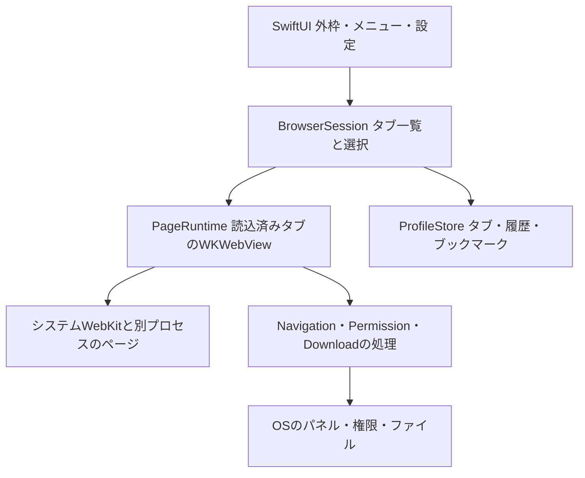

# Levistica 技術設計と完成までの計画

2026-10-20。設計と環境確認まで実施。アプリ本体・独立試作・ビルド・性能測定は未実施。仕様と受入案は [PRODUCT_SPEC.md](PRODUCT_SPEC.md)、作業規則は [AGENTS.md](AGENTS.md) を参照する。

## 推奨方式と選定理由

SwiftUIの外枠に、小さなAppKitの接続部分を通してシステムWebKitの `WKWebView` を組み込む。新規の正式アプリ一つを育て、既存ブラウザのforkは出発点にしない。標準のウィンドウ・メニュー・設定を利用し、閲覧エンジンと外枠を別に扱う。

この案はMac専用、メモリ最優先、拡張互換より日常の3用途を優先する条件に合う。Chromiumや外枠用のWeb実行環境をアプリに同梱せず、タブ一覧のためにWebViewを作らない構成を選べる。ページ自身の重さは残るため、ネイティブUIやWebKitの採用だけではChrome比の削減を保証できない。Safariと同じタブ管理・認証・保護機能を引き継げるわけでもない。

| 候補 | 今回の判断 | 再検討する条件 |
|---|---|---|
| SwiftUI + AppKit + WKWebView | 推奨。delegate・ページの寿命・入出力・権限を明示して設計できる。UIの変更を閲覧処理から分けやすい | 必須サイトの認証・動画が成立しない、または同条件のメモリ目標が達成不能 |
| SwiftUIのWebView/WebPage | システムWebKitを利用する点は共通。今回はWKWebViewを選び、2種類の閲覧実装を持たない。macOS 26 APIを使うためだけの切替はしない | 必要な公開機能がWKWebView経路より明確に扱いやすくなり、移行の効果を示せる |
| AppKit主体 | 同じエンジン。SwiftUIとの差をRAM改善の実測値とは扱わない。全体をAppKitへ寄せる作業は保留 | 外枠のフォーカス・ウィンドウ・入力で小さな橋渡しでは解決できない問題が出る |
| Tauri/Wry | Webの外枠を好む強い条件は今ない。外枠WebViewやIPC境界を増やす理由が薄い。Rustだけでページ側RAMは減らない | PMがHTML/CSSで外枠を変えることを必須とし、比較する価値が生じる |
| Search/Kylmora等のfork | タブ・休眠の参考に限定。既存調査では非公開API利用があり、全機能・依存・保守負担を引き取らない | 必要な公開APIだけを持つ既存実装の監査で、新規実装より小さい範囲で安全に完成できると分かる |
| DuckDuckGoのfork | 実用挙動の参考。大きな共有コード・依存・素材の権利を初期から引き取らない | 新規実装で必要な認証等の負担が大きいと判明した場合に、対象部分だけ再評価 |
| Electron/Chromium | Chrome拡張との近さは利点だが、現優先順位では同梱エンジンと更新責任を増やす選択をしない。RAMの敗北が実証されたという意味ではない | WebKitで必須用途が成立せず、その影響をPMと確認したとき |

選定は実装開始の推奨であり、性能による最終採用判定ではない。M1でサイト成立性、M3でメモリと復帰を判定し、不成立ならこの表へ戻る。

## 環境の確認結果

| 項目 | 2026-10-20に読み取りで確認した事実。CLT更新後の再確認を含む |
|---|---|
| 作業先 | `/Users/User/Non-iCloud-Documents/Levistica`。参照資料の外。初期ファイルはAGENTS.mdとimozuruへのリンク |
| Git | 初回は未初期化。その後ユーザーがmainの基準コミット `0e36965` を作成し、非公開の `fomalhaut16/Levistica` へpush済み。ローカルとGitHubの同一SHAを確認 |
| OS | macOS 26.6、build 25G72、arm64 |
| Mac | `system_profiler` はMacBook Pro / Mac17,2 / Apple M5 / 10 cores / 32 GBを返した。識別番号は記録しない |
| 制限 | `sysctl` のCPU・容量取得はOperation not permitted。一方、上記のsystem_profiler出力で確認できた。独立したVRAM容量は取得していない |
| 選択中の開発先 | `/Library/Developer/CommandLineTools` |
| Swift | 初回は5.10。ユーザーによるCLT更新後はApple Swift 6.4、swiftlang-6.4.0.34.1。clangは21.0.0、clang-2100.3.34.2 |
| SDK | 初回の既定は14.4。CLT更新後の既定はmacOS SDK 27.0。実行中のOSは26.6で、SDKの版とは別に扱う |
| Xcode | `xcodebuild -version/-showsdks` はフルXcodeが必要というエラー。`/Applications` と `~/Applications` の深さ2までにはXcode.appを発見しなかった。別の場所への導入までは断定しない |
| 基本道具 | xcrun、swift、xcodebuildの入口、codesign、plutil、lldb、gitがPATH上に存在。利用可能な署名identityやDeveloperアカウントは未確認 |
| 比較対象 | Chrome 155.0.8059.85、Safari 26.6 / 21624.4.5.11.5をInfo.plistで確認。いずれも起動・操作・設定変更していない |
| 空き容量 | 作業先のData volumeで約606 GiB。導入時に再確認する。Xcodeの必要容量は今回測っていない |
| Homebrewツール | gh 2.102.0が実行可能。CLT更新後にpkgconf 3.0.10が導入済みと確認。gh更新後に止まっていたpkgconfの再インストールも解消 |

本体の構成はXcodeのmacOS Appプロジェクト一つを推奨する。entitlement、署名、通常の.app、XCTest/XCUITest、Instrumentsの操作を一つの流れで管理するため。SwiftPMのGUIアプリを.appにまとめる方法もあるが、現在のCLTだけで本製品の検証まで十分とは確認していない。新旧2種類のビルド構成を同時に作らない。

実装前にフルXcodeの利用を相談する。既に別の場所に適合版があればそれを優先し、なければmacOS 26.6で動く安定版26.xを提案する。公式の[対応表](https://developer.apple.com/xcode/system-requirements)では26.5がmacOS 26.2〜26.xを対象とする。27系やbetaへ上げる必要はない。容量・取得元・ライセンス同意を確認し、ユーザーの同意前に導入や更新をしない。`DEVELOPER_DIR`をビルド入口だけで指定し、全体のxcode-selectは勝手に変更しない。

v1の実利用・受入対象はこのMacのmacOS 26.6。deployment targetは26.0を初期案とし、これは個人用の対象を絞る判断で、26専用の新APIを多用する指示ではない。以前のOS対応やIntel対応を先に作らない。Swiftは採用Xcodeのコンパイラで、原則Swift 6モード・UIはMainActorとし、利用するSDKで署名と並行処理の注釈を確認する。現在はCLTのSwift 6.4とSDK 27.0を確認できたが、フルXcodeの導入、アプリのコンパイル・起動は未実施。CLTの更新だけでXcode本体も導入済みとは扱わない。

## 責務と所有の境界

単一のアプリtarget内で責務を分ける。汎用エンジン切替層、プラグイン基盤、DIコンテナ、別サービス常駐、将来用パッケージ分割は作らない。



| 責務 | 所有するものと境界 |
|---|---|
| App/外枠 | 通常scene、設定、メニュー、URL受信、起動・終了。レイアウト・色・余白は外枠側に集約し、M4で変えられる。ページ内容へのCSS注入と外枠UIを混同しない |
| BrowserSession | 安定したTabID、順序、選択、URL、タイトル、保持指定、状態。WebViewを生成せず一覧を描ける。SwiftUIの再評価や選択行の表示で読込を発火しない |
| PageRuntime | 読込済みTabIDごとのWKWebView、delegate、観測、必要な子ウィンドウ。MainActorで操作し、同じTabIDのWebViewを再利用。実行状態をDBへ丸ごと保存しない |
| AppKit接続 | NSViewRepresentableと小さなCoordinator。値と操作をSessionから受け、遷移・進捗・エラーをイベントで返す。updateNSViewのたびにloadしない。表示を外すことと休眠・終了を区別する |
| Navigation/Permission | URL入力の解釈、遷移とscheme、origin/frame、権限、ポップアップ。信頼UIをページから独立させ、WebKit delegateのcompletionを必ず一度完了する |
| Download処理 | DownloadIDで転送・保存先・取消・失敗を管理し、タブ表示から独立。URLSessionでページ要求を勝手に複製せず、WKDownloadを使う |
| ProfileStore | SQLiteの直列処理、短いtransaction、schema version、移行、バックアップ。大きいI/OをUIスレッドに置かない。Viewやdelegateが直接SQLを発行しない |

M1はApp、RootView、BrowserSession、PageRuntimeと接続部分だけから始める。表の全責務を空クラスで先に作らず、必要な機能を追加するときに分ける。既知の境界を保った小さな関数から始め、Coordinatorや巨大なContentViewへ全機能を詰めない。

タブの状態は `未生成 → 読込中 → 保持中`、そこから明示した条件で `休眠`、再選択で生成・読込へ戻る。ページ終了は `異常` として扱う。閉じたTabIDは一覧と復元データから除去し、実行中の参照も解放する。KVO、delegate、通知、Task、クロージャ、message handlerを所有者の終了時に外す。単なる非表示やstopLoadingをメモリ解放と同義にしない。

## データ・API・権限

| データ | 保存・寿命・失敗時の方針 |
|---|---|
| セッション | SQLiteにschema version、TabID、順序、選択、URL、タイトル、保持指定、正常終了の印。操作後に短くまとめて保存し、正常終了はflush完了後に記録する。URLに機微情報があり得るため通常ログには出さない |
| 履歴/ブックマーク | 同じDBの別table。履歴は90日という初期案、ブックマークは明示削除まで。履歴削除とタブ一覧の削除を混同しない |
| 設定 | 小さなUserDefaults。検索先・外枠の好み・復元・休眠設定。Cookieやフォーム値を入れない |
| Cookie/サイトストレージ | 通常用WKWebsiteDataStoreに任せる。Chrome/Safariのデータを共有・複製しない。削除は対象とログアウトの影響を示して行う |
| ページ内部の状態 | 稼働中のWebViewに保持。interactionStateはM3で寿命・容量・型・復元可否を確かめた範囲だけ使う。任意のJSヒープや接続を保存できるとは扱わない。フォーム値を含み得るblobはv1ではディスク保存しない |
| ダウンロード | サービス側に転送状態、選択された保存先、部分ファイル。resumeDataは使える場合のみ短期間保持し、機微情報として扱う。失敗した部分ファイルの処理を利用者に示す |
| 実行時データ | sandboxコンテナ内のApplication Support等。実際の場所はM1のbundle IDと署名で確定し、READMEを増やさず本書に記録。ディレクトリは利用者限定、DB・バックアップは個人データとして保護する |
| 検証物 | `.local/`に隔離したプロファイル・計測・テスト記録。Git対象外。実利用データとの切替は起動時に明示し、環境変数の値や閲覧URLを大量出力しない |

SQLiteはシステムのSQLite3を使い、初期に外部DBフレームワークを追加しない。DBの書込みは一つのactor/直列所有者にまとめ、移行前のバックアップはSQLiteの整合したbackup経路で作る。稼働中のWAL付きDBの本体だけをコピーしない。破損・容量不足・保存エラーは検出し、原本を保持する。復元・旧版への巻戻しはアプリを停止して、対応するデータ世代と一緒に行う。これはLevisticaの管理データの復旧であり、サイト側で失効したログインやWebKit内部の移行まで元に戻す保証ではない。サイトデータを更新処理で勝手に消去・コピーしない。

| API/機能 | 採用方針と確認の境界 |
|---|---|
| WKNavigationDelegate/WKUIDelegate | 遷移、失敗、TLS既定検証、ダウンロード移行、子画面、ダイアログ、権限、ページprocess終了を処理。APIの存在は実サイト互換の証拠ではない |
| WKDownload | `NSProgressReporting`準拠とmacOS 11.3導入を手元SDKの公開headerで確認。ページのestimatedProgressを転送の進捗と取り違えない。取消後のresumeDataはnilになり得る |
| interactionState | 保存原文・公開headerではmacOS 12から、履歴・現在ページ・スクロール・フォーム等を対象とする。Any?を無条件にData/Codableと仮定せず、休眠時の実装方式を先に検証する |
| cameraCaptureState/microphoneCaptureState | 手元headerでmacOS 12からの公開APIと確認。任意の音声・PiP・画面共有・入力をこれだけで完全に検知したとは扱わない |
| WKProcessPool | 複数poolの作成・利用が無効という非推奨理由を保存原文で確認。メモリを減らす設定として採用しない。サイト分離を弱めない |
| WKWebExtensionController | 保存したDocCのavailabilityはmacOS 15.4。現SDK14.4には前提を満たさない。Control Panel for Twitterの検証時に採用SDKで確認する。Chrome拡張全互換やSafari版の直接流用は保証しない |
| 認証 | サイトログイン、nativeアプリ自身のOAuth、他アプリからのASWebAuthenticationSession要求を分ける。任意RP向けpasskey権限は組織アカウントのAccount Holder申請という制約があり、個人利用でも自動取得できるとは扱わない |

アプリ自身のApp Sandboxとnetwork.clientを基本にする。ネットワークサーバ、Full Disk Access、Accessibility、画面収録はブラウザの基本閲覧には要求しない。ファイルはNSOpenPanel/NSSavePanelと利用者の選択範囲へ限定し、継続が必要なアクセスだけsecurity-scoped bookmarkを検討する。アップロード・保存・再起動後の再アクセスはsandbox下で試す。

カメラ・マイク等は機能を実装するときだけ必要なentitlement・用途説明を追加する。サイトorigin単位の許可とTCCを区別し、初期は永続許可を安易に保存せず都度判断する。任意ページや子iframeにファイル・Keychain・シェルへの汎用bridgeを渡さない。WebKitの要求するJITのためだとして、アプリ側へ未検証の緩い権限を加えない。

URLバーは信頼UIで実際の遷移先とhostを示し、ホストを省略してページタイトルだけで安全と見せない。IDNの紛らわしさ、ユーザー情報部、redirect、別origin iframeの要求をセキュリティfixtureに入れる。HTTPとHTTPSを区別し、HTTPS失敗からHTTPへ黙って落とさない。証明書エラーの全許可、App-Bound Domainsの任意サイトへの一律適用はしない。詐欺サイト警告の既定を保ち、Safariと同等の全保護を保証したとは扱わない。

## メモリ目標を決め、検証する手順

アプリがない現時点では、RAM上限やSafari比を実測値として書けない。目標を決める期限はM1完了後・M2の機能拡大前とし、結果とともにPMへ具体値を提案する。M3まで数値目標を未定のまま放置しない。

1. M1のReleaseで空画面、1ページ、少数の同じページの基準を取る。Chromeは通常配布版、Safariは参考値とする。使う機種・OS・browser/WebKit版・commit・SDK・署名・電源・他アプリを記録する。
2. 隔離プロファイルで同一URL・同一操作・同じloaded数、キャッシュcold/warm、ログイン、広告ブロック、拡張有無をそろえる。既存Chromeの個人プロファイルを変更しない。実サイトの広告や通信の揺れと固定fixtureの結果は分ける。
3. Chrome中央値をC、LevisticaをLとし、まず同じloaded数で比較する。別に実用の休眠・遅延読込ポリシー同士を比べる。C−Lと変動幅を示し、総タブ数だけをそろえた値で優位を宣言しない。
4. 実測から、空画面・読込済み・大量復元・全件巡回後の絶対footprint上限とChrome比の削減目標を提案する。起動・選択・休眠復帰の待ち時間上限と入力欠落ゼロ等の条件も同時に決める。PMが許容する速度・状態欠落との交換を確認するまで未合意と記録する。
5. M2で機能追加時の内訳を残し、M3で合意値を判定する。達成できない場合は参照保持、縮小画像、DB、WebContent、拡張等の内訳を調べる。意味のある削減が実測の揺れを超えて得られなければ、製品上の価値と方式をPMと再判断する。

同じ条件で最低3回、順番を変えて実施し、各回と中央値・範囲を残す。初期案は読み込み完了から60秒後、操作/解放の直後・1分後・5分後を観測する。試験時間はサイトの安定性を見て調整し、変えた条件を記録する。3回の結果で精密なp95や統計的優位を作らない。

大量タブの試験は5→20→50→100件と段階的に進める。継続した強いメモリ圧迫、極端な応答低下、process終了があれば中断し、到達した条件を失敗として記録する。100件のためにユーザーの稼働中Chromeや他アプリを勝手に終了しない。

| 試験 | 分けて記録する状態と判定 |
|---|---|
| W0 空/1ページ | WebView未生成の外枠と1件生成後。操作可能になる時間、安定時とピーク |
| W1 同じloaded数 | 固定5ページと、X/YouTube/Discord＋資料の実用セット。拡張なしの基準と、必要な拡張ありの実用条件を別に測る |
| W2 大量復元 | 50・100件は暫定候補。総数とloaded1を記録し、未選択ページの意図しない生成・通信がないか確認 |
| W3 全件巡回 | 一度全ページを表示し、同じloaded状態の比較を行う。次に保護・手動休眠・合意した自動休眠の各ポリシーと復帰を別に測る |
| W4 保護/復帰 | テスト用入力、音声、動画、必要なら通話・添付・認証。閉じる、終了取消、休眠、復帰、process終了を確認する |
| W5 継続 | 代表操作の反復と実利用候補の長時間稼働。参照増加、CPU待機、メモリ圧迫、圧縮、swap、スリープ復帰を記録する |

帰属はUIプロセスに加えWebContent・Network・GPU等を調べ、PID・開始時刻・役割・根拠を残す。PPIDだけではXPCを落とし得る。名前だけで他のWebKitアプリを足さず、同一PIDをタブごとに重複計上しない。

指標は各PIDのphysical footprintを基本にし、UI単独・確認できた集合の内訳・集計を並べる。共有メモリやIOSurfaceの記帳と重複の可能性を示し、単純合計を専有RAMと呼ばない。帰属や権限で取れない値は不明とし、0MBにしない。RSS、JS heap、Swift heapは別指標として扱う。Activity Monitor等によるシステムのMemory Pressure・Compressed・Swapも添えるが、アプリ単独の値とはしない。正しいfootprint取得経路をM1で検証し、Instruments等の観測負荷がある詳細解析は通常測定から分ける。

## 互換性・セキュリティ・配布

| 論点 | 検証と判断 |
|---|---|
| X/YouTube/Discord | M1の正式アプリで表示・代表ログイン・動画を早く確認。M2で投稿用テスト入力・添付・再起動を確認。GoogleログインやWebAuthnが止まる場合はAPI経路・サービス方針・権限を分けて調べる |
| 動画/DRM | YouTubeの通常動画を必須とする。任意サービスのDRM、ライブ、サブスク再生は未確認。有料サービスが必要ならその試験を追加し、単なるWKWebView採用で対応済みにしない |
| Control Panel for Twitter | 作者の[公開リポジトリ](https://github.com/insin/control-panel-for-twitter)ではMITとSafari版の存在を確認。Levisticaでの互換性は未確認。具体版のmanifest・利用API・content script・設定UI・権限・background処理を読む。最小権限の公開WKWebExtension APIを第一候補とし、独自Chrome shimは先に作らない |
| 拡張検証の上限 | M2後半〜M3で、1版・Xの代表3操作・2回の互換修正まで。動作/権限/無効化/メモリが許容範囲なら任意採用。超えたら未対応として本体から外し、v1必須は進める。Safari拡張がそのままWKWebViewへ入るとは仮定しない |
| 権限・入力保護 | TLS、scheme、popup、frame、カメラ/マイク拒否、入力、POST、WebContent終了を固定fixtureで試す。DOM観測は完全な活動検知ではない。取得したフォーム値をログへ流さない |
| OSとWebKit更新 | システムWebKitはOS等の更新に依存する。更新後は代表サイトと保存・復元・権限の短い回帰試験を行う。WebKitの版をLevistica単体で巻き戻せるとは考えない |

個人用v1はMac App Storeを経由しない通常の.appを基本とし、手動更新とする。開発用と常用用のbundle ID・データは分けるが、同じソースと同じ正式アプリをビルドする。独立した試作品を並べる意図ではない。bundle IDの最終値と署名identityはM1で実在を確認する。

自分のMacでのビルド・起動用署名と、ダウンロード配布のDeveloper ID署名・notarizationを分ける。アカウント・費用は未確認で、有料契約を前提にしない。配布する場合はDeveloper ID等の取得条件を確認して相談し、Gatekeeperの無効化やquarantineの一律削除を手順にしない。Hardened Runtime・entitlementは実物の.appを検査し、署名があることだけで安全と判定しない。

常用版は署名・provisioningの有効期限と更新時のTCCへの影響も確認する。短命な開発用署名で一度動いたことを、開発ツールなしで継続利用できる証拠にしない。安定した常用経路に契約等が必要なら、M5を完了する前に具体的な条件を相談する。

更新時はアプリを終了し、整合したデータのバックアップ、署名と版の確認、置換、起動・主要操作・migration確認の順に進める。DBの前方移行がある場合、旧アプリだけを戻さず対応するバックアップも戻す。移行失敗・新しいOSとの非互換は隔離データで再現する。自動更新、常駐updater、同期基盤はv1には追加しない。

## M0〜M5と直近の一つの仕事

### 初期設計の期間

既存の調査資料を利用できる前提で、初期設計を固める目安は1〜3作業日とする。2026-10-20に初版を作成し、PMから初版への「OK」を受け、GitHubの基準版 `0e36965` を記録した。以後はレビューや環境確認で分かった条件を、小さなPRで修正する。認証・権限の許可待ちやPMの都合による待機日は、作業日数と分けて記録する。10月20日に着手した場合、待機がなければ10月20〜22日を初期設計の想定範囲とする。これは納期の約束や実作業時間の実測値ではない。

| 作業 | 想定と現状 |
|---|---|
| 資料・環境・方式・初版仕様 | 0.5〜1作業日を見込む。初版は作成済み |
| PMレビューと必要な修正 | 0.5〜1作業日、1〜2回のやり取りを想定。全ての将来機能を決めきるために延ばさない |
| 整合確認・GitHubの基準版 | 0.5作業日程度。README、期間、工程別スキル方針と初回コミットの掲載を確認済み |

初期設計の完了は、v1の目的・範囲・受入案、推奨方式、重大な不確実性の検証時期、次の一仕事を説明できることとする。認証やRAMの実測はM1以降の仕事として残し、机上で実証した扱いにしない。実装全体の所要期間は、M1でビルド・サイト・メモリの基準が得られた時点で、残作業とPMの確認頻度から見積もり直す。M0の1〜3日を製品完成までの期間へ読み替えない。

### GitHubでの開発運用

掲載先は個人アカウントの非公開リポジトリ [fomalhaut16/Levistica](https://github.com/fomalhaut16/Levistica)。2026-10-20にユーザーが初期化・初回コミット・作成・pushを実行した。gh APIで非公開設定、READMEと設計文書の存在、基準コミット `0e36965bc2730e9258015e3586ce4564485669aa` とローカルmainの一致を確認済み。ghの認証もfomalhaut16として成功した。以前の認証確認の失敗は通信制限下の結果であり、無効な認証と断定しない。

最初に設計とスキルの基準版をmainへ記録する。その後は、一つの使い方や問題を一つのブランチ・PRにまとめ、目的、実際の変更、検証結果、未確認事項を残す。mainへの統合はPMの指示を確認して行い、受入済みの状態を履歴からたどれるようにする。M1で実行可能なビルド・テストができたら、その検証をCIへ移す。今は実行対象のないビルドCI、保護ルールや大量のIssuesを先に作らない。有料枠の利用や管理設定の変更が必要なら相談する。

GitHub認証・API操作を行うghと、ローカルの履歴を作るgitは別の道具である。GitHubのログイン確認にgit initは必要ない。認証・通信の許可と、ローカルの.git書込みの許可を分けて確認する。制約が出たらユーザーを挟み、ブラウザや別コネクタへ黙って切り替えない。

### 工程の到達条件

| 工程 | 到達条件 | 残す証拠と状態 |
|---|---|---|
| M0 設計・準備 | 3用途・優先順位・挙動・方式・工程を説明できる。未確認API/性能と担当・検証時期が明確 | 設計初版はPM確認済み。GitHub掲載・4スキルの自動認識・CLT更新を確認済み。Xcode利用の相談、サイト成立性・数値目標はM1/M3へ引き継ぐ。ユーザーの最新指示は実装開始前の環境・文書整備まで |
| M1 正式アプリの一本 | Finder/Dockから起動→URL→ページ→戻る/進む→Cmd-Q→再起動。Releaseで動き、代表サイト成立性と初期メモリを記録 | 実行コマンド・SDK・署名・操作結果・process内訳。工程末でメモリ/速度の具体目標をPMへ提案し、M2前に合意する。未実施 |
| M2 普段の操作 | タブ、通常データ、ログイン、復元、PDF、入出力、基本権限とエラーをA2〜A6/A8で確認 | 正常・拒否・中断・再起動・破損の試験。Control Panel for Twitterは独立した任意判断。未実施 |
| M3 メモリと安定性 | 合意値を同条件で満たし、保護と復帰を含む測定が揃う。休眠設定は結果から決める | W0〜W5、各回・中央値・範囲・帰属・状態欠落。未達は方式/範囲の再判断へ戻す。未実施 |
| M4 外枠UI | PMの好みに仕上げ、キーボード・IME・フォーカス・アクセシビリティの基本を確認 | PM受入、M2の機能回帰、M3の主要性能回帰。参考画像や好みはこの段階でまとめて聞く。未実施 |
| M5 常用v1 | 開発ツールなしで利用・終了・翌日再開・更新・旧版復旧ができ、主要用途と品質をPMが受入 | 隔離データでの配布/復旧試験と、PMとの合意期間の常用記録。重大未解決があれば完成にしない。未実施 |

次の実装依頼で行う仕事は、正式アプリLevisticaで「起動→URL入力→ページ表示→戻る/進む→終了」を一本つなぐこと。最初にXcodeの利用条件を解消し、既存ファイルを保護してルートのGit状態を整える。Xcodeプロジェクト一つ、App/RootView/Session/PageRuntimeの最小構成、開発用.app、`script/build_and_run.sh`一つを作る。Run設定は入口の完成後、書き込み権限を得た場合だけ追加する。タブ永続化・拡張・テーマ・自動休眠はこの一仕事に入れない。

この一仕事の合格は、2つの固定ページを順に開き、実際の戻る/進むで元へ移動し、メニューやCmd-Qで終了、Finderから再起動できること。URL入力中のIME、空/不正URL、オフライン/TLS失敗、外部ページからの危険scheme、ページprocess終了の扱いも確認する。XCTestはURL判定・状態遷移、UI試験は起動と操作に絞り、process存在だけで合格にしない。M1の続きとして代表サイトと少数ページのメモリを測り、別アプリは作らない。

以後の順序は、タブと所有/解放 → セッションと通常サイトデータ → サイトログインと入出力/PDF → エラー/復旧/権限の完成 → 省メモリの計測と改善 → 外枠UI → 常用・更新・復旧。認証や再生が不成立なら順番を待たず調べ、不要な機能を増やして回避しない。

独立実験は、正式アプリに組み込むと切り分け不能な公開APIや署名の不明点に限る。問い、1対象・1仮説・2実装案までの投入上限、結果を得る操作を先に記録する。合格なら最小の成果と試験を正式アプリへ移し、不合格なら理由だけを本書へ残して実験を削除する。上限を超えて追う場合はPMへ影響と代案を示す。通常のサイト互換やメモリ測定は正式アプリの隔離データで行う。

## 未解決事項と判定期限

| 項目 | 次に確認すること | 期限・判断 |
|---|---|---|
| 大学資料・認証 | 代表PDF/サイト、SSOやpasskeyが必要か。私的なURLはGitへ書かない | M1〜M2。現在は通常のWeb/PDFを仮定し、特定SSOの対応を約束しない |
| 主要サイト | X・YouTube・Discordのログイン/再起動/再生/入力 | M1で成立性、M2で一連の操作。失敗なら方式/必須範囲をPMと再判断 |
| 50/100タブ | どれだけloaded/保護されるか、実際の使い方と復帰の許容時間 | M1基準からM3へ。100件全活動のRAM保証にはしない |
| メモリと速度 | Chrome/Safariと同条件の基準、実用上の差、目標絶対値と比率 | M1後・M2前に具体案を合意。M3で合否 |
| passkey/DRM/通話 | API経路・資格・代表サービスと操作 | 必要と分かった時点。未確認を対応済みにしない |
| スキルの自動認識 | 既存4件は相対リンク・本文読込・セッションの利用可能一覧で確認済み | 追加導入時も同じ確認を行う。別のMacで認識済みとは扱わない |
| 開発/配布環境 | 適合Xcode、署名identity、アカウント、常用用の署名/更新経路 | Xcodeの追加は実装前に相談、署名/配布はM1/M5で具体化 |

## スキル導入と指示の調整

出発点は参照資料のSKILL_SELECTION.md。公式の[導入説明](https://learn.chatgpt.com/docs/build-skills)で `.agents/skills`、symlinkの追跡、自動検出、表示されない場合の再起動を確認した。初期セッションではそこへ書き込めなかったが、ユーザーが相対リンクを設定し、その後のセッションの利用可能一覧にbuild-run-debug、swiftui-patterns、appkit-interop、imozuruの4件が表示された。相対リンクとSKILL本文を読めることも確認済み。

| スキル | 採用と導入状態 | 依存・制約 |
|---|---|---|
| build-run-debug | `skills/build-run-debug/`。SKILLとrun-button-bootstrapを配置し本文を読込 | shell-first。将来のxcodebuild/swift/open/lldb等。MCP必須ではない。今回は環境確認だけに適用し、scaffoldと起動は保留 |
| swiftui-patterns | `skills/swiftui-patterns/`。SKILLと全6参照を配置、windowing/commands/settings等を設計に使用 | SwiftUI/SDKの実在を優先。ビルド入口の例はbuild-run-debugを参照するだけに統一 |
| appkit-interop | `skills/appkit-interop/`。SKILLと全4参照を配置、representable/panels/responderを読込 | AppKit/WebKitの所有と解放に適用。別の状態管理や全面AppKit化の指示にしない |
| imozuru原版 | `skills/imozuru`に既存導入物8ファイルをコピーし、コピー元との一致を確認。`.installed-from`はMaryCache/imozuru @ 4f8fec7。MIT本文を同梱 | GitHubから使う際の絶対パス依存を解消。元の設置先は変更していない。今回は既存調査を利用し疑わしい部分だけ確認し、全資料の再調査は行わない |
| yomiyasu | ユーザー共通の既存版を明示読込。最後に手元のlintを1回 | 版の確認・更新、進捗報告の毎回検査はユーザー指示で取りやめ。共通ファイルは変更しない |

OpenAI側の採用物は[build-macos-apps](https://github.com/openai/plugins/tree/main/plugins/build-macos-apps)のmanifest記載版0.1.4。manifestはMITを宣言している。専用LICENSE本文は今回の取得範囲では発見できず、アプリへコードや素材を再配布するときは権利表示と実ファイルの条件を改めて確認する。採用manifestを `skills/openai-build-macos-apps.plugin.json`、14ファイルの取得URLとローカルSHA-256を `skills/SOURCES.json` に保存した。

公式skill-installerによる取得を試みたが、シェルのネットワーク名前解決が失敗した。通常の権限拡張申請も現セッションのポリシーで拒否された。そこで利用可能なWebツールで公式raw原文の全行を取得し、許可されたskills内に配置した。Webのテキスト抽出を経ているため、改行や空白が上流のバイト列と同一とは保証せず、ハッシュは配置した写しを識別するものとする。採用commitの完全な固定取得はできず、版0.1.4と取得日で記録している。これは公式installerで正常導入したという報告ではない。

SKILLのfrontmatter、必要参照の存在、手動読込は確認した。swiftui-patternsからbuild-run-debugのcanonical参照へは相対リンクを1本置き、重複した実行手順を作っていない。3スキルとも外部パッケージ、MCP、hook、常駐処理を追加していない。追加スキルは次の工程表に従って、必要な仕事を計画・開始する時点でCodexが導入する。ユーザーの再依頼を待たず、既存の同等スキルがあれば先に活用する。候補を一括で常時適用したり、使う予定のないものを先に全て入れたりしない。

| 導入・参照する時点 | 候補と取得元 | 導入前の確認と役割の調整 |
|---|---|---|
| M1でApp Sandbox・署名・entitlementを具体化するとき | OpenAI [signing-entitlements](https://github.com/openai/plugins/tree/main/plugins/build-macos-apps/skills/signing-entitlements) | 権限の設計と実際の署名の確認に限定。ブラウザ全体の安全性をこのスキルだけで承認しない。アカウントや有料契約は自動追加しない |
| M1のSwift 6/MainActor、M2の非同期I/O・キャンセルを実装する前 | AvdLee [swift-concurrency](https://github.com/AvdLee/Swift-Concurrency-Agent-Skill/tree/main/skills/swift-concurrency) | 実コンパイラと言語モードを確認。非同期処理の担当とし、SwiftUIの状態所有を全面変更する指示にはしない |
| M1で最初のロジック試験を設計するとき | Paul Hudson [swift-testing-pro](https://github.com/twostraws/Swift-Testing-Agent-Skill/tree/main/swift-testing-pro) | Swift 6.2以上という前提を採用Xcodeで確認。単体・統合テストに利用し、UI操作はXCTest/XCUITestで扱う。スキルに合わせてSwiftを更新しない |
| M3の具体的な性能測定を計画するとき、または実際にメモリ問題が出たとき | rshankras [performance/profiling](https://github.com/rshankras/claude-code-apple-skills/tree/main/skills/performance/profiling) | macOSに適合する参照だけ使う。OS・iOS固有の記述や依存を確認し、本書の複数processの帰属と同条件比較を優先する |
| M4の外枠レビュー、またはSwiftUIの更新・寿命の問題が出たとき | AvdLee [swiftui-expert-skill](https://github.com/AvdLee/SwiftUI-Agent-Skill/tree/main/skills/swiftui-expert-skill) | 最初は範囲を絞ったレビューに使用。swiftui-patternsと同じ担当を常時二重化しない。Impeccableはさらに必要な具体的不足がある場合だけ別途判断 |
| M5の.app包装・配布・復旧を計画するとき | OpenAI [packaging-notarization](https://github.com/openai/plugins/tree/main/plugins/build-macos-apps/skills/packaging-notarization) | その時点の実物.appと署名経路を読む。ビルド入口は増やさず、配布条件と費用・アカウントの必要性はPMへ相談する |

原因不明の不具合が続く場合は、参照資料にあるsystematic-debugging等を個別に検討し、Superpowers一式は自動導入しない。スキルを使っても解決しない場合は、時間を使っただけで品質が上がったとは報告しない。

導入時は、取得元と採用版・commit、ライセンス本文、SKILLと必要な参照、外部依存、重複する工程を確認し、プロジェクト内に配置する。自動認識と手動読込を区別し、記録をskills/SOURCES.jsonへ追加する。認証・権限・外部接続の追加が必要なら操作と影響を伝え、ユーザーを挟む。yomiyasuはユーザーの指定により版確認・更新の対象外とする。

現在の4件は自動認識確認済み。以下はユーザーが実行済みの設定で、リポジトリにも相対リンクを含めている。新しい環境で不足している場合の参照として残し、設定済みの環境でそのまま再実行しない。既存の同名項目があれば上書きせず調べる。禁止された書込みを別の道具で迂回しない。

```sh
# Levisticaルートで実行。既存の同名項目があれば上書きせず調べる。
mkdir -p .agents/skills
ln -s ../../skills/build-run-debug .agents/skills/build-run-debug
ln -s ../../skills/swiftui-patterns .agents/skills/swiftui-patterns
ln -s ../../skills/appkit-interop .agents/skills/appkit-interop
ln -s ../../skills/imozuru .agents/skills/imozuru
```

新しい環境では、Codexの `/skills` で4件の名前とLevistica内のパスを照合する。表示されなければ再起動して再確認する。配置済み、手動で使用可能、自動認識確認済みを一つの状態にまとめない。グローバルや他プロジェクトを変更する必要はない。

現在のプラグイン一覧にあった `imozuru-research-chatgpt` は原版とは別の派生版で、本プロジェクトでは使わない。前の削除試行で管理APIはnot installedを返したがローカルキャッシュが残り、共通領域は書込み不可。削除済みとは扱わない。Notion・Sites・ペット等の利用可能なプラグインは本設計のためには使わず、接続や権限を変更しない。

## 根拠と今回の確認範囲

参照資料のREADME.md、PRODUCT_DELIVERY.md、SKILL_SELECTION.mdを先に読み、DESIGN_BRIEF.mdとVALIDATION_PLAN.mdの方式・API・計測・受入部分を使用した。提案・仮説は実測や決定済み仕様に変えていない。原文へ戻ったのはpasskey、SSO、WebExtension、processPool、interactionState等の制約に関係する部分。新しい文献調査や全原文の読み直しはしていない。

現在のAppleの一部ページはJavaScript表示のみで、リンク先MarkdownもWebツールのcontent-type制約により取得できなかった。その部分は保存DocC原文と手元の公開SDK headerを根拠とし、現行SDK全体でコンパイル確認済みとはしない。Apple/WebKit公式資料の候補検索には指定のGPT-6 Lunaを一度使用した。比較・設計・最終判断は主担当が行い、その検索役は終了済み。

| 根拠 | 設計で使う範囲 |
|---|---|
| [WKWebView](https://developer.apple.com/documentation/webkit/wkwebview)、[公開header](https://github.com/WebKit/WebKit/blob/main/Source/WebKit/UIProcess/API/Cocoa/WKWebView.h) | WebViewの公開境界、interactionState、capture等。mainのheaderを出荷済みOSの実装保証にはしない |
| [WKDownload](https://developer.apple.com/documentation/webkit/wkdownload)と手元SDKのWKDownload.h | 転送の所有・NSProgressReporting・取消の境界 |
| [ブラウザpasskey権限](https://developer.apple.com/documentation/bundleresources/entitlements/com.apple.developer.web-browser.public-key-credential)と参照資料の対応DocC | 任意RP権限の申請制約。全Googleログイン不可などへ一般化しない |
| [SSO受信](https://developer.apple.com/documentation/authenticationservices/supporting-single-sign-on-in-a-web-browser-app)と参照資料の対応DocC | 対応宣言と実装が必要なこと、未対応時のSafari fallback |
| [WKWebExtensionController](https://developer.apple.com/documentation/webkit/wkwebextensioncontroller)と参照資料の対応DocC | 拡張実装の候補。15.4導入と、完全Chrome互換の保証を分ける |
| [Xcode対応表](https://developer.apple.com/xcode/system-requirements) | 現Macで利用できる開発環境の候補。最新への更新義務にはしない |
| [Control Panel for Twitter](https://github.com/insin/control-panel-for-twitter) | 作者・配布先・MIT宣言・Safari版の存在。Levisticaでの動作は未試験 |

最終見直しでは、100タブを全件生かす保証、Safari並みの性能保証、未送信入力の完全検知、Chrome拡張全互換、個人アカウントでのpasskey権限取得を断定していないことを確認する。独立試作、汎用基盤、二重ビルド入口、常時MCP、不要な管理文書を追加せず、次は正式アプリの一つの操作経路から始める。
